# Praktikum Modul 4 Komunikasi Data dan Jaringan Komputer 2026
## K52 — Cisco Packet Tracer dengan VLSM

| Identitas | Keterangan |
|---|---|
| Praktikan bagian CPT | Reyhan Adi Satrio |
| NRP | 5027251080 |
| Kelompok | K52 |
| Metode CPT | VLSM dan static routing |
| Cakupan anggota lain | GNS3 dengan metode berbeda; dokumentasinya ditambahkan oleh anggota yang mengerjakan |

## Daftar isi

- [Berkas dan topologi](#berkas-dan-topologi)
- [Perhitungan VLSM CPT](#perhitungan-vlsm-cpt)
- [Implementasi dan routing CPT](#implementasi-dan-routing-cpt)
- [Dokumentasi screenshot pengerjaan CPT](#dokumentasi-screenshot-pengerjaan-cpt)
- [Hasil pengujian yang dikirim melalui CLI](#hasil-pengujian-yang-dikirim-melalui-cli)
- [Pemeriksaan dokumen dan bukti](#pemeriksaan-dokumen-dan-bukti)

## Berkas dan topologi

| Berkas | Keterangan |
|---|---|
| [Project Packet Tracer](cpt/Modul4-K52.pkt) | File .pkt asli dari hasil pekerjaan yang dikirim |
| [Spreadsheet VLSM](spreadsheet/VLSM-K52-asli.xlsx) | File sumber; koreksi total dibahas pada catatan verifikasi |
| [Pohon VLSM PNG](assets/pohon-vlsm.png) | Diagram pembagian blok IP |
| [Pohon VLSM SVG](assets/pohon-vlsm.svg) | Versi vektor yang dapat diperbesar |
| [38 screenshot asli](bukti/screenshot/README.md) | Indeks nama asli dan nama berkas repository |
| [Panduan unggah](PANDUAN-UPLOAD-GITHUB.md) | Langkah upload manual |

### Topologi referensi

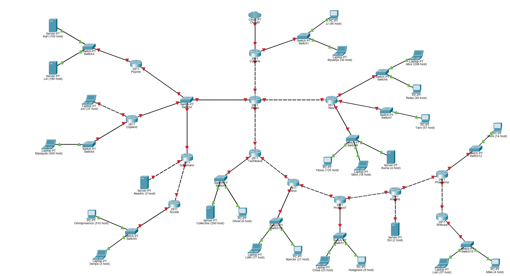

Gambar ini merupakan topologi referensi awal. Port merah pada gambar tidak menunjukkan kondisi akhir project.

### Pohon pembagian VLSM

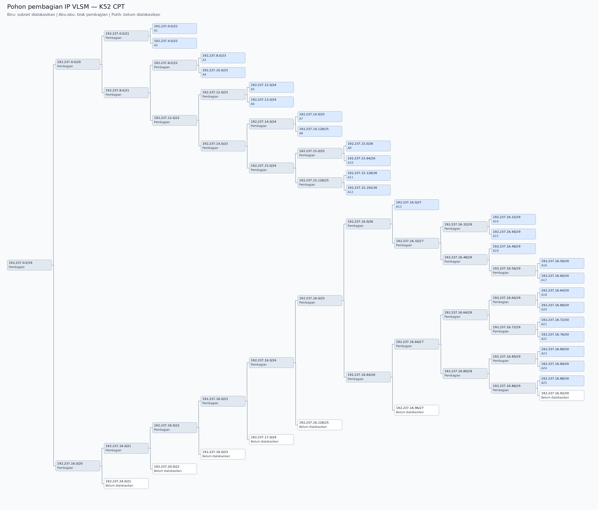

Blok induk 192.237.0.0/19 mencakup seluruh alokasi. Label “belum dialokasikan” menandai ruang di luar 25 subnet, bukan subnet host baru. Pohon dapat dibuka pada tautan gambar untuk membaca setiap cabang.

## Perhitungan VLSM CPT

Kebutuhan IP mencakup host dan interface router pada segmen. Pilih blok terkecil yang memenuhi `2^h - 2 >= kebutuhan IP`, kemudian prefix = `32 - h`. Alokasi dilakukan dari blok terbesar. A19 ditempatkan sebelum subnet /30 karena membutuhkan /29.

Contoh A1: 700 + 180 + 1 = 881 IP usable; /23 hanya 510, sehingga digunakan /22 (1022 usable). A5: 208 + 45 + 1 = 254, tepat menggunakan /24. A19 mencakup empat interface router, sehingga /30 tidak cukup dan digunakan /29.

| Subnet | Segmen | Kebutuhan IP | Network | Netmask | Broadcast | IP usable |
|---|---|---:|---|---|---|---|
| A1 | Psyche → Switch3 → Karl, Lin | 881 | 192.237.0.0/22 | 255.255.252.0 | 192.237.3.255 | 192.237.0.1 – 192.237.3.254 |
| A2 | Accela → Switch5 → Omnipresence, Denpa | 514 | 192.237.4.0/22 | 255.255.252.0 | 192.237.7.255 | 192.237.4.1 – 192.237.7.254 |
| A3 | Copland → Switch4 → Masayuki | 301 | 192.237.8.0/23 | 255.255.254.0 | 192.237.9.255 | 192.237.8.1 – 192.237.9.254 |
| A4 | Tachibana → Switch9 → Collective, Ghost | 267 | 192.237.10.0/23 | 255.255.254.0 | 192.237.11.255 | 192.237.10.1 – 192.237.11.254 |
| A5 | Navi → Switch6 → Alice dan Reika | 254 | 192.237.12.0/24 | 255.255.255.0 | 192.237.12.255 | 192.237.12.1 – 192.237.12.254 |
| A6 | Navi → Switch8 → Yasuo, Miho, Kuma | 143 | 192.237.13.0/24 | 255.255.255.0 | 192.237.13.255 | 192.237.13.1 – 192.237.13.254 |
| A7 | Cyberia → Switch1 → JJ, MyuMyu | 126 | 192.237.14.0/25 | 255.255.255.128 | 192.237.14.127 | 192.237.14.1 – 192.237.14.126 |
| A8 | Deus → Switch10 → Lilith dan Specter | 99 | 192.237.14.128/25 | 255.255.255.128 | 192.237.14.255 | 192.237.14.129 – 192.237.14.254 |
| A9 | Shibuya → Switch13 → Lain, Mika | 62 | 192.237.15.0/26 | 255.255.255.192 | 192.237.15.63 | 192.237.15.1 – 192.237.15.62 |
| A10 | Navi → Switch7 → Taro | 58 | 192.237.15.64/26 | 255.255.255.192 | 192.237.15.127 | 192.237.15.65 – 192.237.15.126 |
| A11 | Protocol7 → Switch11 → Chisa, Hodgeson | 33 | 192.237.15.128/26 | 255.255.255.192 | 192.237.15.191 | 192.237.15.129 – 192.237.15.190 |
| A12 | Copland → Juri | 32 | 192.237.15.192/26 | 255.255.255.192 | 192.237.15.255 | 192.237.15.193 – 192.237.15.254 |
| A13 | Phantoma → Switch12 → Semi | 15 | 192.237.16.0/27 | 255.255.255.224 | 192.237.16.31 | 192.237.16.1 – 192.237.16.30 |
| A14 | Schumann → Akashic | 4 | 192.237.16.32/29 | 255.255.255.248 | 192.237.16.39 | 192.237.16.33 – 192.237.16.38 |
| A15 | Knights → Eiri | 3 | 192.237.16.40/29 | 255.255.255.248 | 192.237.16.47 | 192.237.16.41 – 192.237.16.46 |
| A19 | Wired → Switch2 → Psyche, Copland, Schumann | 4 | 192.237.16.48/29 | 255.255.255.248 | 192.237.16.55 | 192.237.16.49 – 192.237.16.54 |
| A16 | Cyberia → Wired | 2 | 192.237.16.56/30 | 255.255.255.252 | 192.237.16.59 | 192.237.16.57 – 192.237.16.58 |
| A17 | Wired → Navi | 2 | 192.237.16.60/30 | 255.255.255.252 | 192.237.16.63 | 192.237.16.61 – 192.237.16.62 |
| A18 | Wired → Tachibana | 2 | 192.237.16.64/30 | 255.255.255.252 | 192.237.16.67 | 192.237.16.65 – 192.237.16.66 |
| A20 | Schumann → Accela | 2 | 192.237.16.68/30 | 255.255.255.252 | 192.237.16.71 | 192.237.16.69 – 192.237.16.70 |
| A21 | Tachibana → Deus | 2 | 192.237.16.72/30 | 255.255.255.252 | 192.237.16.75 | 192.237.16.73 – 192.237.16.74 |
| A22 | Deus → Protocol7 | 2 | 192.237.16.76/30 | 255.255.255.252 | 192.237.16.79 | 192.237.16.77 – 192.237.16.78 |
| A23 | Protocol7 → Knights | 2 | 192.237.16.80/30 | 255.255.255.252 | 192.237.16.83 | 192.237.16.81 – 192.237.16.82 |
| A24 | Knights → Phantoma | 2 | 192.237.16.84/30 | 255.255.255.252 | 192.237.16.87 | 192.237.16.85 – 192.237.16.86 |
| A25 | Phantoma → Shibuya | 2 | 192.237.16.88/30 | 255.255.255.252 | 192.237.16.91 | 192.237.16.89 – 192.237.16.90 |

Total kebutuhan: **2814 IP usable**. Total blok dialokasikan: **4188 alamat**, termasuk network dan broadcast. Blok induk terkecil yang mencakup seluruh alokasi adalah **192.237.0.0/19**.

Koreksi sumber: sel C27 pada sheet Rute menampilkan 1395, sedangkan penjumlahan C2:C26 adalah 2814. File sumber dipertahankan apa adanya. Kedua sheet CIDR masih berupa template dan tidak mewakili pekerjaan CPT.


## Implementasi dan routing CPT

### Urutan pengerjaan

1. Identifikasi segmen LAN dan transit pada topologi, lalu hitung host beserta interface router.
2. Tentukan prefix minimum dan alokasikan alamat VLSM dari blok terbesar. Hasil akhir ada pada tabel VLSM.
3. Pasang IP dan subnet mask pada host, isi default gateway ke interface router pada LAN yang sama.
4. Pasang IP pada interface router dan aktifkan interface dengan `no shutdown`. Cocokkan port aktual melalui `show ip interface brief`.
5. Pasang static route menuju subnet yang tidak langsung terhubung. Router ujung dapat menggunakan default route ke router hulu.
6. Periksa route yang belum ada, tambahkan route pada seluruh router perantara, lalu uji ping beserta jalur balik.
7. Simpan running-config ke startup-config pada semua router, simpan .pkt, dan uji pemuatan ulang Shibuya.

Langkah 1–5 merangkum metode implementasi. Rincian perintah yang dapat ditelusuri dari percakapan tersedia di bawah; berkas ini bukan salinan lengkap running-config seluruh router.

### Rute transit yang ditambahkan dan diperiksa

| Router | Network tujuan | Mask | Next hop |
|---|---|---|---|
| Wired | 192.237.16.84 | 255.255.255.252 | 192.237.16.66 |
| Tachibana | 192.237.16.84 | 255.255.255.252 | 192.237.16.74 |
| Deus | 192.237.16.84 | 255.255.255.252 | 192.237.16.78 |
| Protocol7 | 192.237.16.84 | 255.255.255.252 | 192.237.16.82 |
| Wired | 192.237.16.80 | 255.255.255.252 | 192.237.16.66 |
| Tachibana | 192.237.16.80 | 255.255.255.252 | 192.237.16.74 |
| Deus | 192.237.16.80 | 255.255.255.252 | 192.237.16.78 |
| Wired | 192.237.16.76 | 255.255.255.252 | 192.237.16.66 |
| Tachibana | 192.237.16.76 | 255.255.255.252 | 192.237.16.74 |
| Wired | 192.237.16.72 | 255.255.255.252 | 192.237.16.66 |
| Wired | 192.237.16.68 | 255.255.255.252 | 192.237.16.52 |

Format pemasangan setiap baris:

```text
configure terminal
ip route <network-tujuan> <subnet-mask> <next-hop>
end
show ip route <ip-tujuan>
```

Route yang muncul pada tabel routing membuktikan pemasangan route, sedangkan ping menguji keterjangkauan tujuan dan balasannya.

### Perbaikan salah router

Route A22 melalui 192.237.16.74 sempat dimasukkan ke Wired. Entri tersebut dihapus secara spesifik agar route yang benar melalui Tachibana tetap ada:

```text
configure terminal
no ip route 192.237.16.76 255.255.255.252 192.237.16.74
end
show ip route 192.237.16.78
```

Hasil pemeriksaan Wired hanya menunjukkan next hop 192.237.16.66. Route melalui .74 kemudian dipasang pada Tachibana.

### Penyimpanan dan uji restart

Perintah berikut digunakan pada Wired, Tachibana, Deus, Protocol7, Knights, Phantoma, Shibuya, Cyberia, Navi, Psyche, Copland, Schumann, dan Accela:

```text
copy running-config startup-config
```

Penyimpanan Wired dibuktikan output `[OK]`; penyimpanan router lain dikonfirmasi pengguna. File Packet Tracer disimpan dengan Ctrl+S.

Shibuya kemudian menjalankan `reload`. Setelah menyala, output menunjukkan:

```text
FastEthernet0/0  192.237.16.90  YES NVRAM  up  up
FastEthernet1/0  192.237.15.1   YES NVRAM  up  up
C  192.237.15.0/26 is directly connected, FastEthernet1/0
C  192.237.16.88/30 is directly connected, FastEthernet0/0
S* 0.0.0.0/0 [1/0] via 192.237.16.89
```

Ping Lain ke Karl 192.237.0.2 sesudah restart mendapat 4/4 balasan. Persistensi konfigurasi diuji langsung pada Shibuya; router lain tidak diklaim telah diuji restart.

### Catatan efisiensi

Prefix pada seluruh baris VLSM cukup dan merupakan blok minimum untuk kebutuhan masing-masing. Alokasi tidak overlap. Efisiensi seluruh static route belum dapat diaudit tanpa running-config semua router. Ringkasan /19 pada Cyberia disebut dalam proses penyimpanan, tetapi baris konfigurasi lengkapnya tidak tersedia dalam bukti yang disertakan.


## Dokumentasi screenshot pengerjaan CPT

Seluruh gambar merupakan screenshot asli kiriman praktikan. Urutan berikut mengikuti tahapan konfigurasi, bukan waktu pembuatan file. Gambar yang memperlihatkan status down merupakan bukti tahap pemasangan, bukan bukti hasil akhir.

### LAN A1: Psyche, Karl, dan Lin

#### Bukti 01 — Di Router Psyche

Psyche Fa0/1 diberi 192.237.0.1/22 dan diaktifkan dengan no shutdown.

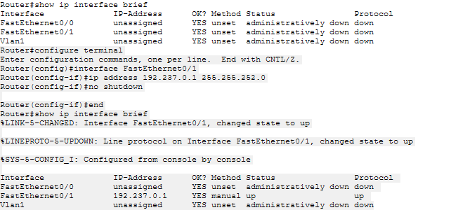

#### Bukti 02 — Atur IP di Karl

Karl memakai 192.237.0.2 dan gateway 192.237.0.1. Screenshot menunjukkan mask /24; rencana A1 menggunakan /22. Ini merupakan ketidaksesuaian yang harus diperiksa pada project akhir.

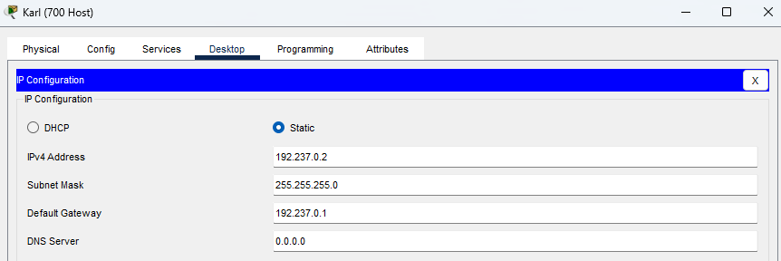

#### Bukti 03 — IP di Lin

Lin memakai 192.237.0.3/22 dengan gateway 192.237.0.1.

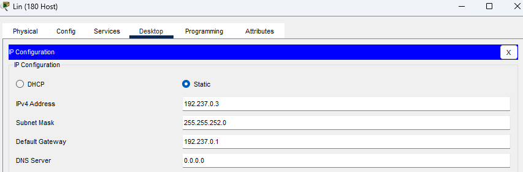

#### Bukti 04 — Test Ping dari Lin ke Karl

Lin menguji 192.237.0.2: empat balasan, 0% loss. Ping lokal ini tidak membuktikan mask Karl sudah /22.

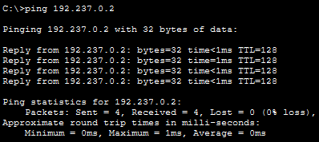

### Segmen bersama A19 dan routing A1

#### Bukti 05 — FastEthernet 11 Wired ke switch 2

Interface Wired menuju Switch2 memakai 192.237.16.49/29.

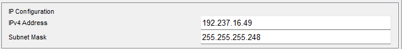

#### Bukti 06 — konfigurasi FastEthernet 00 Psyche

Psyche Fa0/0 memakai 192.237.16.50/29.

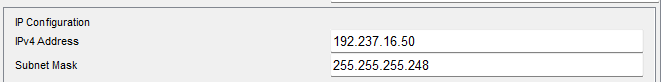

#### Bukti 07 — aktifkan Fa00 Psyche untuk subnet A19

CLI mengonfirmasi Fa0/0 Psyche aktif up/up dengan 192.237.16.50.

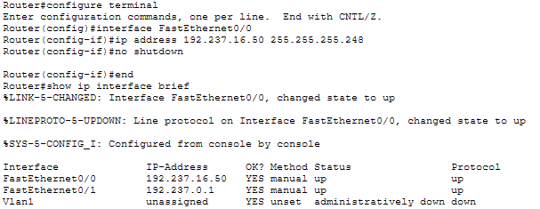

#### Bukti 08 — tambahkan rute ke LAN A1 di Wired

Wired memasang rute 192.237.0.0/22 melalui 192.237.16.50. Pesan invalid input berasal dari configure terminal yang dijalankan saat sudah berada pada mode konfigurasi; perintah ip route berikutnya berhasil.

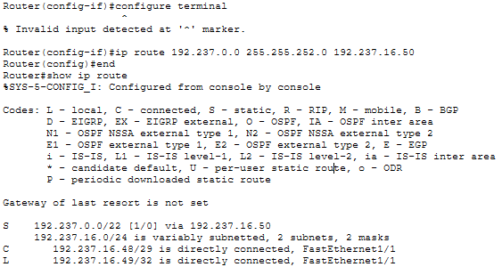

#### Bukti 09 — konfigurasi Fa00 Copland yang menuju Switch2

Copland Fa0/0 memakai 192.237.16.51/29.

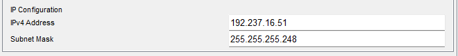

#### Bukti 10 — Konfigurasi Fa00 Schumann yang menuju Switch2

Schumann Fa0/0 memakai 192.237.16.52/29 dan aktif up/up.

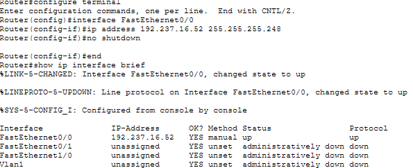

#### Bukti 11 — Bukti Schuman bisa menjangkau Wired

Schumann melakukan ping 192.237.16.49 dengan hasil 5/5, RTT 0/2/13 ms.

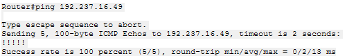

### Copland: LAN A3 dan A12

#### Bukti 12 — Atur Fa10 Copland sebagai gateway LAN Masayuki (A3)

Copland Fa1/0 memakai 192.237.8.1/23 dan aktif up/up.

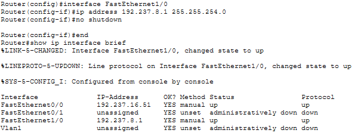

#### Bukti 13 — Mengatur IP Masayuki

Masayuki memakai 192.237.8.2/23 dan gateway 192.237.8.1.

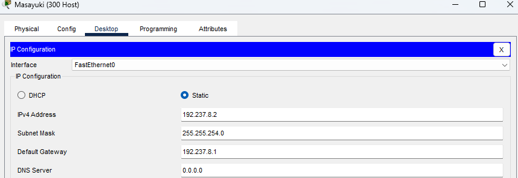

#### Bukti 14 — Ping Masayuki ke gateaway A3

Masayuki berhasil ping gateway 192.237.8.1, empat balasan tanpa loss.

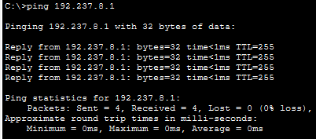

#### Bukti 15 — Menambahkan rute ke A3 dari Wired

Wired memasang 192.237.8.0/23 melalui Copland 192.237.16.51.

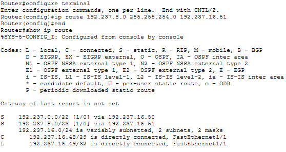

#### Bukti 16 — Konfigurasikan Fa01 Copland sebagai gateway Juri di subnet A12

Copland Fa0/1 memakai 192.237.15.193/26 dan aktif up/up.

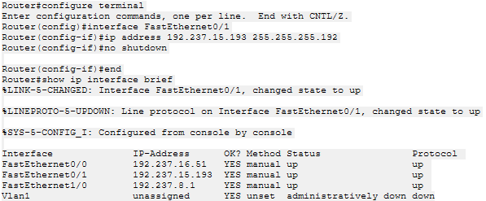

#### Bukti 17 — Mengatur IP Juri

Juri memakai 192.237.15.194/26 dan gateway 192.237.15.193.

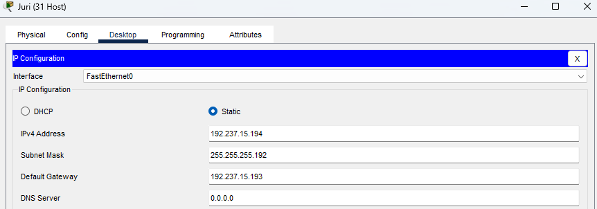

#### Bukti 18 — Cek ping Juri ke gateaway Copland

Juri berhasil ping 192.237.15.193 dengan empat balasan tanpa loss, RTT min/max/avg 0/9/2 ms.

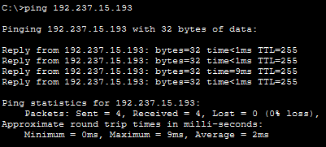

### Schumann: LAN Akashic dan jalur keluar cabang

#### Bukti 19 — mengatur Fa01 Schumann sebagai gateway Akashic di subnet A14

Schumann Fa0/1 memakai 192.237.16.33/29.

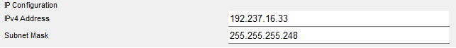

#### Bukti 20 — IP Akashic

Akashic memakai 192.237.16.34/29 dan gateway 192.237.16.33.

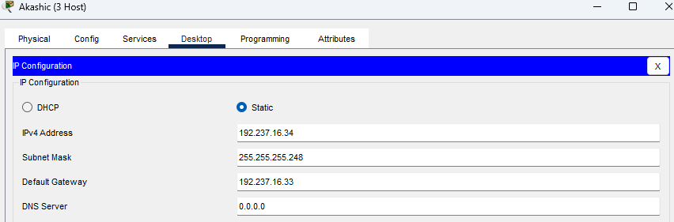

#### Bukti 21 — menambahkan rute default di Psyche

Tabel Psyche menunjukkan default route melalui Wired 192.237.16.49.

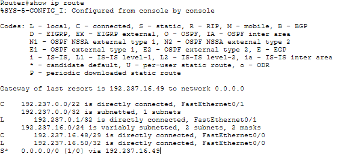

#### Bukti 22 — menambahkan rute default di Copland

Copland memasang default route melalui Wired 192.237.16.49.

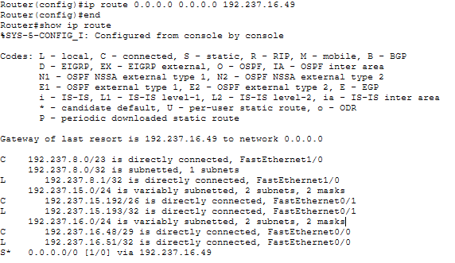

#### Bukti 23 — Ping dari Akashic ke Karl

Akashic berhasil ping Karl 192.237.0.2 dengan empat balasan, 0% loss dan TTL 125.

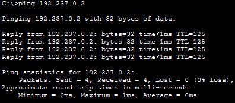

### Cyberia dan link A16

#### Bukti 24 — mengatur Fa00 Wired untuk link ke Cyberia (A16)

Wired Fa0/0 diberi 192.237.16.57/30. Pada tahap ini link masih down karena sisi lawan belum aktif.

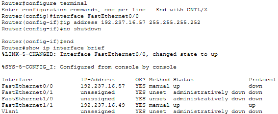

#### Bukti 25 — Mengatur Fa10 Cyberia untuk link A16 ke Wired

Cyberia Fa1/0 diberi 192.237.16.58/30.

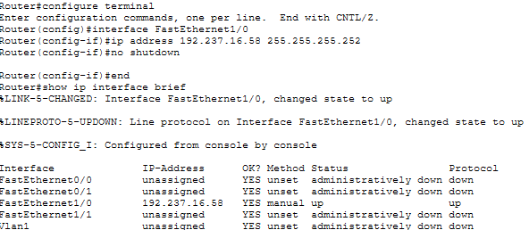

#### Bukti 26 — uji link A16 dari Cyberia ke Wired

Cyberia ping Wired 192.237.16.57, berhasil 5/5 dengan RTT 0/0/0 ms.

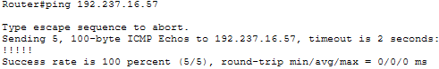

### Host cabang Navi

#### Bukti 27 — IP Alice

Alice memakai 192.237.12.2/24 dan gateway 192.237.12.1 pada A5.

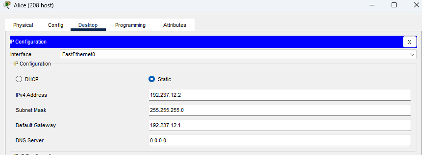

#### Bukti 28 — IP Kuma

Kuma memakai 192.237.13.4/24 dan gateway 192.237.13.1 pada A6.

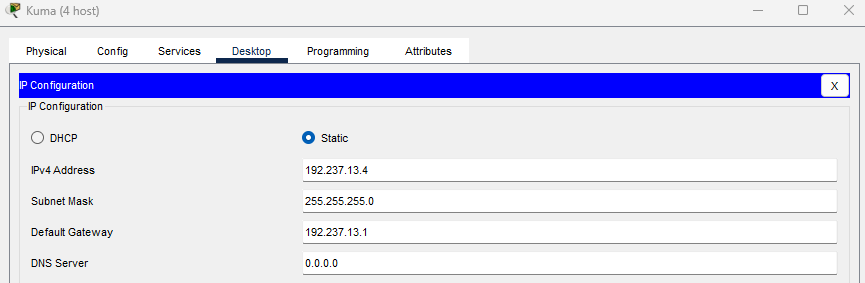

#### Bukti 29 — IP Taro

Taro memakai 192.237.15.66/26 dan gateway 192.237.15.65 pada A10.

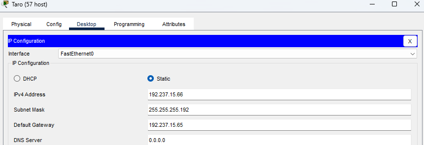

### Tachibana dan Deus

#### Bukti 30 — mengatur Fa10 Wired untuk link ke Tachibana (A18)

Wired Fa1/0 memakai 192.237.16.65 pada link A18.

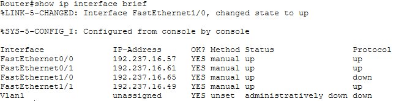

#### Bukti 31 — Atur Fa00 Tachibana untuk link A18 ke Wired

Tachibana Fa0/0 memakai 192.237.16.66 dan aktif up/up.

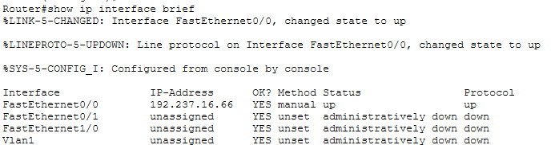

#### Bukti 32 — IP Collective

Collective memakai 192.237.10.2/23 dan gateway 192.237.10.1 pada A4.

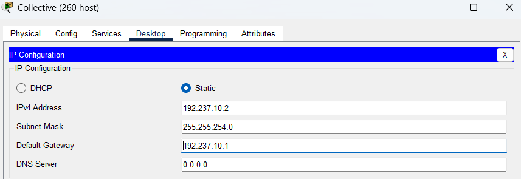

#### Bukti 33 — Menyambungkan Tachiban dengan Deus

Tachibana Fa0/1 diberi 192.237.16.73/30 untuk A21. Status down pada screenshot merupakan keadaan sebelum sisi Deus aktif.

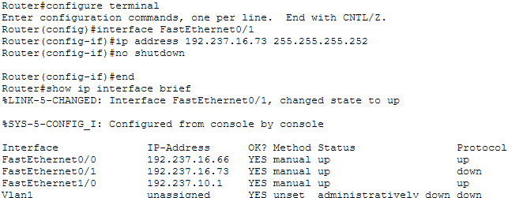

#### Bukti 34 — IP Lilith

Lilith memakai 192.237.14.130/25 dan gateway 192.237.14.129 pada A8.

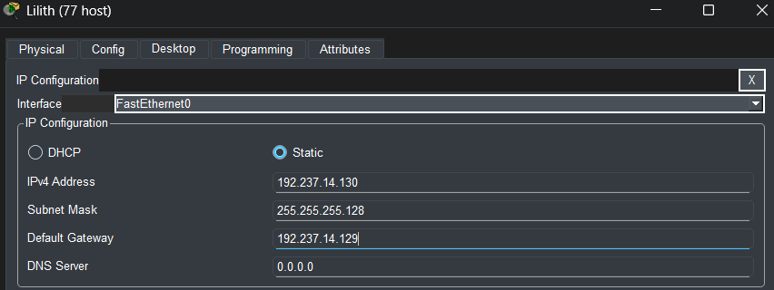

### Host Protocol7 sampai Shibuya

#### Bukti 35 — IP Chisa

Chisa memakai 192.237.15.130/26 dan gateway 192.237.15.129 pada A11.

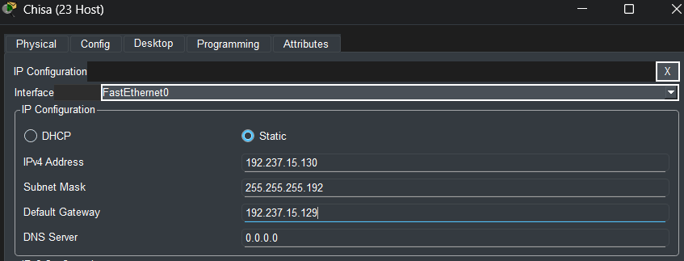

#### Bukti 36 — IP Eiri

Eiri memakai 192.237.16.42/29 dan gateway 192.237.16.41 pada A15.

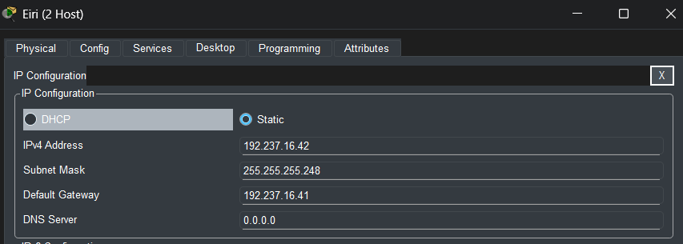

#### Bukti 37 — IP Semi

Semi memakai 192.237.16.2/27 dan gateway 192.237.16.1 pada A13.

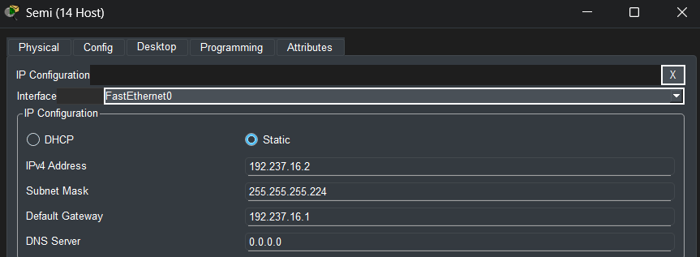

#### Bukti 38 — IP Lain

Lain memakai 192.237.15.2/26 dan gateway 192.237.15.1 pada A9.


## Hasil pengujian yang dikirim melalui CLI

| Sumber | IP tujuan | Node tujuan | Balasan | Loss | RTT min/avg/max (ms) |
|---|---|---|---|---|---|
| Wired | 192.237.16.86 | Phantoma A24 | 5/5 | 0% | 0/1/8 |
| Wired | 192.237.16.82 | Knights A23 | 5/5 | 0% | 0/0/0 |
| Wired | 192.237.16.78 | Protocol7 A22 | 5/5 | 0% | 0/0/0 |
| Wired | 192.237.16.74 | Deus A21 | 5/5 | 0% | 0/0/0 |
| Wired | 192.237.16.70 | Accela A20 | 5/5 | 0% | 0/1/8 |
| Lain | 192.237.4.3 | Denpa A2 | 4/4 | 0% | 0/0/2 |
| MyuMyu | 192.237.15.131 | Hodgeson A11 | 4/4 | 0% | 0/0/0 |
| Reika | 192.237.10.3 | Ghost A4 | 4/4 | 0% | 0/4/18 |
| Kuma | 192.237.15.3 | Mika A9 | 4/4 | 0% | 0/0/2 |
| Juri | 192.237.14.131 | Specter A8 | 4/4 | 0% | 0/0/1 |
| Lain setelah reload Shibuya | 192.237.0.2 | Karl A1 | 4/4 | 0% | 0/0/0 |

Sumber bukti: output teks CLI yang dikirim saat pengerjaan. Tabel ini bukan screenshot dan bukan pengujian ulang file .pkt. Pengujian di atas membuktikan pasangan sumber-tujuan yang disebutkan; belum merupakan uji semua pasangan node.

### Pengujian tambahan dalam screenshot

| Sumber | Tujuan | Balasan | Loss |
|---|---|---|---|
| Lin | Karl 192.237.0.2 | 4/4 | 0% |
| Masayuki | Gateway 192.237.8.1 | 4/4 | 0% |
| Juri | Gateway 192.237.15.193 | 4/4 | 0% |
| Schumann | Wired 192.237.16.49 | 5/5 | 0% |
| Akashic | Karl 192.237.0.2 | 4/4 | 0% |
| Cyberia | Wired 192.237.16.57 | 5/5 | 0% |

Gambar pengujian tersedia di dokumentasi screenshot.


## Pemeriksaan dokumen dan bukti

### Perhitungan

Seluruh 25 subnet pada spreadsheet telah diperiksa: network ID valid, broadcast dan rentang usable sesuai, kapasitas mencukupi, serta tidak ada overlap. Prefix tiap subnet adalah ukuran minimum untuk kebutuhan IP yang tertera. Total kebutuhan host dan interface router adalah 2.814. Jumlah seluruh blok adalah 4.188 alamat; termasuk 50 alamat network/broadcast dan 1.324 alamat usable yang tidak dipakai oleh kebutuhan simulasi. Sisa kapasitas ini merupakan akibat ukuran blok biner VLSM.

