# Dokumentasi screenshot pengerjaan CPT

Seluruh gambar merupakan screenshot asli kiriman praktikan. Urutan berikut mengikuti tahapan konfigurasi, bukan waktu pembuatan file. Gambar yang memperlihatkan status down merupakan bukti tahap pemasangan, bukan bukti hasil akhir.

## LAN A1: Psyche, Karl, dan Lin

### Bukti 01 — Di Router Psyche

Psyche Fa0/1 diberi 192.237.0.1/22 dan diaktifkan dengan no shutdown.

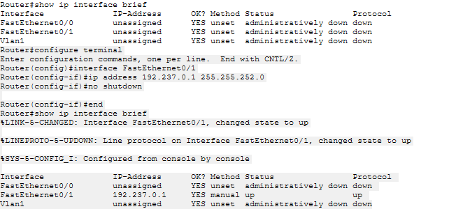

### Bukti 02 — Atur IP di Karl

Karl memakai 192.237.0.2 dan gateway 192.237.0.1. Screenshot menunjukkan mask /24; rencana A1 menggunakan /22. Ini merupakan ketidaksesuaian yang harus diperiksa pada project akhir.

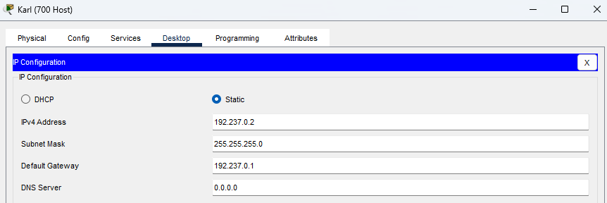

### Bukti 03 — IP di Lin

Lin memakai 192.237.0.3/22 dengan gateway 192.237.0.1.

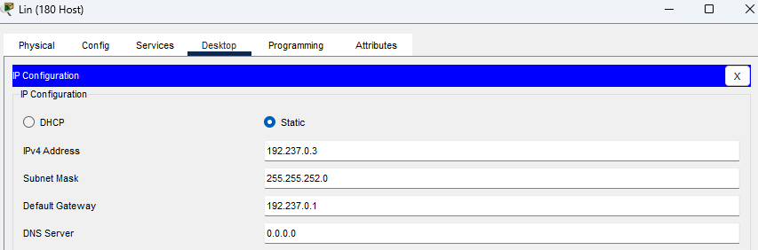

### Bukti 04 — Test Ping dari Lin ke Karl

Lin menguji 192.237.0.2: empat balasan, 0% loss. Ping lokal ini tidak membuktikan mask Karl sudah /22.

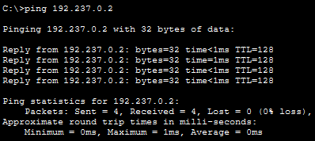

## Segmen bersama A19 dan routing A1

### Bukti 05 — FastEthernet 11 Wired ke switch 2

Interface Wired menuju Switch2 memakai 192.237.16.49/29.

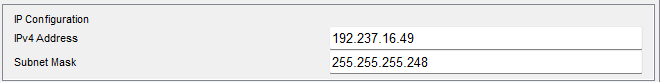

### Bukti 06 — konfigurasi FastEthernet 00 Psyche

Psyche Fa0/0 memakai 192.237.16.50/29.

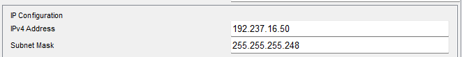

### Bukti 07 — aktifkan Fa00 Psyche untuk subnet A19

CLI mengonfirmasi Fa0/0 Psyche aktif up/up dengan 192.237.16.50.

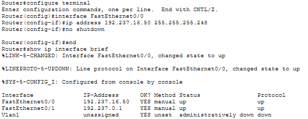

### Bukti 08 — tambahkan rute ke LAN A1 di Wired

Wired memasang rute 192.237.0.0/22 melalui 192.237.16.50. Pesan invalid input berasal dari configure terminal yang dijalankan saat sudah berada pada mode konfigurasi; perintah ip route berikutnya berhasil.

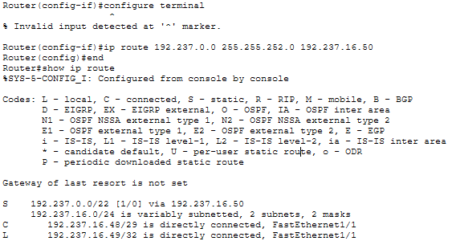

### Bukti 09 — konfigurasi Fa00 Copland yang menuju Switch2

Copland Fa0/0 memakai 192.237.16.51/29.

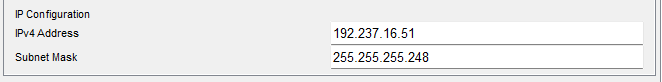

### Bukti 10 — Konfigurasi Fa00 Schumann yang menuju Switch2

Schumann Fa0/0 memakai 192.237.16.52/29 dan aktif up/up.

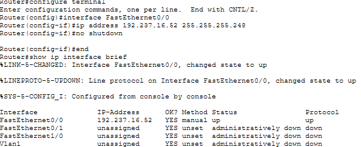

### Bukti 11 — Bukti Schuman bisa menjangkau Wired

Schumann melakukan ping 192.237.16.49 dengan hasil 5/5, RTT 0/2/13 ms.

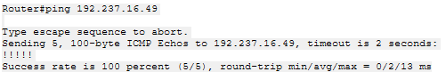

## Copland: LAN A3 dan A12

### Bukti 12 — Atur Fa10 Copland sebagai gateway LAN Masayuki (A3)

Copland Fa1/0 memakai 192.237.8.1/23 dan aktif up/up.

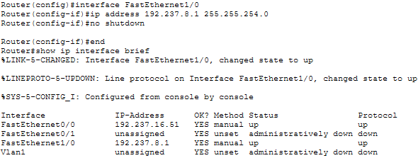

### Bukti 13 — Mengatur IP Masayuki

Masayuki memakai 192.237.8.2/23 dan gateway 192.237.8.1.

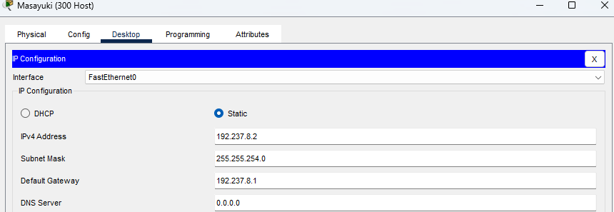

### Bukti 14 — Ping Masayuki ke gateaway A3

Masayuki berhasil ping gateway 192.237.8.1, empat balasan tanpa loss.

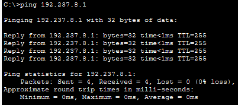

### Bukti 15 — Menambahkan rute ke A3 dari Wired

Wired memasang 192.237.8.0/23 melalui Copland 192.237.16.51.

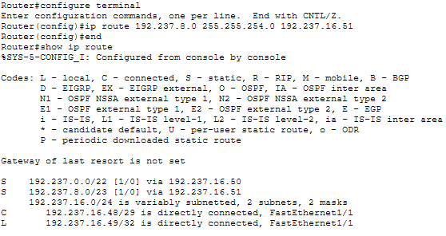

### Bukti 16 — Konfigurasikan Fa01 Copland sebagai gateway Juri di subnet A12

Copland Fa0/1 memakai 192.237.15.193/26 dan aktif up/up.

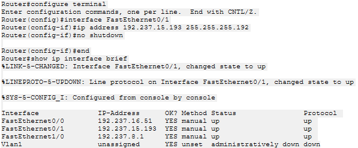

### Bukti 17 — Mengatur IP Juri

Juri memakai 192.237.15.194/26 dan gateway 192.237.15.193.

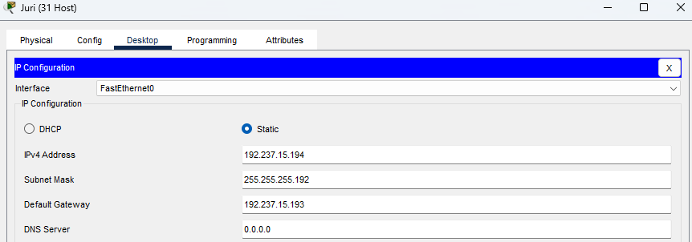

### Bukti 18 — Cek ping Juri ke gateaway Copland

Juri berhasil ping 192.237.15.193 dengan empat balasan tanpa loss, RTT min/max/avg 0/9/2 ms.

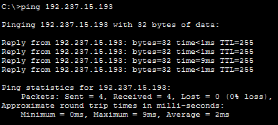

## Schumann: LAN Akashic dan jalur keluar cabang

### Bukti 19 — mengatur Fa01 Schumann sebagai gateway Akashic di subnet A14

Schumann Fa0/1 memakai 192.237.16.33/29.

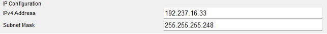

### Bukti 20 — IP Akashic

Akashic memakai 192.237.16.34/29 dan gateway 192.237.16.33.

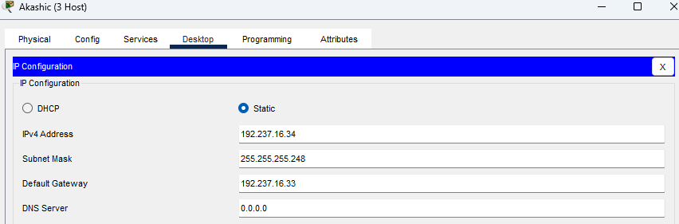

### Bukti 21 — menambahkan rute default di Psyche

Tabel Psyche menunjukkan default route melalui Wired 192.237.16.49.

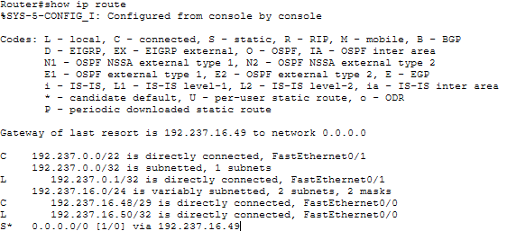

### Bukti 22 — menambahkan rute default di Copland

Copland memasang default route melalui Wired 192.237.16.49.

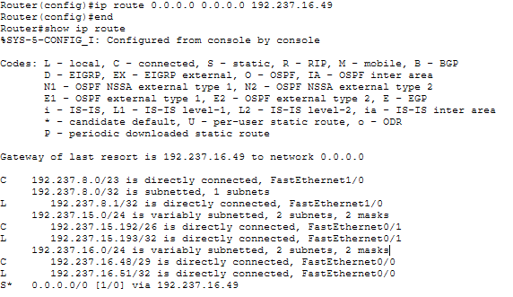

### Bukti 23 — Ping dari Akashic ke Karl

Akashic berhasil ping Karl 192.237.0.2 dengan empat balasan, 0% loss dan TTL 125.

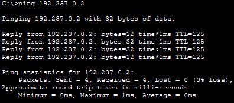

## Cyberia dan link A16

### Bukti 24 — mengatur Fa00 Wired untuk link ke Cyberia (A16)

Wired Fa0/0 diberi 192.237.16.57/30. Pada tahap ini link masih down karena sisi lawan belum aktif.

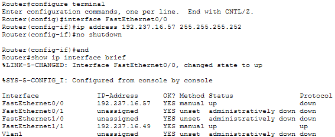

### Bukti 25 — Mengatur Fa10 Cyberia untuk link A16 ke Wired

Cyberia Fa1/0 diberi 192.237.16.58/30.

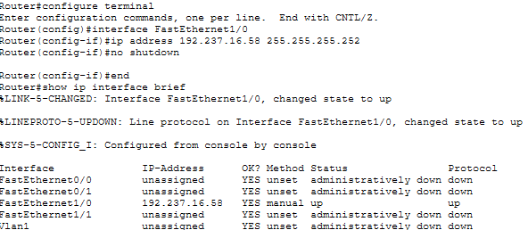

### Bukti 26 — uji link A16 dari Cyberia ke Wired

Cyberia ping Wired 192.237.16.57, berhasil 5/5 dengan RTT 0/0/0 ms.

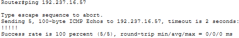

## Host cabang Navi

### Bukti 27 — IP Alice

Alice memakai 192.237.12.2/24 dan gateway 192.237.12.1 pada A5.

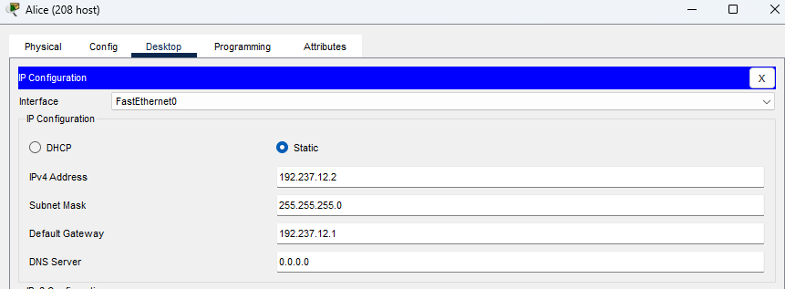

### Bukti 28 — IP Kuma

Kuma memakai 192.237.13.4/24 dan gateway 192.237.13.1 pada A6.

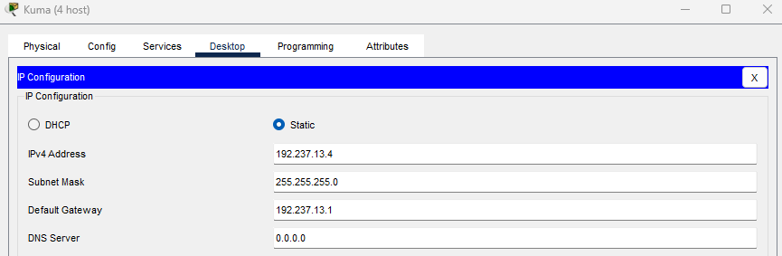

### Bukti 29 — IP Taro

Taro memakai 192.237.15.66/26 dan gateway 192.237.15.65 pada A10.

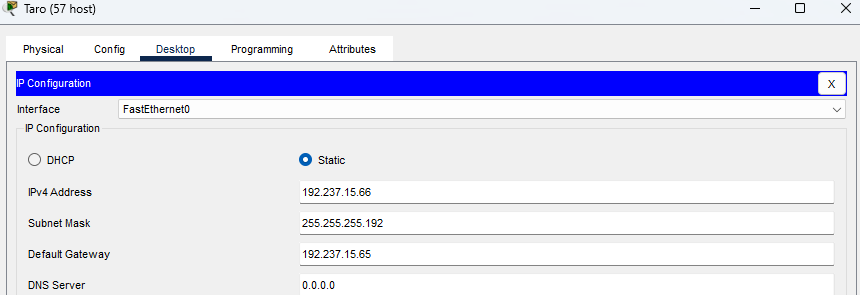

## Tachibana dan Deus

### Bukti 30 — mengatur Fa10 Wired untuk link ke Tachibana (A18)

Wired Fa1/0 memakai 192.237.16.65 pada link A18.

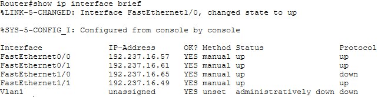

### Bukti 31 — Atur Fa00 Tachibana untuk link A18 ke Wired

Tachibana Fa0/0 memakai 192.237.16.66 dan aktif up/up.

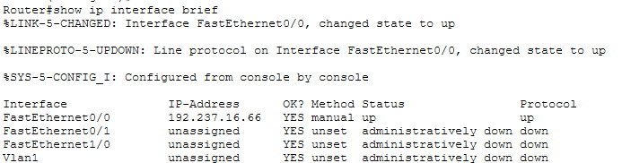

### Bukti 32 — IP Collective

Collective memakai 192.237.10.2/23 dan gateway 192.237.10.1 pada A4.

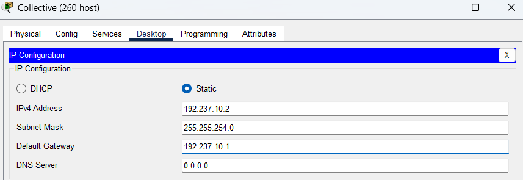

### Bukti 33 — Menyambungkan Tachiban dengan Deus

Tachibana Fa0/1 diberi 192.237.16.73/30 untuk A21. Status down pada screenshot merupakan keadaan sebelum sisi Deus aktif.

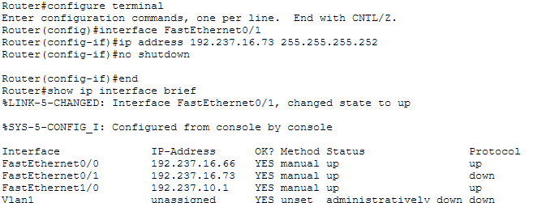

### Bukti 34 — IP Lilith

Lilith memakai 192.237.14.130/25 dan gateway 192.237.14.129 pada A8.

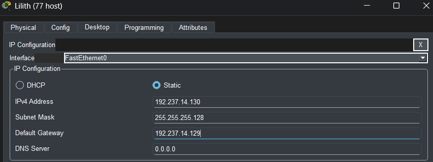

## Host Protocol7 sampai Shibuya

### Bukti 35 — IP Chisa

Chisa memakai 192.237.15.130/26 dan gateway 192.237.15.129 pada A11.

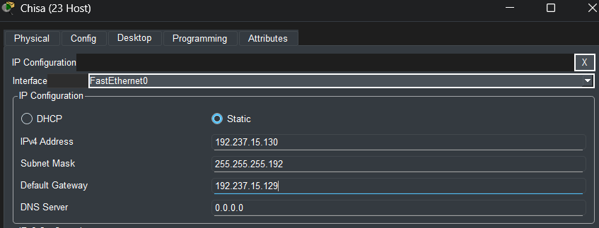

### Bukti 36 — IP Eiri

Eiri memakai 192.237.16.42/29 dan gateway 192.237.16.41 pada A15.

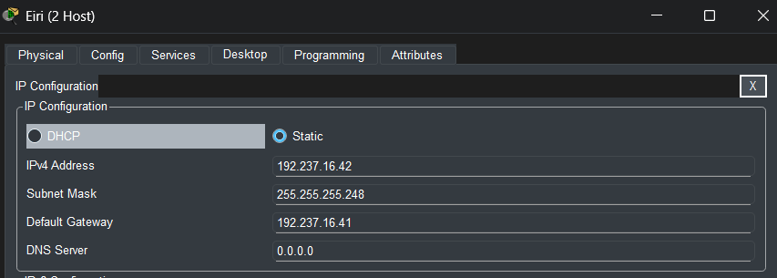

### Bukti 37 — IP Semi

Semi memakai 192.237.16.2/27 dan gateway 192.237.16.1 pada A13.

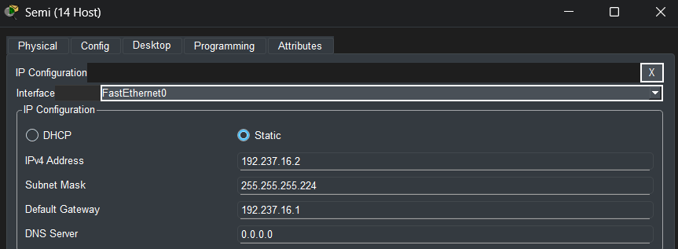

### Bukti 38 — IP Lain

Lain memakai 192.237.15.2/26 dan gateway 192.237.15.1 pada A9.

