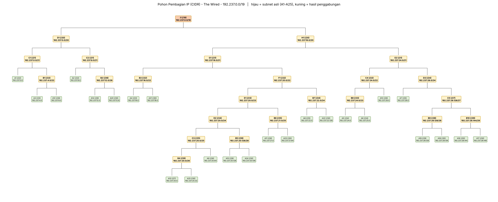

# Laporan Praktikum Modul 4: Subnetting dan Routing CIDR

**Komunikasi Data dan Jaringan Komputer — The Wired Expansion**  
Platform: **GNS3**  
Prefix praktikum: **192.237.x.x**  
Blok agregat akhir: **192.237.0.0/19**

Laporan ini menyatukan perhitungan kebutuhan host, penggabungan CIDR, pohon pembagian alamat, penentuan Network ID–netmask–broadcast–range IP, routing statis, konfigurasi setiap node, dan prosedur ping antar-node. Seluruh konfigurasi menggunakan tabel **Pembagian IP - CIDR**.

**Status validasi:** perhitungan dan model routing sudah diperiksa. Hasil ping aktual pada GNS3 belum tersedia; tabel bukti pengujian disediakan untuk diisi setelah eksekusi. Koreksi total kebutuhan pada spreadsheet dijelaskan pada bagian 10.

## Daftar isi

1. [Latar belakang, tujuan, dan topologi](#topologi)
2. [Gambar pohon CIDR lengkap dan cara membacanya](#pohon)
3. [Dasar CIDR dan kebutuhan IP setiap subnet](#kebutuhan)
4. [Aturan serta contoh penggabungan](#aturan)
5. [Seluruh tahap penggabungan B1–I1](#penggabungan)
6. [Network ID, netmask, broadcast, dan range IP](#pembagian)
7. [Routing CIDR langkah demi langkah](#routing)
8. [Penerapan melalui Edit config dan Web console](#penerapan)
9. [Pengujian ping ke node lain](#pengujian)
10. [Hasil pemeriksaan dan bukti pengujian](#hasil)
11. [Diagnosis ketika koneksi gagal](#diagnosis)
12. [Konfigurasi lengkap 38 node](#konfigurasi)
13. [Kesimpulan dan sumber](#kesimpulan)

<a id="topologi"></a>

## 1. Latar belakang, tujuan, dan topologi

Topologi The Wired memiliki banyak LAN dengan kebutuhan host berbeda serta sejumlah segmen penghubung router. Pembagian alamat harus menyediakan kapasitas yang cukup, menghindari subnet tumpang tindih, dan memungkinkan routing yang mudah ditelusuri. CIDR digunakan untuk membentuk blok alamat berukuran pangkat dua serta merangkum beberapa subnet yang dapat dicapai melalui jalur yang sama.

Tujuan pekerjaan ini adalah:

1. Menghitung kebutuhan IP host dan interface router pada 25 subnet.
2. Memilih prefix terkecil yang cukup untuk setiap subnet dasar.
3. Menyusun 24 penggabungan menjadi satu blok induk dan menggambarkannya sebagai pohon.
4. Menetapkan IP interface, gateway, serta route pergi dan balik.
5. Menyiapkan pengujian dari setiap node ke node lain dan mencatat bukti aktualnya.

Topologi GNS3 pada halaman 3 soal menjadi acuan jumlah host. Cyberia merupakan satu-satunya router yang terhubung ke NAT. Wired bercabang ke Navi, Tachibana, serta segmen bersama Psyche–Copland–Schumann melalui Switch2. Schumann terhubung ke Accela. Cabang panjang berikutnya adalah Tachibana–Deus–Protocol7–Knights–Phantoma–Shibuya.

| Komponen | Jumlah/keterangan |
| --- | --- |
| Router | 13 |
| Host contoh di emulator | 25 |
| Node ber-IP internal | 38 |
| Subnet dasar | 25, diberi nama A1–A25 |
| Alamat interface internal terkonfigurasi | 62 |
| Penggabungan | 24, diberi nama B1–I1 |
| Jaringan upstream Cyberia | 192.168.122.0/24 sesuai asumsi konfigurasi; cocokkan dengan NAT aktual |

Jumlah host pada gambar GNS3 dan CPT tidak seluruhnya sama. Laporan ini menggunakan kebutuhan **GNS3**. Switch Ethernet tanpa alamat manajemen tidak dihitung sebagai perangkat ber-IP dan tidak menjadi tujuan ping.

<a id="pohon"></a>

## 2. Gambar pohon CIDR lengkap



### 2.1 Cara membaca pohon

Pohon dibaca dari atas ke bawah untuk melihat pembagian blok induk menjadi anak. Untuk menjelaskan proses penggabungan CIDR, baca dari bawah ke atas, dimulai dari subnet A1–A25 sampai mencapai I1. Garis penghubung menunjukkan pasangan blok anak yang membentuk induknya, misalnya B1 berasal dari A3 + A12.

Kotak hijau A1–A25 merupakan subnet dasar yang digunakan untuk LAN atau segmen antar-router. Kotak kuning B1–I1 adalah hasil penggabungan, dengan I1 sebagai akar pohon. Setiap kotak mencantumkan nama blok, prefix, dan Network ID.

| Blok | Network/prefix | Anak langsung | Cakupan utama |
| --- | --- | --- | --- |
| I1 | 192.237.0.0/19 | D1 + H1 | Seluruh rancangan alamat internal |
| D1 | 192.237.0.0/20 | C1 + C2 | Psyche, Copland, Schumann, Accela |
| H1 | 192.237.16.0/20 | G1 + E2 | Kedua kelompok alamat di bawahnya |
| G1 | 192.237.16.0/21 | B3 + F1 | Tachibana sampai Shibuya |
| E2 | 192.237.24.0/21 | C4 + D3 | LAN Navi, LAN Cyberia, dan beberapa segmen antar-router |

Garis pada gambar menunjukkan hubungan alamat induk–anak. Tidak semua anak menghabiskan seluruh ruang induknya: ruang kosong pada covering aggregate tidak digambar sebagai subnet tambahan. Suatu blok agregasi juga tidak otomatis menjadi route melalui satu router; next-hop tetap ditentukan oleh topologi fisik.

### 2.2 Contoh penelusuran alamat Lain

Subnet Lain–Mika adalah A9 = 192.237.20.64/26. Jalur pada pohon alokasinya adalah **I1 → H1 → G1 → F1 → E1 → D2 → C3 → A9**. Setiap blok anak berada dalam cakupan blok sebelumnya. Jalur ini menjelaskan pembagian alamat; perjalanan paket Karl menuju Lain dijelaskan pada bagian routing.

<a id="kebutuhan"></a>

## 3. Dasar CIDR dan kebutuhan IP setiap subnet

IPv4 terdiri dari 32 bit. Penulisan `/p` berarti p bit pertama adalah bagian jaringan; sisanya adalah bit host. Untuk subnet LAN/transit biasa pada tugas ini:

- Bit host: **h = 32 − p**.
- Banyak alamat satu blok: **2^h**.
- Kapasitas host usable: **2^h − 2**.
- Dua alamat khusus adalah network ID dan broadcast.
- Kebutuhan IP: **jumlah host pada gambar + jumlah interface router di subnet itu**. Switch Ethernet biasa tidak dihitung sebagai host IP.

Angka ratusan host pada label node menyatakan kebutuhan perencanaan alamat. Di emulator, satu node Karl tetap memakai satu IP yang mewakili kelompok Karl; tidak perlu memberi 700 alamat pada eth0 Karl untuk membuktikan routing contoh node.

CIDR menyediakan pengalamatan tanpa batas kelas A/B/C dan memungkinkan agregasi prefix. Dalam alur tugas ini, kita menentukan ukuran subnet dasar, menggabungkan blok dari bawah ke atas, lalu menempatkan subnet ke dalam blok induknya. VLSM juga memakai prefix classless, tetapi tabel alokasinya berbeda. Jangan mencampur alamat dari kedua sheet dalam satu topologi.

### 3.1 Contoh pemilihan subnet

**A1 (Karl, Lin, Psyche):** 700 + 180 + 1 = 881 IP. Dengan 9 bit host, 2^9 − 2 = 510, belum cukup. Dengan 10 bit host, 2^10 − 2 = 1.022, cukup. Jadi prefix = 32 − 10 = **/22**, total blok 1.024 alamat, netmask 255.255.252.0.

**A5 (Alice, Reika, Navi):** 208 + 45 + 1 = 254 IP. /25 hanya menyediakan 126 usable, sedangkan /24 menyediakan tepat 254 usable. Maka **/24** sudah benar. Jangan menambahkan router dua kali: angka 254 sudah termasuk gateway.

**A9 (Lain, Mika, Shibuya):** 57 + 4 + 1 = 62 IP. /26 menyediakan 64 alamat, yaitu 62 usable, sehingga **/26** tepat.

**A12 (Juri, Copland):** 31 + 1 = 32 IP. /27 hanya mempunyai 30 usable, sehingga harus naik menjadi **/26**, walaupun 32 terlihat sama dengan ukuran total blok /27.

**A19 (Wired, Psyche, Copland, Schumann):** ada empat interface router dalam satu segmen bersama melalui Switch2. /30 hanya mempunyai dua usable. Karena itu gunakan **/29**, dengan enam usable. A19 bukan tiga subnet point-to-point terpisah.

**A16 (Cyberia–Wired):** dua interface router membutuhkan dua IP. /30 menyediakan empat alamat, yaitu satu network, dua host, satu broadcast. /31 mempunyai penggunaan khusus pada point-to-point, tetapi tabel praktikum ini memakai /30 secara konsisten.

### 3.2 Kebutuhan dan kapasitas seluruh subnet

| Subnet | Perhitungan IP | Kebutuhan | Prefix | Total alamat | Usable | Sisa usable |
| --- | --- | --- | --- | --- | --- | --- |
| A1 | 700 + 180 + 1 | 881 | /22 | 1024 | 1022 | 141 |
| A2 | 510 + 3 + 1 | 514 | /22 | 1024 | 1022 | 508 |
| A3 | 300 + 1 | 301 | /23 | 512 | 510 | 209 |
| A4 | 260 + 6 + 1 | 267 | /23 | 512 | 510 | 243 |
| A5 | 208 + 45 + 1 | 254 | /24 | 256 | 254 | 0 |
| A6 | 120 + 18 + 4 + 1 | 143 | /24 | 256 | 254 | 111 |
| A7 | 95 + 30 + 1 | 126 | /25 | 128 | 126 | 0 |
| A8 | 77 + 21 + 1 | 99 | /25 | 128 | 126 | 27 |
| A9 | 57 + 4 + 1 | 62 | /26 | 64 | 62 | 0 |
| A10 | 57 + 1 | 58 | /26 | 64 | 62 | 4 |
| A11 | 23 + 9 + 1 | 33 | /26 | 64 | 62 | 29 |
| A12 | 31 + 1 | 32 | /26 | 64 | 62 | 30 |
| A13 | 14 + 1 | 15 | /27 | 32 | 30 | 15 |
| A14 | 3 + 1 | 4 | /29 | 8 | 6 | 2 |
| A15 | 2 + 1 | 3 | /29 | 8 | 6 | 3 |
| A16 | 1 + 1 | 2 | /30 | 4 | 2 | 0 |
| A17 | 1 + 1 | 2 | /30 | 4 | 2 | 0 |
| A18 | 1 + 1 | 2 | /30 | 4 | 2 | 0 |
| A19 | 4 interface | 4 | /29 | 8 | 6 | 2 |
| A20 | 1 + 1 | 2 | /30 | 4 | 2 | 0 |
| A21 | 1 + 1 | 2 | /30 | 4 | 2 | 0 |
| A22 | 1 + 1 | 2 | /30 | 4 | 2 | 0 |
| A23 | 1 + 1 | 2 | /30 | 4 | 2 | 0 |
| A24 | 1 + 1 | 2 | /30 | 4 | 2 | 0 |
| A25 | 1 + 1 | 2 | /30 | 4 | 2 | 0 |

Total kebutuhan **2.814 IP**. Total ukuran seluruh subnet dasar adalah **4.188 alamat**. Karena setiap satu dari 25 subnet memiliki network dan broadcast sendiri, kapasitas usable gabungannya adalah 4.188 − (25 × 2) = **4.138 IP**, dengan 4.138 − 2.814 = **1.324 IP usable tersisa**.


<a id="aturan"></a>

## 4. Aturan penggabungan blok

Penggabungan mencari satu prefix yang menutupi seluruh alamat kedua anak. Caranya: ambil alamat network paling kecil dan broadcast paling besar, ubah ke biner, lalu hitung bit awal yang sama. Bagian yang berbeda menjadi bagian host dari blok induk.

Jika dua blok sama besar, berurutan, dan sejajar pada batas induknya, `/p` + `/p` menjadi `/(p−1)`. Contohnya 192.237.24.0/24 + 192.237.25.0/24 = 192.237.24.0/23. Aturan ini tidak berlaku sembarangan: dua /24 pada oktet ketiga 25 dan 26 membutuhkan /22, karena keduanya tidak membentuk pasangan /23 yang sejajar.

Jika ukurannya berbeda, hitung kebutuhan blok dan periksa keselarasan alamat. Contoh 512 + 64 = 576 alamat memerlukan blok pangkat dua berikutnya, 1.024 alamat (/22), apabila penempatannya muat dalam batas /22 itu. Menjumlahkan ukuran saja tidak cukup untuk alamat yang berjauhan.

**Penggabungan yang mencakup ruang kosong adalah covering aggregate.** Contoh B1 mencakup A3 dan A12, sekaligus alamat kosong di antaranya dan sesudahnya. Ruang kosong tersebut bukan subnet host baru dan tidak boleh dinyatakan sebagai alamat host yang sudah dipakai.

### 4.1 Contoh B1: A3 + A12 menjadi /22

- A3 = 192.237.4.0/23, rentang total 192.237.4.0–192.237.5.255, ukuran 512.
- A12 = 192.237.6.0/26, rentang total 192.237.6.0–192.237.6.63, ukuran 64.
- Kebutuhan dua blok = 512 + 64 = 576 alamat, sehingga blok 512 tidak cukup; pilih 1.024 alamat.
- B1 = **192.237.4.0/22**, meliputi 192.237.4.0–192.237.7.255. Ruang di luar kedua anak dalam B1 adalah 1.024 − 576 = 448 alamat.

Pada oktet ketiga, 4 = `00000100` dan 6 = `00000110`. Enam bit awal `000001` sama. Dua oktet awal menyumbang 16 bit, sehingga prefix bersama = 16 + 6 = **/22**.

### 4.2 Contoh B4 lalu C3: menggabungkan blok yang lebih kecil

- A13 = 192.237.20.0/27, mencakup .0–.31.
- A25 = 192.237.20.32/30, mencakup .32–.35.
- B4 harus menampung .0–.35: blok /27 tidak cukup, sehingga menjadi **192.237.20.0/26**, mencakup .0–.63.
- A9 = 192.237.20.64/26 mencakup .64–.127.
- B4 + A9 adalah dua /26 yang sejajar, sehingga C3 = **192.237.20.0/25**, mencakup .0–.127.

### 4.3 Contoh I1: hasil akhir /19

D1 = 192.237.0.0/20 mencakup oktet ketiga 0–15. H1 = 192.237.16.0/20 mencakup oktet ketiga 16–31. Keduanya berurutan dan sejajar, sehingga I1 = **192.237.0.0/19**.

Pada oktet ketiga, alamat terendah 0 = `00000000` dan tertinggi 31 = `00011111`. Tiga bit awal `000` sama. Prefix = 16 + 3 = **/19**. Netmask biner adalah `11111111.11111111.11100000.00000000`, yaitu **255.255.224.0**. Besar langkah oktet ketiga = 256 − 224 = **32**.

- Network induk: 192.237.0.0.
- Batas akhir blok induk: 192.237.31.255.
- Ukuran blok induk: 2^(32−19) = **8.192 alamat**.
- Jumlah ukuran subnet dasar: **4.188 alamat**.
- Ruang di blok induk yang tidak termasuk subnet dasar: 8.192 − 4.188 = **4.004 alamat**.

Jangan menyebut 8.190 sebagai kapasitas host gabungan topologi: angka itu hanya berlaku jika /19 digunakan sebagai satu subnet datar. Di sini /19 merupakan ringkasan banyak subnet. /20 hanya menyediakan 4.096 alamat, lebih kecil dari total 4.188 alamat subnet dasar, sehingga tidak cukup untuk seluruh rancangan ini.


<a id="penggabungan"></a>

## 5. Seluruh tahap penggabungan B1 sampai I1

Tabel ini mengikuti nama dan urutan di sheet Penggabungan - CIDR. Kolom sisa hanya menghitung ruang induk di luar kedua blok anak langsung; sisa yang sudah ada di dalam anak tidak dihitung ulang di kolom itu.

| Gabungan | Anak 1 | Anak 2 | Jumlah alamat anak | Blok induk | Sisa |
| --- | --- | --- | --- | --- | --- |
| B1 | A3 (192.237.4.0/23) | A12 (192.237.6.0/26) | 512 + 64 = 576 | 192.237.4.0/22 | 448 |
| B2 | A14 (192.237.12.0/29) | A20 (192.237.12.8/30) | 8 + 4 = 12 | 192.237.12.0/28 | 4 |
| B3 | A4 (192.237.16.0/23) | A21 (192.237.18.0/30) | 512 + 4 = 516 | 192.237.16.0/22 | 508 |
| B4 | A13 (192.237.20.0/27) | A25 (192.237.20.32/30) | 32 + 4 = 36 | 192.237.20.0/26 | 28 |
| B5 | A15 (192.237.20.128/29) | A24 (192.237.20.136/30) | 8 + 4 = 12 | 192.237.20.128/28 | 4 |
| B6 | A11 (192.237.21.0/26) | A23 (192.237.21.64/30) | 64 + 4 = 68 | 192.237.21.0/25 | 60 |
| B7 | A8 (192.237.22.0/25) | A22 (192.237.22.128/30) | 128 + 4 = 132 | 192.237.22.0/24 | 124 |
| B8 | A5 (192.237.24.0/24) | A6 (192.237.25.0/24) | 256 + 256 = 512 | 192.237.24.0/23 | 0 |
| B9 | A19 (192.237.28.128/29) | A18 (192.237.28.136/30) | 8 + 4 = 12 | 192.237.28.128/28 | 4 |
| B10 | A16 (192.237.28.144/30) | A17 (192.237.28.148/30) | 4 + 4 = 8 | 192.237.28.144/29 | 0 |
| C1 | A1 (192.237.0.0/22) | B1 (192.237.4.0/22) | 1024 + 1024 = 2048 | 192.237.0.0/21 | 0 |
| C2 | A2 (192.237.8.0/22) | B2 (192.237.12.0/28) | 1024 + 16 = 1040 | 192.237.8.0/21 | 1008 |
| C3 | B4 (192.237.20.0/26) | A9 (192.237.20.64/26) | 64 + 64 = 128 | 192.237.20.0/25 | 0 |
| C4 | B8 (192.237.24.0/23) | A10 (192.237.26.0/26) | 512 + 64 = 576 | 192.237.24.0/22 | 448 |
| C5 | B9 (192.237.28.128/28) | B10 (192.237.28.144/29) | 16 + 8 = 24 | 192.237.28.128/27 | 8 |
| D1 | C1 (192.237.0.0/21) | C2 (192.237.8.0/21) | 2048 + 2048 = 4096 | 192.237.0.0/20 | 0 |
| D2 | C3 (192.237.20.0/25) | B5 (192.237.20.128/28) | 128 + 16 = 144 | 192.237.20.0/24 | 112 |
| D3 | A7 (192.237.28.0/25) | C5 (192.237.28.128/27) | 128 + 32 = 160 | 192.237.28.0/24 | 96 |
| E1 | D2 (192.237.20.0/24) | B6 (192.237.21.0/25) | 256 + 128 = 384 | 192.237.20.0/23 | 128 |
| E2 | C4 (192.237.24.0/22) | D3 (192.237.28.0/24) | 1024 + 256 = 1280 | 192.237.24.0/21 | 768 |
| F1 | E1 (192.237.20.0/23) | B7 (192.237.22.0/24) | 512 + 256 = 768 | 192.237.20.0/22 | 256 |
| G1 | B3 (192.237.16.0/22) | F1 (192.237.20.0/22) | 1024 + 1024 = 2048 | 192.237.16.0/21 | 0 |
| H1 | G1 (192.237.16.0/21) | E2 (192.237.24.0/21) | 2048 + 2048 = 4096 | 192.237.16.0/20 | 0 |
| I1 | D1 (192.237.0.0/20) | H1 (192.237.16.0/20) | 4096 + 4096 = 8192 | 192.237.0.0/19 | 0 |

**B1 — A3 + A12.** Rentang yang harus dicakup mulai dari 192.237.4.0 sampai 192.237.6.63. Kedua blok anak berukuran 512 dan 64 alamat. Blok sejajar terkecil yang mencakup semuanya adalah **192.237.4.0/22**, berukuran 1024 alamat, dengan batas akhir 192.237.7.255. Tersisa 448 alamat di luar kedua blok anak langsung.

**B2 — A14 + A20.** Rentang yang harus dicakup mulai dari 192.237.12.0 sampai 192.237.12.11. Kedua blok anak berukuran 8 dan 4 alamat. Blok sejajar terkecil yang mencakup semuanya adalah **192.237.12.0/28**, berukuran 16 alamat, dengan batas akhir 192.237.12.15. Tersisa 4 alamat di luar kedua blok anak langsung.

**B3 — A4 + A21.** Rentang yang harus dicakup mulai dari 192.237.16.0 sampai 192.237.18.3. Kedua blok anak berukuran 512 dan 4 alamat. Blok sejajar terkecil yang mencakup semuanya adalah **192.237.16.0/22**, berukuran 1024 alamat, dengan batas akhir 192.237.19.255. Tersisa 508 alamat di luar kedua blok anak langsung.

**B4 — A13 + A25.** Rentang yang harus dicakup mulai dari 192.237.20.0 sampai 192.237.20.35. Kedua blok anak berukuran 32 dan 4 alamat. Blok sejajar terkecil yang mencakup semuanya adalah **192.237.20.0/26**, berukuran 64 alamat, dengan batas akhir 192.237.20.63. Tersisa 28 alamat di luar kedua blok anak langsung.

**B5 — A15 + A24.** Rentang yang harus dicakup mulai dari 192.237.20.128 sampai 192.237.20.139. Kedua blok anak berukuran 8 dan 4 alamat. Blok sejajar terkecil yang mencakup semuanya adalah **192.237.20.128/28**, berukuran 16 alamat, dengan batas akhir 192.237.20.143. Tersisa 4 alamat di luar kedua blok anak langsung.

**B6 — A11 + A23.** Rentang yang harus dicakup mulai dari 192.237.21.0 sampai 192.237.21.67. Kedua blok anak berukuran 64 dan 4 alamat. Blok sejajar terkecil yang mencakup semuanya adalah **192.237.21.0/25**, berukuran 128 alamat, dengan batas akhir 192.237.21.127. Tersisa 60 alamat di luar kedua blok anak langsung.

**B7 — A8 + A22.** Rentang yang harus dicakup mulai dari 192.237.22.0 sampai 192.237.22.131. Kedua blok anak berukuran 128 dan 4 alamat. Blok sejajar terkecil yang mencakup semuanya adalah **192.237.22.0/24**, berukuran 256 alamat, dengan batas akhir 192.237.22.255. Tersisa 124 alamat di luar kedua blok anak langsung.

**B8 — A5 + A6.** Rentang yang harus dicakup mulai dari 192.237.24.0 sampai 192.237.25.255. Kedua blok anak berukuran 256 dan 256 alamat. Blok sejajar terkecil yang mencakup semuanya adalah **192.237.24.0/23**, berukuran 512 alamat, dengan batas akhir 192.237.25.255. Kedua anak mengisi seluruh blok induk.

**B9 — A19 + A18.** Rentang yang harus dicakup mulai dari 192.237.28.128 sampai 192.237.28.139. Kedua blok anak berukuran 8 dan 4 alamat. Blok sejajar terkecil yang mencakup semuanya adalah **192.237.28.128/28**, berukuran 16 alamat, dengan batas akhir 192.237.28.143. Tersisa 4 alamat di luar kedua blok anak langsung.

**B10 — A16 + A17.** Rentang yang harus dicakup mulai dari 192.237.28.144 sampai 192.237.28.151. Kedua blok anak berukuran 4 dan 4 alamat. Blok sejajar terkecil yang mencakup semuanya adalah **192.237.28.144/29**, berukuran 8 alamat, dengan batas akhir 192.237.28.151. Kedua anak mengisi seluruh blok induk.

**C1 — A1 + B1.** Rentang yang harus dicakup mulai dari 192.237.0.0 sampai 192.237.7.255. Kedua blok anak berukuran 1024 dan 1024 alamat. Blok sejajar terkecil yang mencakup semuanya adalah **192.237.0.0/21**, berukuran 2048 alamat, dengan batas akhir 192.237.7.255. Kedua anak mengisi seluruh blok induk.

**C2 — A2 + B2.** Rentang yang harus dicakup mulai dari 192.237.8.0 sampai 192.237.12.15. Kedua blok anak berukuran 1024 dan 16 alamat. Blok sejajar terkecil yang mencakup semuanya adalah **192.237.8.0/21**, berukuran 2048 alamat, dengan batas akhir 192.237.15.255. Tersisa 1008 alamat di luar kedua blok anak langsung.

**C3 — B4 + A9.** Rentang yang harus dicakup mulai dari 192.237.20.0 sampai 192.237.20.127. Kedua blok anak berukuran 64 dan 64 alamat. Blok sejajar terkecil yang mencakup semuanya adalah **192.237.20.0/25**, berukuran 128 alamat, dengan batas akhir 192.237.20.127. Kedua anak mengisi seluruh blok induk.

**C4 — B8 + A10.** Rentang yang harus dicakup mulai dari 192.237.24.0 sampai 192.237.26.63. Kedua blok anak berukuran 512 dan 64 alamat. Blok sejajar terkecil yang mencakup semuanya adalah **192.237.24.0/22**, berukuran 1024 alamat, dengan batas akhir 192.237.27.255. Tersisa 448 alamat di luar kedua blok anak langsung.

**C5 — B9 + B10.** Rentang yang harus dicakup mulai dari 192.237.28.128 sampai 192.237.28.151. Kedua blok anak berukuran 16 dan 8 alamat. Blok sejajar terkecil yang mencakup semuanya adalah **192.237.28.128/27**, berukuran 32 alamat, dengan batas akhir 192.237.28.159. Tersisa 8 alamat di luar kedua blok anak langsung.

**D1 — C1 + C2.** Rentang yang harus dicakup mulai dari 192.237.0.0 sampai 192.237.15.255. Kedua blok anak berukuran 2048 dan 2048 alamat. Blok sejajar terkecil yang mencakup semuanya adalah **192.237.0.0/20**, berukuran 4096 alamat, dengan batas akhir 192.237.15.255. Kedua anak mengisi seluruh blok induk.

**D2 — C3 + B5.** Rentang yang harus dicakup mulai dari 192.237.20.0 sampai 192.237.20.143. Kedua blok anak berukuran 128 dan 16 alamat. Blok sejajar terkecil yang mencakup semuanya adalah **192.237.20.0/24**, berukuran 256 alamat, dengan batas akhir 192.237.20.255. Tersisa 112 alamat di luar kedua blok anak langsung.

**D3 — A7 + C5.** Rentang yang harus dicakup mulai dari 192.237.28.0 sampai 192.237.28.159. Kedua blok anak berukuran 128 dan 32 alamat. Blok sejajar terkecil yang mencakup semuanya adalah **192.237.28.0/24**, berukuran 256 alamat, dengan batas akhir 192.237.28.255. Tersisa 96 alamat di luar kedua blok anak langsung.

**E1 — D2 + B6.** Rentang yang harus dicakup mulai dari 192.237.20.0 sampai 192.237.21.127. Kedua blok anak berukuran 256 dan 128 alamat. Blok sejajar terkecil yang mencakup semuanya adalah **192.237.20.0/23**, berukuran 512 alamat, dengan batas akhir 192.237.21.255. Tersisa 128 alamat di luar kedua blok anak langsung.

**E2 — C4 + D3.** Rentang yang harus dicakup mulai dari 192.237.24.0 sampai 192.237.28.255. Kedua blok anak berukuran 1024 dan 256 alamat. Blok sejajar terkecil yang mencakup semuanya adalah **192.237.24.0/21**, berukuran 2048 alamat, dengan batas akhir 192.237.31.255. Tersisa 768 alamat di luar kedua blok anak langsung.

**F1 — E1 + B7.** Rentang yang harus dicakup mulai dari 192.237.20.0 sampai 192.237.22.255. Kedua blok anak berukuran 512 dan 256 alamat. Blok sejajar terkecil yang mencakup semuanya adalah **192.237.20.0/22**, berukuran 1024 alamat, dengan batas akhir 192.237.23.255. Tersisa 256 alamat di luar kedua blok anak langsung.

**G1 — B3 + F1.** Rentang yang harus dicakup mulai dari 192.237.16.0 sampai 192.237.23.255. Kedua blok anak berukuran 1024 dan 1024 alamat. Blok sejajar terkecil yang mencakup semuanya adalah **192.237.16.0/21**, berukuran 2048 alamat, dengan batas akhir 192.237.23.255. Kedua anak mengisi seluruh blok induk.

**H1 — G1 + E2.** Rentang yang harus dicakup mulai dari 192.237.16.0 sampai 192.237.31.255. Kedua blok anak berukuran 2048 dan 2048 alamat. Blok sejajar terkecil yang mencakup semuanya adalah **192.237.16.0/20**, berukuran 4096 alamat, dengan batas akhir 192.237.31.255. Kedua anak mengisi seluruh blok induk.

**I1 — D1 + H1.** Rentang yang harus dicakup mulai dari 192.237.0.0 sampai 192.237.31.255. Kedua blok anak berukuran 4096 dan 4096 alamat. Blok sejajar terkecil yang mencakup semuanya adalah **192.237.0.0/19**, berukuran 8192 alamat, dengan batas akhir 192.237.31.255. Kedua anak mengisi seluruh blok induk.

### 5.1 Pohon alokasi dan tabel routing mempunyai fungsi berbeda

Pohon penggabungan menjelaskan letak alamat dalam blok induk. Sebuah gabungan tidak otomatis boleh dijadikan satu route dengan next-hop sembarang. Di Wired, A1 harus lewat Psyche, B1 lewat Copland, dan C2 lewat Schumann. Walaupun C1 = A1 + B1, Wired tidak boleh menggantikan kedua route tersebut dengan satu C1 ke Psyche atau Copland, karena next-hop-nya berbeda.

Sebaliknya, seluruh jaringan 192.237.16.0/21 bisa diarahkan dari Wired ke Tachibana karena Tachibana menjadi pintu masuk cabang itu. Seluruh 192.237.24.0/22 bisa diarahkan dari Wired ke Navi. Gunakan summary hanya ketika semua subnet aktif yang dicakup memang dapat dicapai melalui next-hop tersebut.


<a id="pembagian"></a>

## 6. Network ID, netmask, broadcast, dan range IP

Setelah ukuran blok dan penempatannya diketahui dari pohon CIDR, setiap subnet diisi ke tabel pembagian IP. Empat istilah berikut menjelaskan bagian-bagian satu subnet.

| Istilah | Arti | Boleh dipakai sebagai IP perangkat? |
| --- | --- | --- |
| Network ID | Alamat pertama yang menjadi identitas subnet | Tidak, pada subnet biasa yang digunakan dalam laporan ini |
| Netmask/prefix | Menentukan jumlah bit jaringan dan besar blok alamat | Bukan alamat perangkat |
| Broadcast | Alamat terakhir untuk broadcast pada subnet tersebut | Tidak sebagai alamat unicast perangkat |
| Range IP usable | Rentang dari host pertama sampai host terakhir, termasuk kedua batasnya | Ya, untuk host dan interface router |

### 6.1 Rumus penentuan alamat

Untuk subnet biasa dengan prefix /p pada rancangan ini:

- **Bit host = 32 − p**.
- **Jumlah alamat = 2^(32 − p)**.
- **Network ID = alamat IP AND netmask**, atau alamat awal blok yang sudah ditentukan pada pohon.
- **Broadcast = Network ID + jumlah alamat − 1**.
- **Host pertama = Network ID + 1**.
- **Host terakhir = broadcast − 1**.
- **Kapasitas usable = jumlah alamat − 2**.

Penjumlahan alamat dilakukan sebagai bilangan IPv4 32 bit. Jika penjumlahan melewati 255 pada satu oktet, nilainya berlanjut ke oktet sebelumnya. Jangan menambahkan seluruh ukuran blok ke oktet terakhir tanpa memperhitungkan perpindahan oktet.

| Prefix | Netmask | Ukuran blok | Usable jika digunakan sebagai satu subnet biasa | Langkah blok |
| --- | --- | --- | --- | --- |
| /19 | 255.255.224.0 | 8.192 | 8.190 | 32 pada oktet ketiga |
| /20 | 255.255.240.0 | 4.096 | 4.094 | 16 pada oktet ketiga |
| /21 | 255.255.248.0 | 2.048 | 2.046 | 8 pada oktet ketiga |
| /22 | 255.255.252.0 | 1.024 | 1.022 | 4 pada oktet ketiga |
| /23 | 255.255.254.0 | 512 | 510 | 2 pada oktet ketiga |
| /24 | 255.255.255.0 | 256 | 254 | 1 pada oktet ketiga |
| /25 | 255.255.255.128 | 128 | 126 | 128 pada oktet keempat |
| /26 | 255.255.255.192 | 64 | 62 | 64 pada oktet keempat |
| /27 | 255.255.255.224 | 32 | 30 | 32 pada oktet keempat |
| /28 | 255.255.255.240 | 16 | 14 | 16 pada oktet keempat |
| /29 | 255.255.255.248 | 8 | 6 | 8 pada oktet keempat |
| /30 | 255.255.255.252 | 4 | 2 | 4 pada oktet keempat |

Kolom usable di atas menjelaskan satu subnet datar. Pada rancangan ini /19 adalah agregat; kapasitas host gabungan tetap dihitung dari masing-masing subnet A1–A25, sehingga berjumlah 4.138 usable.

### 6.2 Apa arti range IP?

**Range IP adalah rentang alamat yang boleh dipasang pada perangkat dalam satu subnet.** Sebagai contoh, range 192.237.20.65–192.237.20.126 berarti perangkat dapat memakai alamat .65, .66, .67, dan seterusnya sampai .126. Kedua batas termasuk dalam range. Setiap perangkat/interface harus memakai alamat unik; tidak harus seluruh alamat langsung digunakan.

Alamat gateway juga mengambil satu alamat dalam range usable. Pada A9, Shibuya menggunakan .65, Lain .66, dan Mika .67. Memilih alamat pertama sebagai gateway merupakan kebiasaan pada rancangan ini, bukan syarat bahwa gateway selalu harus menggunakan alamat pertama.

### 6.3 Contoh A9: 192.237.20.64/26

1. Prefix /26 menyisakan 32 − 26 = 6 bit host.
2. Ukuran blok = 2^6 = 64 alamat.
3. Netmask /26 = 255.255.255.192. Langkah blok pada oktet terakhir = 256 − 192 = 64.
4. Network ID A9 pada pohon adalah 192.237.20.64. B4 memakai blok .0–.63 sehingga A9 ditempatkan pada blok .64–.127.
5. Broadcast = .64 + 64 − 1 = .127, yaitu 192.237.20.127.
6. Host pertama = .64 + 1 = .65; host terakhir = .127 − 1 = .126.
7. Range IP = **192.237.20.65–192.237.20.126**, dengan 62 IP usable.

| Alamat | Fungsi |
| --- | --- |
| 192.237.20.64 | Network ID A9 |
| 192.237.20.65 | Interface Shibuya/gateway |
| 192.237.20.66 | Lain |
| 192.237.20.67 | Mika |
| 192.237.20.68–192.237.20.126 | Usable lainnya dalam rencana kapasitas subnet |
| 192.237.20.127 | Broadcast A9 |

Network ID harus sejajar dengan ukuran blok. Untuk /26 dalam 192.237.20.0/24, network yang valid dimulai pada .0, .64, .128, atau .192. Alamat 192.237.20.70/26 adalah IP host dalam network 192.237.20.64/26.

Pembuktian menggunakan AND pada oktet terakhir: 70 = `01000110`, netmask 192 = `11000000`, dan hasil AND = `01000000` = 64. Karena itu network-nya .64.

### 6.4 Contoh A16: 192.237.28.144/30

A16 menghubungkan Cyberia dan Wired. Prefix /30 menyisakan dua bit host, sehingga ukuran bloknya 2^2 = 4 alamat. Broadcast = .144 + 4 − 1 = .147. Range usable berada di antara keduanya, yaitu .145–.146.

| Network ID | Netmask | Cyberia | Wired | Broadcast |
| --- | --- | --- | --- | --- |
| 192.237.28.144 | 255.255.255.252 | 192.237.28.145 | 192.237.28.146 | 192.237.28.147 |

Empat alamat dalam blok ini terdiri dari satu network, dua IP interface router, dan satu broadcast. Inilah alasan /30 cukup untuk dua interface.

### 6.5 Contoh A1: 192.237.0.0/22

1. Netmask /22 adalah 255.255.252.0.
2. Jumlah alamat = 2^(32−22) = 1.024 alamat.
3. Langkah pada oktet ketiga = 256 − 252 = 4.
4. Network dimulai pada 192.237.0.0, sedangkan batas blok berikutnya adalah 192.237.4.0.
5. Broadcast adalah satu alamat sebelum batas berikutnya: **192.237.3.255**.
6. Range usable = **192.237.0.1–192.237.3.254**, sebanyak 1.022 IP.

Broadcast A1 bukan 192.237.0.255 karena subnet /22 ini mencakup oktet ketiga 0 sampai 3. Alamat seperti 192.237.0.255 dan 192.237.1.0 justru merupakan alamat host yang valid dalam A1. Akhiran .0 atau .255 saja tidak cukup untuk menentukan apakah alamat merupakan network atau broadcast; prefix harus diperhatikan.

### 6.6 Tabel pembagian IP seluruh subnet

| Subnet | Network ID | Prefix | Netmask | Broadcast | Range IP usable |
| --- | --- | --- | --- | --- | --- |
| A1 | 192.237.0.0 | /22 | 255.255.252.0 | 192.237.3.255 | 192.237.0.1–192.237.3.254 |
| A2 | 192.237.8.0 | /22 | 255.255.252.0 | 192.237.11.255 | 192.237.8.1–192.237.11.254 |
| A3 | 192.237.4.0 | /23 | 255.255.254.0 | 192.237.5.255 | 192.237.4.1–192.237.5.254 |
| A4 | 192.237.16.0 | /23 | 255.255.254.0 | 192.237.17.255 | 192.237.16.1–192.237.17.254 |
| A5 | 192.237.24.0 | /24 | 255.255.255.0 | 192.237.24.255 | 192.237.24.1–192.237.24.254 |
| A6 | 192.237.25.0 | /24 | 255.255.255.0 | 192.237.25.255 | 192.237.25.1–192.237.25.254 |
| A7 | 192.237.28.0 | /25 | 255.255.255.128 | 192.237.28.127 | 192.237.28.1–192.237.28.126 |
| A8 | 192.237.22.0 | /25 | 255.255.255.128 | 192.237.22.127 | 192.237.22.1–192.237.22.126 |
| A9 | 192.237.20.64 | /26 | 255.255.255.192 | 192.237.20.127 | 192.237.20.65–192.237.20.126 |
| A10 | 192.237.26.0 | /26 | 255.255.255.192 | 192.237.26.63 | 192.237.26.1–192.237.26.62 |
| A11 | 192.237.21.0 | /26 | 255.255.255.192 | 192.237.21.63 | 192.237.21.1–192.237.21.62 |
| A12 | 192.237.6.0 | /26 | 255.255.255.192 | 192.237.6.63 | 192.237.6.1–192.237.6.62 |
| A13 | 192.237.20.0 | /27 | 255.255.255.224 | 192.237.20.31 | 192.237.20.1–192.237.20.30 |
| A14 | 192.237.12.0 | /29 | 255.255.255.248 | 192.237.12.7 | 192.237.12.1–192.237.12.6 |
| A15 | 192.237.20.128 | /29 | 255.255.255.248 | 192.237.20.135 | 192.237.20.129–192.237.20.134 |
| A16 | 192.237.28.144 | /30 | 255.255.255.252 | 192.237.28.147 | 192.237.28.145–192.237.28.146 |
| A17 | 192.237.28.148 | /30 | 255.255.255.252 | 192.237.28.151 | 192.237.28.149–192.237.28.150 |
| A18 | 192.237.28.136 | /30 | 255.255.255.252 | 192.237.28.139 | 192.237.28.137–192.237.28.138 |
| A19 | 192.237.28.128 | /29 | 255.255.255.248 | 192.237.28.135 | 192.237.28.129–192.237.28.134 |
| A20 | 192.237.12.8 | /30 | 255.255.255.252 | 192.237.12.11 | 192.237.12.9–192.237.12.10 |
| A21 | 192.237.18.0 | /30 | 255.255.255.252 | 192.237.18.3 | 192.237.18.1–192.237.18.2 |
| A22 | 192.237.22.128 | /30 | 255.255.255.252 | 192.237.22.131 | 192.237.22.129–192.237.22.130 |
| A23 | 192.237.21.64 | /30 | 255.255.255.252 | 192.237.21.67 | 192.237.21.65–192.237.21.66 |
| A24 | 192.237.20.136 | /30 | 255.255.255.252 | 192.237.20.139 | 192.237.20.137–192.237.20.138 |
| A25 | 192.237.20.32 | /30 | 255.255.255.252 | 192.237.20.35 | 192.237.20.33–192.237.20.34 |

### 6.7 Daftar IP host dan gateway

Host memakai gateway pada subnetnya sendiri untuk mencapai jaringan lain. IP berikut merupakan IP contoh yang benar-benar dikonfigurasi pada node emulator.

| Host | IP/prefix | Default gateway |
| --- | --- | --- |
| Karl | 192.237.0.2/22 | 192.237.0.1 |
| Lin | 192.237.0.3/22 | 192.237.0.1 |
| Omnipresence | 192.237.8.2/22 | 192.237.8.1 |
| Denpa | 192.237.8.3/22 | 192.237.8.1 |
| Masayuki | 192.237.4.2/23 | 192.237.4.1 |
| Collective | 192.237.16.2/23 | 192.237.16.1 |
| Ghost | 192.237.16.3/23 | 192.237.16.1 |
| Alice | 192.237.24.2/24 | 192.237.24.1 |
| Reika | 192.237.24.3/24 | 192.237.24.1 |
| Yasuo | 192.237.25.2/24 | 192.237.25.1 |
| Miho | 192.237.25.3/24 | 192.237.25.1 |
| Kuma | 192.237.25.4/24 | 192.237.25.1 |
| JJ | 192.237.28.2/25 | 192.237.28.1 |
| MyuMyu | 192.237.28.3/25 | 192.237.28.1 |
| Lilith | 192.237.22.2/25 | 192.237.22.1 |
| Specter | 192.237.22.3/25 | 192.237.22.1 |
| Lain | 192.237.20.66/26 | 192.237.20.65 |
| Mika | 192.237.20.67/26 | 192.237.20.65 |
| Taro | 192.237.26.2/26 | 192.237.26.1 |
| Chisa | 192.237.21.2/26 | 192.237.21.1 |
| Hodgeson | 192.237.21.3/26 | 192.237.21.1 |
| Juri | 192.237.6.2/26 | 192.237.6.1 |
| Semi | 192.237.20.2/27 | 192.237.20.1 |
| Akashic | 192.237.12.2/29 | 192.237.12.1 |
| Eiri | 192.237.20.130/29 | 192.237.20.129 |


<a id="routing"></a>

## 7. Routing CIDR langkah demi langkah

Routing menentukan router tetangga yang akan menerima paket berikutnya agar paket mencapai subnet tujuan. Pada rancangan ini, default route mengarah dari router anak ke induk, sedangkan static route pada induk mengarah ke subnet/cabang di bawahnya. Summary CIDR mengurangi jumlah route ketika beberapa subnet dapat dicapai melalui next-hop yang sama.

### 7.1 Connected route, static route, dan default route

| Jenis | Fungsi | Contoh |
| --- | --- | --- |
| Connected route | Jaringan yang terhubung langsung; biasanya muncul otomatis ketika IP dipasang dan interface aktif | Jaringan 192.237.24.0/24 pada Navi |
| Static route | Route yang ditambahkan secara eksplisit ke jaringan lain | Wired menuju 192.237.24.0/22 melalui Navi |
| Default route | Digunakan jika tidak ada route yang lebih spesifik untuk tujuan | Navi menuju Wired untuk jaringan di luar cabangnya |

Format perintah Linux:

```sh
ip route replace NETWORK_TUJUAN/PREFIX via IP_ROUTER_TETANGGA
```

Contoh pada Wired:

```sh
ip route replace 192.237.24.0/22 via 192.237.28.150
```

Tujuan pada perintah adalah network yang ingin dicapai. Nilai setelah `via` adalah IP interface router tetangga, bukan IP host tujuan. Wired menggunakan 192.237.28.150 karena alamat tersebut milik Navi pada subnet penghubung Wired–Navi.

### 7.2 Urutan menyiapkan routing

1. **Pasang IP interface sesuai tabel CIDR.** Wired eth1 = 192.237.28.149/30 dan Navi eth0 = 192.237.28.150/30 adalah contoh pasangan tetangga.
2. **Uji router tetangga.** Dari Wired jalankan `ping -c 4 192.237.28.150`. Jika gagal, periksa kabel, interface, dan netmask sebelum menelusuri jaringan di belakang Navi.
3. **Aktifkan IP forwarding pada seluruh router.** Jalankan perintah berikut di Web console masing-masing router, atau gunakan baris `up sysctl ...` yang sudah tersedia dalam Edit config.

```sh
sysctl -w net.ipv4.ip_forward=1
cat /proc/sys/net/ipv4/ip_forward
```

Hasil pemeriksaan harus `1`. IP forwarding memungkinkan router meneruskan paket yang diterima pada satu interface ke interface lain.

4. **Pasang default route anak menuju induk.** Contoh di Navi: `ip route replace default via 192.237.28.149`.
5. **Pasang route cabang pada induk.** Contoh di Wired: `ip route replace 192.237.24.0/22 via 192.237.28.150`.
6. **Pasang default gateway setiap host.** Contoh di Karl: `ip route replace default via 192.237.0.1`.
7. **Periksa tabel serta keputusan routing.** Gunakan `ip route` dan `ip route get 192.237.20.66`. Pada Wired, tujuan Lain harus diarahkan via 192.237.28.138.
8. **Uji kedua arah.** Ping Karl ke Lain, kemudian Lain ke Karl. Jalur balasan wajib tersedia.

### 7.3 Hubungan hasil penggabungan dengan route

Contoh cabang Navi: A5 = 192.237.24.0/24, A6 = 192.237.25.0/24, dan A10 = 192.237.26.0/26. Ketiganya dicakup oleh C4 = 192.237.24.0/22 dan semuanya berada di belakang Navi. Wired dapat memakai satu route summary C4 melalui Navi.

| Router pemasang | Tujuan CIDR | Blok pada pohon | Next-hop | Router tetangga |
| --- | --- | --- | --- | --- |
| Cyberia | 192.237.0.0/19 | I1 | 192.237.28.146 | Wired |
| Wired | 192.237.24.0/22 | C4 | 192.237.28.150 | Navi |
| Wired | 192.237.16.0/21 | G1 | 192.237.28.138 | Tachibana |
| Wired | 192.237.0.0/22 | A1 | 192.237.28.130 | Psyche |
| Wired | 192.237.4.0/22 | B1 | 192.237.28.131 | Copland |
| Wired | 192.237.8.0/21 | C2 | 192.237.28.132 | Schumann |
| Tachibana | 192.237.20.0/22 | F1 | 192.237.18.2 | Deus |
| Deus | 192.237.20.0/23 | E1 | 192.237.22.130 | Protocol7 |
| Protocol7 | 192.237.20.0/24 | D2 | 192.237.21.66 | Knights |
| Knights | 192.237.20.0/25 | C3 | 192.237.20.138 | Phantoma |
| Phantoma | 192.237.20.64/26 | A9 | 192.237.20.34 | Shibuya |
| Schumann | 192.237.8.0/22 | A2 | 192.237.12.10 | Accela |

Tidak semua penggabungan pada pohon dipasang sebagai static route. Misalnya C1 mencakup A1 dan B1, tetapi Wired mencapai A1 melalui Psyche dan B1 melalui Copland. Satu route C1 ke salah satu router itu akan mengarahkan sebagian tujuan ke cabang yang salah. Wired mempertahankan kedua route secara terpisah.

### 7.4 Perintah routing lengkap per router

Jalankan masing-masing blok hanya pada **Web console router yang disebutkan**. Perintah mengasumsikan IP interface sudah dipasang. Jika route dari Edit config sudah aktif, periksa hasilnya; tidak perlu menjalankan pemasangan ulang seluruh alamat. Navi, Psyche, Copland, Accela, dan Shibuya cukup memiliki default route karena jaringan di bawahnya terhubung langsung.

#### Cyberia

```sh
# Default menuju NAT
ip route replace default via 192.168.122.1
# I1: menuju Wired
ip route replace 192.237.0.0/19 via 192.237.28.146
```

#### Wired

```sh
# Default menuju Cyberia
ip route replace default via 192.237.28.145
# C4: menuju Navi
ip route replace 192.237.24.0/22 via 192.237.28.150
# G1: menuju Tachibana
ip route replace 192.237.16.0/21 via 192.237.28.138
# A1: menuju Psyche
ip route replace 192.237.0.0/22 via 192.237.28.130
# B1: menuju Copland
ip route replace 192.237.4.0/22 via 192.237.28.131
# C2: menuju Schumann
ip route replace 192.237.8.0/21 via 192.237.28.132
```

#### Navi

```sh
# Default menuju Wired
ip route replace default via 192.237.28.149
```

#### Tachibana

```sh
# Default menuju Wired
ip route replace default via 192.237.28.137
# F1: menuju Deus
ip route replace 192.237.20.0/22 via 192.237.18.2
```

#### Deus

```sh
# Default menuju Tachibana
ip route replace default via 192.237.18.1
# E1: menuju Protocol7
ip route replace 192.237.20.0/23 via 192.237.22.130
```

#### Protocol7

```sh
# Default menuju Deus
ip route replace default via 192.237.22.129
# D2: menuju Knights
ip route replace 192.237.20.0/24 via 192.237.21.66
```

#### Knights

```sh
# Default menuju Protocol7
ip route replace default via 192.237.21.65
# C3: menuju Phantoma
ip route replace 192.237.20.0/25 via 192.237.20.138
```

#### Phantoma

```sh
# Default menuju Knights
ip route replace default via 192.237.20.137
# A9: menuju Shibuya
ip route replace 192.237.20.64/26 via 192.237.20.34
```

#### Shibuya

```sh
# Default menuju Phantoma
ip route replace default via 192.237.20.33
```

#### Psyche

```sh
# Default menuju Wired
ip route replace default via 192.237.28.129
```

#### Copland

```sh
# Default menuju Wired
ip route replace default via 192.237.28.129
```

#### Schumann

```sh
# Default menuju Wired
ip route replace default via 192.237.28.129
# A2: menuju Accela
ip route replace 192.237.8.0/22 via 192.237.12.10
```

#### Accela

```sh
# Default menuju Schumann
ip route replace default via 192.237.12.9
```

Pada Cyberia, summary /19 mengarah ke Wired, sedangkan LAN JJ–MyuMyu tetap menggunakan connected route /25 yang lebih spesifik. Router menggunakan **longest-prefix match**: dari semua route yang cocok, dipilih route dengan prefix paling panjang. Default route /0 dipakai bila tidak ada kecocokan yang lebih spesifik.

### 7.5 Perjalanan paket Karl ke Lain dan arah balik

Pada Karl jalankan `ping -c 4 192.237.20.66`. Alamat tujuan tetap 192.237.20.66 selama paket melewati router internal; setiap router menentukan next-hop berdasarkan tabelnya.

| Langkah | Perangkat | Route yang dipilih | Next-hop/tujuan berikutnya |
| --- | --- | --- | --- |
| 1 | Karl | Default | Psyche: 192.237.0.1 |
| 2 | Psyche | Default | Wired: 192.237.28.129 |
| 3 | Wired | 192.237.16.0/21 | Tachibana: 192.237.28.138 |
| 4 | Tachibana | 192.237.20.0/22 | Deus: 192.237.18.2 |
| 5 | Deus | 192.237.20.0/23 | Protocol7: 192.237.22.130 |
| 6 | Protocol7 | 192.237.20.0/24 | Knights: 192.237.21.66 |
| 7 | Knights | 192.237.20.0/25 | Phantoma: 192.237.20.138 |
| 8 | Phantoma | 192.237.20.64/26 | Shibuya: 192.237.20.34 |
| 9 | Shibuya | Connected 192.237.20.64/26 | Lain: 192.237.20.66 |

Wired memilih /21 karena alamat Lain berada dalam rentang 192.237.16.0–192.237.23.255. Route /21 lebih spesifik daripada default /0.

Pada arah balik, tujuan paket adalah Karl 192.237.0.2. Lain mengirim ke Shibuya melalui gateway 192.237.20.65. Shibuya, Phantoma, Knights, Protocol7, Deus, dan Tachibana meneruskan melalui default route masing-masing hingga Wired. Wired memilih 192.237.0.0/22 via 192.237.28.130 menuju Psyche. Psyche kemudian mengirim langsung ke Karl melalui connected route. Ping hanya berhasil jika request dan reply sama-sama memiliki jalur yang benar serta tidak diblokir firewall.

### 7.6 Penanganan alamat kosong pada summary

Konfigurasi awal mempunyai jalur untuk IP node yang digunakan, tetapi sebagian alamat kosong dapat berputar. Misalnya Wired mengirim 192.237.27.1 ke Navi melalui /22; Navi tidak memiliki subnet tujuan itu, lalu memakai default route kembali ke Wired. Loop ini tidak berarti IP Alice atau Taro salah, tetapi perlu dibedakan dari konektivitas node aktif.

Perbaikan tambahan di bawah memasang blackhole pada router pemilik summary. Route yang lebih spesifik tetap menang. **Pada Wired, route ke LAN Cyberia harus dipasang lebih dahulu**, supaya JJ dan MyuMyu tidak terblokir oleh blackhole /19. Untuk paket ini perintah disediakan sebagai tambahan terpisah, belum dimasukkan ke konfigurasi dasar atau dijalankan.

| Node | Perintah tambahan di Web console |
| --- | --- |
| Wired | `ip route replace 192.237.28.0/25 via 192.237.28.145`<br>`ip route replace blackhole 192.237.0.0/19` |
| Navi | `ip route replace blackhole 192.237.24.0/22` |
| Copland | `ip route replace blackhole 192.237.4.0/22` |
| Schumann | `ip route replace blackhole 192.237.8.0/21` |
| Tachibana | `ip route replace blackhole 192.237.16.0/21` |
| Deus | `ip route replace blackhole 192.237.20.0/22` |
| Protocol7 | `ip route replace blackhole 192.237.20.0/23` |
| Knights | `ip route replace blackhole 192.237.20.0/24` |
| Phantoma | `ip route replace blackhole 192.237.20.0/25` |

Jika ingin persisten, tambahkan masing-masing perintah sebagai `up ip route ...` pada stanza interface node terkait setelah route dasarnya. Perintah ini memerlukan implementasi `ip route` yang mendukung blackhole. Jika tidak didukung pada image yang dipakai, jangan menganggap langkah berhasil. Jalankan ulang tes node aktif setelah menerapkannya. Rujukan konsep: [RFC 4632 §5.1](https://www.rfc-editor.org/rfc/rfc4632.html#section-5.1).


<a id="penerapan"></a>

## 8. Cara menerapkan dan mengecek konfigurasi

1. **[GNS3 GUI]** Pastikan kabel dan nomor interface cocok dengan bagian konfigurasi tiap node. Tabel IP yang benar tidak akan membantu jika kabel eth1 dan eth2 tertukar.
2. **[EDIT CONFIG]** Tempel blok konfigurasi node yang sesuai. Gunakan satu skema CIDR ini secara konsisten.
3. **[GNS3 GUI]** Stop lalu Start node setelah mengubah Edit config.
4. **[WEB CONSOLE]** Jalankan `ip -4 addr` dan `ip route`. Pada semua router periksa `cat /proc/sys/net/ipv4/ip_forward`; hasil harus `1`.
5. **[WEB CONSOLE CYBERIA]** Pastikan jaringan NAT memang 192.168.122.0/24 dengan gateway 192.168.122.1 dan .50 tidak dipakai node lain. Jika NAT aktual berbeda, sesuaikan eth0 Cyberia, bukan seluruh subnet CIDR.
6. **[WEB CONSOLE CYBERIA]** Periksa `command -v iptables`. Jika belum ada, untuk Alpine gunakan `apk add --no-cache iptables`; untuk Debian gunakan `apt-get update && apt-get install -y iptables`. Instalasi membutuhkan konektivitas upstream dan DNS.
7. **[WEB CONSOLE CYBERIA]** Aktifkan NAT tanpa menduplikasi aturan: `iptables -t nat -C POSTROUTING -o eth0 -j MASQUERADE 2>/dev/null || iptables -t nat -A POSTROUTING -o eth0 -j MASQUERADE`. Periksa hasil dengan `iptables -t nat -S POSTROUTING`. Baris `|| true` pada konfigurasi lama dapat menyembunyikan kegagalan; output verifikasi ini tetap perlu dicek.
8. **[WEB CONSOLE SETIAP NODE]** Buat `/root/script.sh` sesuai bagian node. Perintah `cat ... EOF` hanya menyimpan file; tidak menjalankan pemasangan ulang konfigurasinya. Gunakan `sh /root/script.sh` hanya bila konfigurasi belum aktif. Mode ini melakukan flush alamat pada interface yang tercantum, jadi dapat memutus sesi jaringan yang lewat interface tersebut.
9. **[WEB CONSOLE SETIAP NODE]** Buat `/root/testping.sh` menggunakan blok berikut. Tes ditempatkan di /root sesuai ketentuan. File tes ini sama untuk semua node.

### 8.1 Penulisan route agar persisten

| Tempat | Bentuk penulisan | Fungsi |
| --- | --- | --- |
| Web console | `ip route replace ...` | Mengubah tabel routing yang sedang aktif |
| Edit config | `up ip route replace ...` | Menjalankan perintah saat interface dinaikkan |
| Edit config | `gateway ...` | Menetapkan default gateway pada konfigurasi interface |

Contoh stanza Wired menuju Navi:

```text
auto eth1
iface eth1 inet static
    address 192.237.28.149
    netmask 255.255.255.252
    up ip route replace 192.237.24.0/22 via 192.237.28.150
```

Default gateway Wired menuju Cyberia ditulis pada eth0:

```text
auto eth0
iface eth0 inet static
    address 192.237.28.146
    netmask 255.255.255.252
    gateway 192.237.28.145
    up sysctl -w net.ipv4.ip_forward=1
```

Setelah mengubah Edit config, Stop lalu Start node dan periksa `ip -4 addr` serta `ip route`. Semua skrip operasional disimpan di /root. Gunakan **sh** untuk skrip POSIX yang disediakan, termasuk pada Alpine yang belum tentu mempunyai bash.


<a id="pengujian"></a>

## 9. Tes ping ke node lain

Terdapat **38 node ber-IP**: 13 router dan 25 host. Switch Ethernet tanpa IP manajemen tidak menjadi tujuan ping. NAT merupakan upstream dan diuji terpisah. Script mempunyai tiga mode:

| Perintah | Tujuan |
| --- | --- |
| `sh /root/testping.sh nodes` | Satu alamat per node lain. Dari setiap node: **37 tujuan** |
| `sh /root/testping.sh interfaces` | Seluruh 62 alamat internal, dikurangi semua interface milik node sumber |
| `sh /root/testping.sh Lain` | Tes khusus ke node Lain dari node lain |

Mode nodes memakai alamat internal pertama pada tabel untuk tiap router, dan eth0 untuk host. Mode interfaces lebih lengkap karena turut memeriksa setiap IP router. Script mengenali sumber dari IP aktif; hostname container boleh berbeda dari nama node GNS3. Nama tujuan peka huruf besar/kecil, misalnya `Protocol7`, `MyuMyu`, dan `JJ`.

### 9.1 Salin blok ini ke Web console setiap node

```sh
cat > /root/testping.sh <<'TESTPING_EOF'
#!/bin/sh
# [WEB CONSOLE] Simpan sebagai /root/testping.sh di SETIAP node Linux GNS3.
# Tidak mengubah IP, route, firewall, atau DNS. Tidak memerlukan bash.
# sh /root/testping.sh nodes       : satu IP per node lain
# sh /root/testping.sh interfaces  : seluruh IP internal pada node lain
# sh /root/testping.sh Lain        : satu node bernama Lain
# exit 0 = semua membalas; 1 = ada yang gagal; 2 = input/prasyarat salah
mode=${1:-nodes}
command -v ip >/dev/null 2>&1 || { echo "ERROR: perintah ip tidak tersedia"; exit 2; }
command -v ping >/dev/null 2>&1 || { echo "ERROR: perintah ping tidak tersedia"; exit 2; }
local_ips=$(ip -4 -o addr show | awk '{split($4,a,"/"); print a[1]}')
is_local() {
    for local_ip in $local_ips; do
        [ "$local_ip" = "$1" ] && return 0
    done
    return 1
}
targets='
Cyberia eth1 192.237.28.1
Cyberia eth2 192.237.28.145
Wired eth0 192.237.28.146
Wired eth1 192.237.28.149
Wired eth2 192.237.28.137
Wired eth3 192.237.28.129
Navi eth0 192.237.28.150
Navi eth1 192.237.24.1
Navi eth2 192.237.25.1
Navi eth3 192.237.26.1
Tachibana eth0 192.237.28.138
Tachibana eth1 192.237.16.1
Tachibana eth2 192.237.18.1
Deus eth0 192.237.18.2
Deus eth1 192.237.22.1
Deus eth2 192.237.22.129
Protocol7 eth0 192.237.22.130
Protocol7 eth1 192.237.21.1
Protocol7 eth2 192.237.21.65
Knights eth0 192.237.21.66
Knights eth1 192.237.20.129
Knights eth2 192.237.20.137
Phantoma eth0 192.237.20.138
Phantoma eth1 192.237.20.1
Phantoma eth2 192.237.20.33
Shibuya eth0 192.237.20.34
Shibuya eth1 192.237.20.65
Psyche eth0 192.237.28.130
Psyche eth1 192.237.0.1
Copland eth0 192.237.28.131
Copland eth1 192.237.4.1
Copland eth2 192.237.6.1
Schumann eth0 192.237.28.132
Schumann eth1 192.237.12.1
Schumann eth2 192.237.12.9
Accela eth0 192.237.12.10
Accela eth1 192.237.8.1
Karl eth0 192.237.0.2
Lin eth0 192.237.0.3
Omnipresence eth0 192.237.8.2
Denpa eth0 192.237.8.3
Masayuki eth0 192.237.4.2
Collective eth0 192.237.16.2
Ghost eth0 192.237.16.3
Alice eth0 192.237.24.2
Reika eth0 192.237.24.3
Yasuo eth0 192.237.25.2
Miho eth0 192.237.25.3
Kuma eth0 192.237.25.4
JJ eth0 192.237.28.2
MyuMyu eth0 192.237.28.3
Lilith eth0 192.237.22.2
Specter eth0 192.237.22.3
Lain eth0 192.237.20.66
Mika eth0 192.237.20.67
Taro eth0 192.237.26.2
Chisa eth0 192.237.21.2
Hodgeson eth0 192.237.21.3
Juri eth0 192.237.6.2
Semi eth0 192.237.20.2
Akashic eth0 192.237.12.2
Eiri eth0 192.237.20.130
'

# Kenali node melalui alamat aktif, bukan hostname container yang bisa acak.
source_node=
while read -r node dev address; do
    [ -n "$node" ] || continue
    if is_local "$address"; then
        if [ -n "$source_node" ] && [ "$source_node" != "$node" ]; then
            echo "ERROR: IP aktif cocok dengan lebih dari satu node. Periksa IP ganda/sisa konfigurasi."
            exit 2
        fi
        source_node=$node
    fi
done <<TARGETS
$targets
TARGETS
[ -n "$source_node" ] || { echo "ERROR: IP node tidak cocok dengan tabel CIDR. Jalankan ip -4 addr dan periksa Edit config."; exit 2; }
case "$mode" in
    nodes|interfaces) ;;
    *)
        found=0
        while read -r node dev address; do
            [ "$node" = "$mode" ] && found=1
        done <<TARGETS
$targets
TARGETS
        [ "$found" -eq 1 ] || { echo "ERROR: nama tujuan tidak dikenal: $mode (huruf besar/kecil harus sesuai)"; exit 2; }
        [ "$mode" != "$source_node" ] || { echo "ERROR: pilih node lain; $mode adalah node sumber."; exit 2; }
        ;;
esac
echo "=== TEST PING | Sumber: $source_node | Mode: $mode ==="
ok=0; fail=0; skipped=0; seen=' '
while read -r node dev address; do
    [ -n "$node" ] || continue
    # Seluruh interface node sendiri dilewati, termasuk jika salah satunya belum aktif.
    if [ "$node" = "$source_node" ]; then skipped=$((skipped+1)); continue; fi
    case "$mode" in
        nodes|interfaces) ;;
        *) [ "$node" = "$mode" ] || continue ;;
    esac
    if [ "$mode" != interfaces ]; then
        case "$seen" in *" $node "*) continue ;; esac
        seen="$seen$node "
    fi
    # Pemanasan ARP agar paket pertama saat cache kosong tidak mengaburkan hasil.
    ping -n -c 1 -W 1 "$address" >/dev/null 2>&1 || :
    result=$(ping -n -c 3 -W 2 "$address" 2>&1)
    status=$?
    if [ "$status" -eq 0 ]; then
        printf 'OK    %-15s %-5s %s\n' "$node" "$dev" "$address"
        ok=$((ok+1))
        printf '%s\n' "$result" | awk '/packet loss/ {print "      " $0}'
    else
        printf 'FAIL  %-15s %-5s %s\n' "$node" "$dev" "$address"
        printf '%s\n' "$result" | sed 's/^/      /'
        fail=$((fail+1))
    fi
done <<TARGETS
$targets
TARGETS
echo "=== $source_node: $ok membalas, $fail gagal, $((ok+fail)) tujuan diuji ==="
echo "Catatan: OK berarti ada balasan. Untuk demo bersih, periksa packet loss = 0%."
[ "$((ok+fail))" -gt 0 ] || exit 2
[ "$fail" -eq 0 ] || exit 1
exit 0
TESTPING_EOF
sh /root/testping.sh nodes
```

Tes tidak mengubah konfigurasi dan tidak memerlukan internet. Hasil `OK` berarti ping mendapat balasan; baris packet loss tetap ditampilkan. Untuk bukti demo yang bersih, targetkan **0% packet loss**. Jika sebagian paket hilang, ulangi dan periksa kestabilan jaringan. `FAIL` menampilkan pesan ping asli. Exit code 1 menandakan setidaknya satu tujuan gagal; 2 menunjukkan input atau prasyarat bermasalah.

Mode `sh /root/script.sh test` pada setiap node juga mengarah ke script ini. Gunakan `sh /root/script.sh test interfaces` atau `sh /root/script.sh test Lain` untuk memilih mode lain. Jika testping.sh belum dibuat, wrapper menampilkan instruksi dan keluar dengan kode 2.

### 9.2 Contoh tes lintas cabang yang bisa langsung dijalankan

| Console sumber | Node tujuan | Perintah | Yang diuji |
| --- | --- | --- | --- |
| Karl | Lain | `ping -c 4 192.237.20.66` | Cabang Psyche ke ujung Shibuya |
| Lain | Karl | `ping -c 4 192.237.0.2` | Arah balik ujung Shibuya ke Psyche |
| Alice | Omnipresence | `ping -c 4 192.237.8.2` | Navi ke Accela |
| Omnipresence | Alice | `ping -c 4 192.237.24.2` | Arah balik Accela ke Navi |
| JJ | Eiri | `ping -c 4 192.237.20.130` | LAN Cyberia ke Knights |
| Eiri | JJ | `ping -c 4 192.237.28.2` | Knights ke LAN Cyberia |
| Masayuki | Taro | `ping -c 4 192.237.26.2` | Copland ke Navi |
| Taro | Masayuki | `ping -c 4 192.237.4.2` | Navi ke Copland |
| Semi | Akashic | `ping -c 4 192.237.12.2` | Phantoma ke Schumann |
| Akashic | Semi | `ping -c 4 192.237.20.2` | Schumann ke Phantoma |

Contoh lengkap di **console Karl**:

```sh
ip -4 addr show dev eth0
ip route
ping -c 4 192.237.0.1
ping -c 4 192.237.20.66
sh /root/testping.sh nodes
```

Gateway Karl adalah 192.237.0.1. Ping pertama memeriksa segmen lokal; ping kedua benar-benar menuju Lain di cabang lain. Jalankan ulang dari **console Lain** dengan `ping -c 4 192.237.0.2`.

### 9.3 Tes seluruh sumber dan simpan bukti

Jalankan mode nodes pada **masing-masing dari 38 node**, bukan hanya Cyberia. Satu node yang bisa mencapai semuanya belum menjadi bukti setiap node telah diuji sebagai sumber. Terdapat 38 × 37 = **1.406 pasangan sumber–tujuan terarah** jika seluruh node menjalankan mode ini.

Untuk menyimpan log di tiap node tanpa kehilangan exit code melalui pipe:

```sh
sh /root/testping.sh nodes > /root/hasil-ping-node.txt 2>&1
hasil=$?
cat /root/hasil-ping-node.txt
echo "Exit code: $hasil"
```

Tambahkan uji mode interfaces. Dari host dengan satu IP internal, jumlah tujuannya 61. Dari Wired dengan empat IP internal, jumlah tujuannya 58. Jika seluruh 38 node menjalankan mode interfaces, totalnya 2.294 kombinasi terarah. Tes ini memakai IP sumber yang dipilih kernel sesuai route; untuk memeriksa satu IP sumber router tertentu secara eksplisit, gunakan misalnya dari Cyberia `ping -I 192.237.28.1 -c 4 192.237.20.66` jika opsi itu didukung image.

Jangan memakai 192.168.122.50 sebagai sumber untuk membuktikan routing antar-node internal. IP itu milik sisi NAT dan rute baliknya perlu pertimbangan berbeda. Tes default pada paket ini berfokus pada alamat internal 192.237.x.x.

Template pencatatan hasil ada di `Matriks_Hasil_Ping.csv`: 1.406 baris pasangan sumber–tujuan, dengan kolom hasil dan packet loss kosong untuk diisi berdasarkan pengujian nyata. Tidak ada hasil sukses yang direkayasa.

### 9.4 Tes internet terpisah

```sh
ping -c 4 8.8.8.8
ping -c 4 google.com
```

Jalankan setelah ping internal berhasil. Ping IP publik berhasil tetapi nama domain gagal menunjukkan perlunya memeriksa DNS. Ping ke internet gagal tidak otomatis berarti CIDR salah; periksa upstream Cyberia, NAT, forwarding, dan firewall. Paket tes node tidak memasukkan internet ke jumlah tujuan wajib.


<a id="hasil"></a>

## 10. Hasil pemeriksaan dan batas verifikasi

**Perhitungan 25 subnet, seluruh 24 penggabungan CIDR, serta alamat internal README konsisten. Blok akhirnya adalah 192.237.0.0/19. Namun, belum tepat menyatakan seluruh pekerjaan sudah 100% benar atau pasti berhasil di GNS3.**

Pemeriksaan dilakukan terhadap README, empat sheet spreadsheet, dan gambar GNS3 pada halaman 3 PDF soal. Gambar CPT pada halaman 4 memiliki beberapa jumlah host berbeda; perhitungan GNS3 tidak boleh langsung dianggap cocok untuk CPT.

| Bagian | Hasil pemeriksaan |
| --- | --- |
| Kebutuhan IP per subnet GNS3 | Sesuai jumlah host + interface router pada gambar |
| Prefix A1–A25 | Cukup dan merupakan ukuran terkecil untuk masing-masing kebutuhan, memakai subnet biasa dengan network dan broadcast |
| Network, broadcast, rentang CIDR | Sesuai; 25 subnet tidak saling tumpang tindih |
| Penggabungan B1–I1 | Seluruh 24 hasil merupakan blok CIDR terkecil yang mencakup kedua anak pada alamat yang dipilih |
| IP dan gateway README | Sesuai tabel CIDR; tidak ditemukan IP internal ganda |
| Routing menuju IP yang terdaftar | Model longest-prefix match menemukan jalur untuk 2.294 kombinasi node sumber–IP tujuan di node lain |
| Total pada Rute!C27 | SALAH: `=SUM(C2:C3)` hanya menjumlahkan 881 + 514 = 1.395. Ganti dengan `=SUM(C2:C26)` sehingga menjadi **2.814** |
| Tes lama | Menghitung alamat node sendiri, hanya menampilkan kegagalan, serta selalu `exit 0` meskipun ada kegagalan |
| NAT Cyberia | IP upstream 192.168.122.50/24 dan gateway 192.168.122.1 harus cocok dengan NAT aktual; keberadaan iptables belum terbukti dari file |
| Alamat kosong dalam summary | Ada potensi loop akibat summary dan default route. Contoh 192.237.27.1 berputar Wired–Navi sebelum TTL habis |
| Pengujian aktual | Belum dilakukan: tidak tersedia proyek/sesi GNS3 aktif, hasil ping, kondisi firewall, atau pemetaan kabel aktual |

Angka 2.294 adalah hasil **analisis model routing**, bukan 2.294 ping yang dijalankan. Model mengasumsikan kabel menghubungkan interface yang berada dalam subnet yang sama, seluruh interface aktif, forwarding menyala, dan firewall mengizinkan ICMP. Balasan ke IP sumber internal juga tercakup dalam pemeriksaan arah sebaliknya.

Spreadsheet asli tidak diubah dalam paket ini. Koreksi sel total dijelaskan di atas; penjelasan dan tes diperbarui di README ini. Konfigurasi node di bagian akhir mempertahankan IP dan jalur lama, menggunakan `ip route replace` agar pengulangan perintah tidak menghasilkan error route sudah ada, serta memakai `sh` supaya sesuai dengan skrip POSIX pada Alpine maupun Debian.

### 10.1 Validasi skrip dan model yang sudah dilakukan

| Pemeriksaan | Hasil | Batas bukti |
| --- | --- | --- |
| Sintaks 39 file shell | Valid | Pemeriksaan sintaks; 38 skrip node dan 1 skrip tes |
| Pemilihan tujuan mode nodes | 37 tujuan dari Karl maupun Wired | Simulasi perintah ip dan ping, bukan ping GNS3 |
| Pemilihan tujuan mode interfaces | 61 dari Karl, 58 dari Wired | Simulasi perintah ip dan ping |
| Tujuan spesifik Lain | Memilih satu tujuan | Simulasi |
| Satu tujuan gagal | Exit code 1 dan penghitung kegagalan sesuai | Simulasi |
| Nama tidak dikenal, tujuan diri sendiri, IP sumber tidak cocok, konflik IP | Ditolak dengan exit code 2 | Simulasi |
| Matriks pengujian | 1.406 pasangan terarah unik, hasil kosong | Template pencatatan |
| Model routing dasar | 2.294 kombinasi node sumber–IP tujuan internal dapat dicapai | Mengasumsikan koneksi dan konfigurasi aktif sesuai rancangan |
| Tambahan discard route pada bagian 7.6 | Mempertahankan 2.294 jalur IP aktif; model tidak menemukan loop dari 13 router menuju 8.192 alamat blok induk | Tambahan belum diterapkan atau diuji pada GNS3 |
| Pohon CIDR | 49 kotak, 48 hubungan induk–anak, 25 daun unik | Isi dan relasi alamat diperiksa; gambar memuat seluruh subnet |

### 10.2 Catatan hasil ping aktual

Tabel berikut belum merupakan hasil pengujian. Isi berdasarkan output console yang benar-benar dijalankan. Gunakan packet loss 0% sebagai bukti koneksi stabil; balasan sebagian tetap perlu ditelusuri.

| Sumber | Tujuan | IP tujuan | Hasil aktual | Packet loss | Bukti/log |
| --- | --- | --- | --- | --- | --- |
| Karl | Lain | 192.237.20.66 | Belum diuji | Belum diukur | Belum tersedia |
| Lain | Karl | 192.237.0.2 | Belum diuji | Belum diukur | Belum tersedia |
| Alice | Omnipresence | 192.237.8.2 | Belum diuji | Belum diukur | Belum tersedia |
| Omnipresence | Alice | 192.237.24.2 | Belum diuji | Belum diukur | Belum tersedia |
| JJ | Eiri | 192.237.20.130 | Belum diuji | Belum diukur | Belum tersedia |
| Eiri | JJ | 192.237.28.2 | Belum diuji | Belum diukur | Belum tersedia |

Matriks seluruh pasangan tersedia pada [Matriks_Hasil_Ping.csv](Matriks_Hasil_Ping.csv). Jika menambahkan screenshot ke laporan, simpan di folder `assets/bukti/` dan sisipkan dengan tautan relatif ke file screenshot yang benar-benar tersedia. Cantumkan node sumber, tujuan, dan hasilnya. Jangan mengisi status berhasil berdasarkan model routing saja.


<a id="diagnosis"></a>

## 11. Urutan diagnosis bila ada FAIL

1. Periksa `ip -4 addr`: alamat dan prefix harus sesuai tabel, interface harus aktif, dan tidak ada alamat lama yang tersisa.
2. Periksa `ip route`: host harus mempunyai default gateway yang benar dan router harus mempunyai route cabang yang tercantum.
3. Ping gateway lokal lebih dahulu. Jika gagal, fokus pada kabel, nomor interface, netmask, dan status node.
4. Jika gateway berhasil tetapi cabang lain gagal, periksa jalur satu per satu dari router induk ke anak. Untuk tujuan Lain, gunakan `ip route get 192.237.20.66` pada router sepanjang jalur.
5. Pada seluruh router, `cat /proc/sys/net/ipv4/ip_forward` harus menghasilkan `1`. Bila perlu aktifkan dengan `sysctl -w net.ipv4.ip_forward=1`, lalu pastikan juga persisten di Edit config.
6. Periksa route balik pada router di sisi tujuan dan default gateway host tujuan. Request yang sampai tanpa route balik tetap membuat ping gagal.
7. Bila iptables tersedia, periksa `iptables -S` dan `iptables -L FORWARD -n -v`. Jangan langsung menghapus seluruh firewall; cari aturan atau policy yang memblokir ICMP/forwarding sesuai hasil pemeriksaan.
8. Jika pesan `Time to live exceeded` muncul saat menguji alamat kosong dalam summary, periksa kemungkinan loop yang dijelaskan pada bagian 7.6. Jangan gunakan network ID atau broadcast sebagai target host.
9. Setelah perbaikan, ulangi kedua arah dan simpan output aktual. Pernyataan semua node terhubung baru didukung setelah pengujian GNS3 selesai.


<a id="konfigurasi"></a>

## 12. Konfigurasi per node

Blok **EDIT CONFIG** ditempatkan melalui menu konfigurasi node. Blok **WEB CONSOLE** membuat `/root/script.sh`. Script tes bersama pada bagian 9 harus sudah dibuat di setiap node sebelum mode test digunakan.

Setiap bagian node dapat dibuka untuk melihat konfigurasi lengkap. File pendamping di `nodes/NAMA_NODE/` berisi `interfaces.txt` untuk Edit config dan `script.sh` untuk disimpan sebagai /root/script.sh. Script tes bersama tersedia di [testping.sh](testping.sh), dan blok pemasangannya juga tercantum penuh pada bagian 9.

<details>
<summary><strong>Router Cyberia</strong></summary>

**Langkah 1 – [Edit config]** (klik kanan Cyberia > Edit config > tempel > Save):
```
# [EDIT CONFIG] node Cyberia: klik kanan node > Edit config > hapus isi lama > tempel ini > Save

auto eth0
iface eth0 inet static
    address 192.168.122.50
    netmask 255.255.255.0
    gateway 192.168.122.1
    up sysctl -w net.ipv4.ip_forward=1
    up echo "nameserver 8.8.8.8" > /etc/resolv.conf

auto eth1
iface eth1 inet static
    address 192.237.28.1
    netmask 255.255.255.128

auto eth2
iface eth2 inet static
    address 192.237.28.145
    netmask 255.255.255.252
    up ip route replace 192.237.0.0/19 via 192.237.28.146
    up iptables -t nat -A POSTROUTING -o eth0 -j MASQUERADE || true
```

**Langkah 2 – [GNS3 GUI]** Start (atau Stop lalu Start) node Cyberia.

**Langkah 3 – [Web console]** (console Cyberia; menaruh file di /root):
```sh
cat > /root/script.sh <<'EOF'
#!/bin/sh
# ===== Router Cyberia =====
# Tempel lewat WEB CONSOLE (menaruh file di /root). Jaringan utama sudah dipasang lewat Edit config.
# Uji konektivitas: sh /root/script.sh test   |   Pasang ulang config (cadangan): sh /root/script.sh
# [CONFIG] = sudah ada di config interfaces (di sini hanya cadangan) | [SCRIPT] = hanya ada di script
# Jalankan "sh /root/script.sh" hanya jika IP/route tidak naik dari Edit config.

if [ "$1" = "test" ]; then
  shift
  if [ ! -f /root/testping.sh ]; then
    echo "Buat /root/testping.sh dari bagian Tes ping README terlebih dahulu."
    exit 2
  fi
  exec sh /root/testping.sh "${1:-nodes}"
fi

echo 1 > /proc/sys/net/ipv4/ip_forward  # [CONFIG] up sysctl -w net.ipv4.ip_forward=1
ip addr flush dev eth0  # [SCRIPT] bersihkan IP lama (tidak ada di config)
ip addr add 192.168.122.50/24 dev eth0  # [CONFIG] address + netmask eth0
ip link set eth0 up  # [SCRIPT] naikkan interface (di config otomatis oleh ifupdown)
ip addr flush dev eth1  # [SCRIPT] bersihkan IP lama (tidak ada di config)
ip addr add 192.237.28.1/25 dev eth1  # [CONFIG] address + netmask eth1 (A7)
ip link set eth1 up  # [SCRIPT] naikkan interface (di config otomatis oleh ifupdown)
ip addr flush dev eth2  # [SCRIPT] bersihkan IP lama (tidak ada di config)
ip addr add 192.237.28.145/30 dev eth2  # [CONFIG] address + netmask eth2 (A16)
ip link set eth2 up  # [SCRIPT] naikkan interface (di config otomatis oleh ifupdown)
ip route replace default via 192.168.122.1  # [CONFIG] gateway eth0
ip route replace 192.237.0.0/19 via 192.237.28.146  # [CONFIG] up ip route replace 192.237.0.0/19 via 192.237.28.146
echo "nameserver 8.8.8.8" > /etc/resolv.conf  # [CONFIG] up echo nameserver
command -v iptables >/dev/null 2>&1 || apk add --no-cache iptables || (apt-get update && apt-get install -y iptables)  # [SCRIPT] pasang iptables bila belum ada (tidak bisa di config, butuh internet)
iptables -t nat -C POSTROUTING -o eth0 -j MASQUERADE 2>/dev/null || iptables -t nat -A POSTROUTING -o eth0 -j MASQUERADE  # [CONFIG] up iptables ... MASQUERADE (+cek -C agar tidak dobel)
EOF
ls /root
```

</details>

<details>
<summary><strong>Router Wired</strong></summary>

**Langkah 1 – [Edit config]** (klik kanan Wired > Edit config > tempel > Save):
```
# [EDIT CONFIG] node Wired: klik kanan node > Edit config > hapus isi lama > tempel ini > Save

auto eth0
iface eth0 inet static
    address 192.237.28.146
    netmask 255.255.255.252
    gateway 192.237.28.145
    up sysctl -w net.ipv4.ip_forward=1

auto eth1
iface eth1 inet static
    address 192.237.28.149
    netmask 255.255.255.252
    up ip route replace 192.237.24.0/22 via 192.237.28.150

auto eth2
iface eth2 inet static
    address 192.237.28.137
    netmask 255.255.255.252
    up ip route replace 192.237.16.0/21 via 192.237.28.138

auto eth3
iface eth3 inet static
    address 192.237.28.129
    netmask 255.255.255.248
    up ip route replace 192.237.0.0/22 via 192.237.28.130
    up ip route replace 192.237.4.0/22 via 192.237.28.131
    up ip route replace 192.237.8.0/21 via 192.237.28.132
```

**Langkah 2 – [GNS3 GUI]** Start (atau Stop lalu Start) node Wired.

**Langkah 3 – [Web console]** (console Wired; menaruh file di /root):
```sh
cat > /root/script.sh <<'EOF'
#!/bin/sh
# ===== Router Wired =====
# Tempel lewat WEB CONSOLE (menaruh file di /root). Jaringan utama sudah dipasang lewat Edit config.
# Uji konektivitas: sh /root/script.sh test   |   Pasang ulang config (cadangan): sh /root/script.sh
# [CONFIG] = sudah ada di config interfaces (di sini hanya cadangan) | [SCRIPT] = hanya ada di script
# Jalankan "sh /root/script.sh" hanya jika IP/route tidak naik dari Edit config.

if [ "$1" = "test" ]; then
  shift
  if [ ! -f /root/testping.sh ]; then
    echo "Buat /root/testping.sh dari bagian Tes ping README terlebih dahulu."
    exit 2
  fi
  exec sh /root/testping.sh "${1:-nodes}"
fi

echo 1 > /proc/sys/net/ipv4/ip_forward  # [CONFIG] up sysctl -w net.ipv4.ip_forward=1
ip addr flush dev eth0  # [SCRIPT] bersihkan IP lama (tidak ada di config)
ip addr add 192.237.28.146/30 dev eth0  # [CONFIG] address + netmask eth0 (A16)
ip link set eth0 up  # [SCRIPT] naikkan interface (di config otomatis oleh ifupdown)
ip addr flush dev eth1  # [SCRIPT] bersihkan IP lama (tidak ada di config)
ip addr add 192.237.28.149/30 dev eth1  # [CONFIG] address + netmask eth1 (A17)
ip link set eth1 up  # [SCRIPT] naikkan interface (di config otomatis oleh ifupdown)
ip addr flush dev eth2  # [SCRIPT] bersihkan IP lama (tidak ada di config)
ip addr add 192.237.28.137/30 dev eth2  # [CONFIG] address + netmask eth2 (A18)
ip link set eth2 up  # [SCRIPT] naikkan interface (di config otomatis oleh ifupdown)
ip addr flush dev eth3  # [SCRIPT] bersihkan IP lama (tidak ada di config)
ip addr add 192.237.28.129/29 dev eth3  # [CONFIG] address + netmask eth3 (A19)
ip link set eth3 up  # [SCRIPT] naikkan interface (di config otomatis oleh ifupdown)
ip route replace default via 192.237.28.145  # [CONFIG] gateway
ip route replace 192.237.24.0/22 via 192.237.28.150  # [CONFIG] up ip route replace 192.237.24.0/22 via 192.237.28.150
ip route replace 192.237.16.0/21 via 192.237.28.138  # [CONFIG] up ip route replace 192.237.16.0/21 via 192.237.28.138
ip route replace 192.237.0.0/22 via 192.237.28.130  # [CONFIG] up ip route replace 192.237.0.0/22 via 192.237.28.130
ip route replace 192.237.4.0/22 via 192.237.28.131  # [CONFIG] up ip route replace 192.237.4.0/22 via 192.237.28.131
ip route replace 192.237.8.0/21 via 192.237.28.132  # [CONFIG] up ip route replace 192.237.8.0/21 via 192.237.28.132
EOF
ls /root
```

</details>

<details>
<summary><strong>Router Navi</strong></summary>

**Langkah 1 – [Edit config]** (klik kanan Navi > Edit config > tempel > Save):
```
# [EDIT CONFIG] node Navi: klik kanan node > Edit config > hapus isi lama > tempel ini > Save

auto eth0
iface eth0 inet static
    address 192.237.28.150
    netmask 255.255.255.252
    gateway 192.237.28.149
    up sysctl -w net.ipv4.ip_forward=1

auto eth1
iface eth1 inet static
    address 192.237.24.1
    netmask 255.255.255.0

auto eth2
iface eth2 inet static
    address 192.237.25.1
    netmask 255.255.255.0

auto eth3
iface eth3 inet static
    address 192.237.26.1
    netmask 255.255.255.192
```

**Langkah 2 – [GNS3 GUI]** Start (atau Stop lalu Start) node Navi.

**Langkah 3 – [Web console]** (console Navi; menaruh file di /root):
```sh
cat > /root/script.sh <<'EOF'
#!/bin/sh
# ===== Router Navi =====
# Tempel lewat WEB CONSOLE (menaruh file di /root). Jaringan utama sudah dipasang lewat Edit config.
# Uji konektivitas: sh /root/script.sh test   |   Pasang ulang config (cadangan): sh /root/script.sh
# [CONFIG] = sudah ada di config interfaces (di sini hanya cadangan) | [SCRIPT] = hanya ada di script
# Jalankan "sh /root/script.sh" hanya jika IP/route tidak naik dari Edit config.

if [ "$1" = "test" ]; then
  shift
  if [ ! -f /root/testping.sh ]; then
    echo "Buat /root/testping.sh dari bagian Tes ping README terlebih dahulu."
    exit 2
  fi
  exec sh /root/testping.sh "${1:-nodes}"
fi

echo 1 > /proc/sys/net/ipv4/ip_forward  # [CONFIG] up sysctl -w net.ipv4.ip_forward=1
ip addr flush dev eth0  # [SCRIPT] bersihkan IP lama (tidak ada di config)
ip addr add 192.237.28.150/30 dev eth0  # [CONFIG] address + netmask eth0 (A17)
ip link set eth0 up  # [SCRIPT] naikkan interface (di config otomatis oleh ifupdown)
ip addr flush dev eth1  # [SCRIPT] bersihkan IP lama (tidak ada di config)
ip addr add 192.237.24.1/24 dev eth1  # [CONFIG] address + netmask eth1 (A5)
ip link set eth1 up  # [SCRIPT] naikkan interface (di config otomatis oleh ifupdown)
ip addr flush dev eth2  # [SCRIPT] bersihkan IP lama (tidak ada di config)
ip addr add 192.237.25.1/24 dev eth2  # [CONFIG] address + netmask eth2 (A6)
ip link set eth2 up  # [SCRIPT] naikkan interface (di config otomatis oleh ifupdown)
ip addr flush dev eth3  # [SCRIPT] bersihkan IP lama (tidak ada di config)
ip addr add 192.237.26.1/26 dev eth3  # [CONFIG] address + netmask eth3 (A10)
ip link set eth3 up  # [SCRIPT] naikkan interface (di config otomatis oleh ifupdown)
ip route replace default via 192.237.28.149  # [CONFIG] gateway
EOF
ls /root
```

</details>

<details>
<summary><strong>Router Tachibana</strong></summary>

**Langkah 1 – [Edit config]** (klik kanan Tachibana > Edit config > tempel > Save):
```
# [EDIT CONFIG] node Tachibana: klik kanan node > Edit config > hapus isi lama > tempel ini > Save

auto eth0
iface eth0 inet static
    address 192.237.28.138
    netmask 255.255.255.252
    gateway 192.237.28.137
    up sysctl -w net.ipv4.ip_forward=1

auto eth1
iface eth1 inet static
    address 192.237.16.1
    netmask 255.255.254.0

auto eth2
iface eth2 inet static
    address 192.237.18.1
    netmask 255.255.255.252
    up ip route replace 192.237.20.0/22 via 192.237.18.2
```

**Langkah 2 – [GNS3 GUI]** Start (atau Stop lalu Start) node Tachibana.

**Langkah 3 – [Web console]** (console Tachibana; menaruh file di /root):
```sh
cat > /root/script.sh <<'EOF'
#!/bin/sh
# ===== Router Tachibana =====
# Tempel lewat WEB CONSOLE (menaruh file di /root). Jaringan utama sudah dipasang lewat Edit config.
# Uji konektivitas: sh /root/script.sh test   |   Pasang ulang config (cadangan): sh /root/script.sh
# [CONFIG] = sudah ada di config interfaces (di sini hanya cadangan) | [SCRIPT] = hanya ada di script
# Jalankan "sh /root/script.sh" hanya jika IP/route tidak naik dari Edit config.

if [ "$1" = "test" ]; then
  shift
  if [ ! -f /root/testping.sh ]; then
    echo "Buat /root/testping.sh dari bagian Tes ping README terlebih dahulu."
    exit 2
  fi
  exec sh /root/testping.sh "${1:-nodes}"
fi

echo 1 > /proc/sys/net/ipv4/ip_forward  # [CONFIG] up sysctl -w net.ipv4.ip_forward=1
ip addr flush dev eth0  # [SCRIPT] bersihkan IP lama (tidak ada di config)
ip addr add 192.237.28.138/30 dev eth0  # [CONFIG] address + netmask eth0 (A18)
ip link set eth0 up  # [SCRIPT] naikkan interface (di config otomatis oleh ifupdown)
ip addr flush dev eth1  # [SCRIPT] bersihkan IP lama (tidak ada di config)
ip addr add 192.237.16.1/23 dev eth1  # [CONFIG] address + netmask eth1 (A4)
ip link set eth1 up  # [SCRIPT] naikkan interface (di config otomatis oleh ifupdown)
ip addr flush dev eth2  # [SCRIPT] bersihkan IP lama (tidak ada di config)
ip addr add 192.237.18.1/30 dev eth2  # [CONFIG] address + netmask eth2 (A21)
ip link set eth2 up  # [SCRIPT] naikkan interface (di config otomatis oleh ifupdown)
ip route replace default via 192.237.28.137  # [CONFIG] gateway
ip route replace 192.237.20.0/22 via 192.237.18.2  # [CONFIG] up ip route replace 192.237.20.0/22 via 192.237.18.2
EOF
ls /root
```

</details>

<details>
<summary><strong>Router Deus</strong></summary>

**Langkah 1 – [Edit config]** (klik kanan Deus > Edit config > tempel > Save):
```
# [EDIT CONFIG] node Deus: klik kanan node > Edit config > hapus isi lama > tempel ini > Save

auto eth0
iface eth0 inet static
    address 192.237.18.2
    netmask 255.255.255.252
    gateway 192.237.18.1
    up sysctl -w net.ipv4.ip_forward=1

auto eth1
iface eth1 inet static
    address 192.237.22.1
    netmask 255.255.255.128

auto eth2
iface eth2 inet static
    address 192.237.22.129
    netmask 255.255.255.252
    up ip route replace 192.237.20.0/23 via 192.237.22.130
```

**Langkah 2 – [GNS3 GUI]** Start (atau Stop lalu Start) node Deus.

**Langkah 3 – [Web console]** (console Deus; menaruh file di /root):
```sh
cat > /root/script.sh <<'EOF'
#!/bin/sh
# ===== Router Deus =====
# Tempel lewat WEB CONSOLE (menaruh file di /root). Jaringan utama sudah dipasang lewat Edit config.
# Uji konektivitas: sh /root/script.sh test   |   Pasang ulang config (cadangan): sh /root/script.sh
# [CONFIG] = sudah ada di config interfaces (di sini hanya cadangan) | [SCRIPT] = hanya ada di script
# Jalankan "sh /root/script.sh" hanya jika IP/route tidak naik dari Edit config.

if [ "$1" = "test" ]; then
  shift
  if [ ! -f /root/testping.sh ]; then
    echo "Buat /root/testping.sh dari bagian Tes ping README terlebih dahulu."
    exit 2
  fi
  exec sh /root/testping.sh "${1:-nodes}"
fi

echo 1 > /proc/sys/net/ipv4/ip_forward  # [CONFIG] up sysctl -w net.ipv4.ip_forward=1
ip addr flush dev eth0  # [SCRIPT] bersihkan IP lama (tidak ada di config)
ip addr add 192.237.18.2/30 dev eth0  # [CONFIG] address + netmask eth0 (A21)
ip link set eth0 up  # [SCRIPT] naikkan interface (di config otomatis oleh ifupdown)
ip addr flush dev eth1  # [SCRIPT] bersihkan IP lama (tidak ada di config)
ip addr add 192.237.22.1/25 dev eth1  # [CONFIG] address + netmask eth1 (A8)
ip link set eth1 up  # [SCRIPT] naikkan interface (di config otomatis oleh ifupdown)
ip addr flush dev eth2  # [SCRIPT] bersihkan IP lama (tidak ada di config)
ip addr add 192.237.22.129/30 dev eth2  # [CONFIG] address + netmask eth2 (A22)
ip link set eth2 up  # [SCRIPT] naikkan interface (di config otomatis oleh ifupdown)
ip route replace default via 192.237.18.1  # [CONFIG] gateway
ip route replace 192.237.20.0/23 via 192.237.22.130  # [CONFIG] up ip route replace 192.237.20.0/23 via 192.237.22.130
EOF
ls /root
```

</details>

<details>
<summary><strong>Router Protocol7</strong></summary>

**Langkah 1 – [Edit config]** (klik kanan Protocol7 > Edit config > tempel > Save):
```
# [EDIT CONFIG] node Protocol7: klik kanan node > Edit config > hapus isi lama > tempel ini > Save

auto eth0
iface eth0 inet static
    address 192.237.22.130
    netmask 255.255.255.252
    gateway 192.237.22.129
    up sysctl -w net.ipv4.ip_forward=1

auto eth1
iface eth1 inet static
    address 192.237.21.1
    netmask 255.255.255.192

auto eth2
iface eth2 inet static
    address 192.237.21.65
    netmask 255.255.255.252
    up ip route replace 192.237.20.0/24 via 192.237.21.66
```

**Langkah 2 – [GNS3 GUI]** Start (atau Stop lalu Start) node Protocol7.

**Langkah 3 – [Web console]** (console Protocol7; menaruh file di /root):
```sh
cat > /root/script.sh <<'EOF'
#!/bin/sh
# ===== Router Protocol7 =====
# Tempel lewat WEB CONSOLE (menaruh file di /root). Jaringan utama sudah dipasang lewat Edit config.
# Uji konektivitas: sh /root/script.sh test   |   Pasang ulang config (cadangan): sh /root/script.sh
# [CONFIG] = sudah ada di config interfaces (di sini hanya cadangan) | [SCRIPT] = hanya ada di script
# Jalankan "sh /root/script.sh" hanya jika IP/route tidak naik dari Edit config.

if [ "$1" = "test" ]; then
  shift
  if [ ! -f /root/testping.sh ]; then
    echo "Buat /root/testping.sh dari bagian Tes ping README terlebih dahulu."
    exit 2
  fi
  exec sh /root/testping.sh "${1:-nodes}"
fi

echo 1 > /proc/sys/net/ipv4/ip_forward  # [CONFIG] up sysctl -w net.ipv4.ip_forward=1
ip addr flush dev eth0  # [SCRIPT] bersihkan IP lama (tidak ada di config)
ip addr add 192.237.22.130/30 dev eth0  # [CONFIG] address + netmask eth0 (A22)
ip link set eth0 up  # [SCRIPT] naikkan interface (di config otomatis oleh ifupdown)
ip addr flush dev eth1  # [SCRIPT] bersihkan IP lama (tidak ada di config)
ip addr add 192.237.21.1/26 dev eth1  # [CONFIG] address + netmask eth1 (A11)
ip link set eth1 up  # [SCRIPT] naikkan interface (di config otomatis oleh ifupdown)
ip addr flush dev eth2  # [SCRIPT] bersihkan IP lama (tidak ada di config)
ip addr add 192.237.21.65/30 dev eth2  # [CONFIG] address + netmask eth2 (A23)
ip link set eth2 up  # [SCRIPT] naikkan interface (di config otomatis oleh ifupdown)
ip route replace default via 192.237.22.129  # [CONFIG] gateway
ip route replace 192.237.20.0/24 via 192.237.21.66  # [CONFIG] up ip route replace 192.237.20.0/24 via 192.237.21.66
EOF
ls /root
```

</details>

<details>
<summary><strong>Router Knights</strong></summary>

**Langkah 1 – [Edit config]** (klik kanan Knights > Edit config > tempel > Save):
```
# [EDIT CONFIG] node Knights: klik kanan node > Edit config > hapus isi lama > tempel ini > Save

auto eth0
iface eth0 inet static
    address 192.237.21.66
    netmask 255.255.255.252
    gateway 192.237.21.65
    up sysctl -w net.ipv4.ip_forward=1

auto eth1
iface eth1 inet static
    address 192.237.20.129
    netmask 255.255.255.248

auto eth2
iface eth2 inet static
    address 192.237.20.137
    netmask 255.255.255.252
    up ip route replace 192.237.20.0/25 via 192.237.20.138
```

**Langkah 2 – [GNS3 GUI]** Start (atau Stop lalu Start) node Knights.

**Langkah 3 – [Web console]** (console Knights; menaruh file di /root):
```sh
cat > /root/script.sh <<'EOF'
#!/bin/sh
# ===== Router Knights =====
# Tempel lewat WEB CONSOLE (menaruh file di /root). Jaringan utama sudah dipasang lewat Edit config.
# Uji konektivitas: sh /root/script.sh test   |   Pasang ulang config (cadangan): sh /root/script.sh
# [CONFIG] = sudah ada di config interfaces (di sini hanya cadangan) | [SCRIPT] = hanya ada di script
# Jalankan "sh /root/script.sh" hanya jika IP/route tidak naik dari Edit config.

if [ "$1" = "test" ]; then
  shift
  if [ ! -f /root/testping.sh ]; then
    echo "Buat /root/testping.sh dari bagian Tes ping README terlebih dahulu."
    exit 2
  fi
  exec sh /root/testping.sh "${1:-nodes}"
fi

echo 1 > /proc/sys/net/ipv4/ip_forward  # [CONFIG] up sysctl -w net.ipv4.ip_forward=1
ip addr flush dev eth0  # [SCRIPT] bersihkan IP lama (tidak ada di config)
ip addr add 192.237.21.66/30 dev eth0  # [CONFIG] address + netmask eth0 (A23)
ip link set eth0 up  # [SCRIPT] naikkan interface (di config otomatis oleh ifupdown)
ip addr flush dev eth1  # [SCRIPT] bersihkan IP lama (tidak ada di config)
ip addr add 192.237.20.129/29 dev eth1  # [CONFIG] address + netmask eth1 (A15)
ip link set eth1 up  # [SCRIPT] naikkan interface (di config otomatis oleh ifupdown)
ip addr flush dev eth2  # [SCRIPT] bersihkan IP lama (tidak ada di config)
ip addr add 192.237.20.137/30 dev eth2  # [CONFIG] address + netmask eth2 (A24)
ip link set eth2 up  # [SCRIPT] naikkan interface (di config otomatis oleh ifupdown)
ip route replace default via 192.237.21.65  # [CONFIG] gateway
ip route replace 192.237.20.0/25 via 192.237.20.138  # [CONFIG] up ip route replace 192.237.20.0/25 via 192.237.20.138
EOF
ls /root
```

</details>

<details>
<summary><strong>Router Phantoma</strong></summary>

**Langkah 1 – [Edit config]** (klik kanan Phantoma > Edit config > tempel > Save):
```
# [EDIT CONFIG] node Phantoma: klik kanan node > Edit config > hapus isi lama > tempel ini > Save

auto eth0
iface eth0 inet static
    address 192.237.20.138
    netmask 255.255.255.252
    gateway 192.237.20.137
    up sysctl -w net.ipv4.ip_forward=1

auto eth1
iface eth1 inet static
    address 192.237.20.1
    netmask 255.255.255.224

auto eth2
iface eth2 inet static
    address 192.237.20.33
    netmask 255.255.255.252
    up ip route replace 192.237.20.64/26 via 192.237.20.34
```

**Langkah 2 – [GNS3 GUI]** Start (atau Stop lalu Start) node Phantoma.

**Langkah 3 – [Web console]** (console Phantoma; menaruh file di /root):
```sh
cat > /root/script.sh <<'EOF'
#!/bin/sh
# ===== Router Phantoma =====
# Tempel lewat WEB CONSOLE (menaruh file di /root). Jaringan utama sudah dipasang lewat Edit config.
# Uji konektivitas: sh /root/script.sh test   |   Pasang ulang config (cadangan): sh /root/script.sh
# [CONFIG] = sudah ada di config interfaces (di sini hanya cadangan) | [SCRIPT] = hanya ada di script
# Jalankan "sh /root/script.sh" hanya jika IP/route tidak naik dari Edit config.

if [ "$1" = "test" ]; then
  shift
  if [ ! -f /root/testping.sh ]; then
    echo "Buat /root/testping.sh dari bagian Tes ping README terlebih dahulu."
    exit 2
  fi
  exec sh /root/testping.sh "${1:-nodes}"
fi

echo 1 > /proc/sys/net/ipv4/ip_forward  # [CONFIG] up sysctl -w net.ipv4.ip_forward=1
ip addr flush dev eth0  # [SCRIPT] bersihkan IP lama (tidak ada di config)
ip addr add 192.237.20.138/30 dev eth0  # [CONFIG] address + netmask eth0 (A24)
ip link set eth0 up  # [SCRIPT] naikkan interface (di config otomatis oleh ifupdown)
ip addr flush dev eth1  # [SCRIPT] bersihkan IP lama (tidak ada di config)
ip addr add 192.237.20.1/27 dev eth1  # [CONFIG] address + netmask eth1 (A13)
ip link set eth1 up  # [SCRIPT] naikkan interface (di config otomatis oleh ifupdown)
ip addr flush dev eth2  # [SCRIPT] bersihkan IP lama (tidak ada di config)
ip addr add 192.237.20.33/30 dev eth2  # [CONFIG] address + netmask eth2 (A25)
ip link set eth2 up  # [SCRIPT] naikkan interface (di config otomatis oleh ifupdown)
ip route replace default via 192.237.20.137  # [CONFIG] gateway
ip route replace 192.237.20.64/26 via 192.237.20.34  # [CONFIG] up ip route replace 192.237.20.64/26 via 192.237.20.34
EOF
ls /root
```

</details>

<details>
<summary><strong>Router Shibuya</strong></summary>

**Langkah 1 – [Edit config]** (klik kanan Shibuya > Edit config > tempel > Save):
```
# [EDIT CONFIG] node Shibuya: klik kanan node > Edit config > hapus isi lama > tempel ini > Save

auto eth0
iface eth0 inet static
    address 192.237.20.34
    netmask 255.255.255.252
    gateway 192.237.20.33
    up sysctl -w net.ipv4.ip_forward=1

auto eth1
iface eth1 inet static
    address 192.237.20.65
    netmask 255.255.255.192
```

**Langkah 2 – [GNS3 GUI]** Start (atau Stop lalu Start) node Shibuya.

**Langkah 3 – [Web console]** (console Shibuya; menaruh file di /root):
```sh
cat > /root/script.sh <<'EOF'
#!/bin/sh
# ===== Router Shibuya =====
# Tempel lewat WEB CONSOLE (menaruh file di /root). Jaringan utama sudah dipasang lewat Edit config.
# Uji konektivitas: sh /root/script.sh test   |   Pasang ulang config (cadangan): sh /root/script.sh
# [CONFIG] = sudah ada di config interfaces (di sini hanya cadangan) | [SCRIPT] = hanya ada di script
# Jalankan "sh /root/script.sh" hanya jika IP/route tidak naik dari Edit config.

if [ "$1" = "test" ]; then
  shift
  if [ ! -f /root/testping.sh ]; then
    echo "Buat /root/testping.sh dari bagian Tes ping README terlebih dahulu."
    exit 2
  fi
  exec sh /root/testping.sh "${1:-nodes}"
fi

echo 1 > /proc/sys/net/ipv4/ip_forward  # [CONFIG] up sysctl -w net.ipv4.ip_forward=1
ip addr flush dev eth0  # [SCRIPT] bersihkan IP lama (tidak ada di config)
ip addr add 192.237.20.34/30 dev eth0  # [CONFIG] address + netmask eth0 (A25)
ip link set eth0 up  # [SCRIPT] naikkan interface (di config otomatis oleh ifupdown)
ip addr flush dev eth1  # [SCRIPT] bersihkan IP lama (tidak ada di config)
ip addr add 192.237.20.65/26 dev eth1  # [CONFIG] address + netmask eth1 (A9)
ip link set eth1 up  # [SCRIPT] naikkan interface (di config otomatis oleh ifupdown)
ip route replace default via 192.237.20.33  # [CONFIG] gateway
EOF
ls /root
```

</details>

<details>
<summary><strong>Router Psyche</strong></summary>

**Langkah 1 – [Edit config]** (klik kanan Psyche > Edit config > tempel > Save):
```
# [EDIT CONFIG] node Psyche: klik kanan node > Edit config > hapus isi lama > tempel ini > Save

auto eth0
iface eth0 inet static
    address 192.237.28.130
    netmask 255.255.255.248
    gateway 192.237.28.129
    up sysctl -w net.ipv4.ip_forward=1

auto eth1
iface eth1 inet static
    address 192.237.0.1
    netmask 255.255.252.0
```

**Langkah 2 – [GNS3 GUI]** Start (atau Stop lalu Start) node Psyche.

**Langkah 3 – [Web console]** (console Psyche; menaruh file di /root):
```sh
cat > /root/script.sh <<'EOF'
#!/bin/sh
# ===== Router Psyche =====
# Tempel lewat WEB CONSOLE (menaruh file di /root). Jaringan utama sudah dipasang lewat Edit config.
# Uji konektivitas: sh /root/script.sh test   |   Pasang ulang config (cadangan): sh /root/script.sh
# [CONFIG] = sudah ada di config interfaces (di sini hanya cadangan) | [SCRIPT] = hanya ada di script
# Jalankan "sh /root/script.sh" hanya jika IP/route tidak naik dari Edit config.

if [ "$1" = "test" ]; then
  shift
  if [ ! -f /root/testping.sh ]; then
    echo "Buat /root/testping.sh dari bagian Tes ping README terlebih dahulu."
    exit 2
  fi
  exec sh /root/testping.sh "${1:-nodes}"
fi

echo 1 > /proc/sys/net/ipv4/ip_forward  # [CONFIG] up sysctl -w net.ipv4.ip_forward=1
ip addr flush dev eth0  # [SCRIPT] bersihkan IP lama (tidak ada di config)
ip addr add 192.237.28.130/29 dev eth0  # [CONFIG] address + netmask eth0 (A19)
ip link set eth0 up  # [SCRIPT] naikkan interface (di config otomatis oleh ifupdown)
ip addr flush dev eth1  # [SCRIPT] bersihkan IP lama (tidak ada di config)
ip addr add 192.237.0.1/22 dev eth1  # [CONFIG] address + netmask eth1 (A1)
ip link set eth1 up  # [SCRIPT] naikkan interface (di config otomatis oleh ifupdown)
ip route replace default via 192.237.28.129  # [CONFIG] gateway
EOF
ls /root
```

</details>

<details>
<summary><strong>Router Copland</strong></summary>

**Langkah 1 – [Edit config]** (klik kanan Copland > Edit config > tempel > Save):
```
# [EDIT CONFIG] node Copland: klik kanan node > Edit config > hapus isi lama > tempel ini > Save

auto eth0
iface eth0 inet static
    address 192.237.28.131
    netmask 255.255.255.248
    gateway 192.237.28.129
    up sysctl -w net.ipv4.ip_forward=1

auto eth1
iface eth1 inet static
    address 192.237.4.1
    netmask 255.255.254.0

auto eth2
iface eth2 inet static
    address 192.237.6.1
    netmask 255.255.255.192
```

**Langkah 2 – [GNS3 GUI]** Start (atau Stop lalu Start) node Copland.

**Langkah 3 – [Web console]** (console Copland; menaruh file di /root):
```sh
cat > /root/script.sh <<'EOF'
#!/bin/sh
# ===== Router Copland =====
# Tempel lewat WEB CONSOLE (menaruh file di /root). Jaringan utama sudah dipasang lewat Edit config.
# Uji konektivitas: sh /root/script.sh test   |   Pasang ulang config (cadangan): sh /root/script.sh
# [CONFIG] = sudah ada di config interfaces (di sini hanya cadangan) | [SCRIPT] = hanya ada di script
# Jalankan "sh /root/script.sh" hanya jika IP/route tidak naik dari Edit config.

if [ "$1" = "test" ]; then
  shift
  if [ ! -f /root/testping.sh ]; then
    echo "Buat /root/testping.sh dari bagian Tes ping README terlebih dahulu."
    exit 2
  fi
  exec sh /root/testping.sh "${1:-nodes}"
fi

echo 1 > /proc/sys/net/ipv4/ip_forward  # [CONFIG] up sysctl -w net.ipv4.ip_forward=1
ip addr flush dev eth0  # [SCRIPT] bersihkan IP lama (tidak ada di config)
ip addr add 192.237.28.131/29 dev eth0  # [CONFIG] address + netmask eth0 (A19)
ip link set eth0 up  # [SCRIPT] naikkan interface (di config otomatis oleh ifupdown)
ip addr flush dev eth1  # [SCRIPT] bersihkan IP lama (tidak ada di config)
ip addr add 192.237.4.1/23 dev eth1  # [CONFIG] address + netmask eth1 (A3)
ip link set eth1 up  # [SCRIPT] naikkan interface (di config otomatis oleh ifupdown)
ip addr flush dev eth2  # [SCRIPT] bersihkan IP lama (tidak ada di config)
ip addr add 192.237.6.1/26 dev eth2  # [CONFIG] address + netmask eth2 (A12)
ip link set eth2 up  # [SCRIPT] naikkan interface (di config otomatis oleh ifupdown)
ip route replace default via 192.237.28.129  # [CONFIG] gateway
EOF
ls /root
```

</details>

<details>
<summary><strong>Router Schumann</strong></summary>

**Langkah 1 – [Edit config]** (klik kanan Schumann > Edit config > tempel > Save):
```
# [EDIT CONFIG] node Schumann: klik kanan node > Edit config > hapus isi lama > tempel ini > Save

auto eth0
iface eth0 inet static
    address 192.237.28.132
    netmask 255.255.255.248
    gateway 192.237.28.129
    up sysctl -w net.ipv4.ip_forward=1

auto eth1
iface eth1 inet static
    address 192.237.12.1
    netmask 255.255.255.248

auto eth2
iface eth2 inet static
    address 192.237.12.9
    netmask 255.255.255.252
    up ip route replace 192.237.8.0/22 via 192.237.12.10
```

**Langkah 2 – [GNS3 GUI]** Start (atau Stop lalu Start) node Schumann.

**Langkah 3 – [Web console]** (console Schumann; menaruh file di /root):
```sh
cat > /root/script.sh <<'EOF'
#!/bin/sh
# ===== Router Schumann =====
# Tempel lewat WEB CONSOLE (menaruh file di /root). Jaringan utama sudah dipasang lewat Edit config.
# Uji konektivitas: sh /root/script.sh test   |   Pasang ulang config (cadangan): sh /root/script.sh
# [CONFIG] = sudah ada di config interfaces (di sini hanya cadangan) | [SCRIPT] = hanya ada di script
# Jalankan "sh /root/script.sh" hanya jika IP/route tidak naik dari Edit config.

if [ "$1" = "test" ]; then
  shift
  if [ ! -f /root/testping.sh ]; then
    echo "Buat /root/testping.sh dari bagian Tes ping README terlebih dahulu."
    exit 2
  fi
  exec sh /root/testping.sh "${1:-nodes}"
fi

echo 1 > /proc/sys/net/ipv4/ip_forward  # [CONFIG] up sysctl -w net.ipv4.ip_forward=1
ip addr flush dev eth0  # [SCRIPT] bersihkan IP lama (tidak ada di config)
ip addr add 192.237.28.132/29 dev eth0  # [CONFIG] address + netmask eth0 (A19)
ip link set eth0 up  # [SCRIPT] naikkan interface (di config otomatis oleh ifupdown)
ip addr flush dev eth1  # [SCRIPT] bersihkan IP lama (tidak ada di config)
ip addr add 192.237.12.1/29 dev eth1  # [CONFIG] address + netmask eth1 (A14)
ip link set eth1 up  # [SCRIPT] naikkan interface (di config otomatis oleh ifupdown)
ip addr flush dev eth2  # [SCRIPT] bersihkan IP lama (tidak ada di config)
ip addr add 192.237.12.9/30 dev eth2  # [CONFIG] address + netmask eth2 (A20)
ip link set eth2 up  # [SCRIPT] naikkan interface (di config otomatis oleh ifupdown)
ip route replace default via 192.237.28.129  # [CONFIG] gateway
ip route replace 192.237.8.0/22 via 192.237.12.10  # [CONFIG] up ip route replace 192.237.8.0/22 via 192.237.12.10
EOF
ls /root
```

</details>

<details>
<summary><strong>Router Accela</strong></summary>

**Langkah 1 – [Edit config]** (klik kanan Accela > Edit config > tempel > Save):
```
# [EDIT CONFIG] node Accela: klik kanan node > Edit config > hapus isi lama > tempel ini > Save

auto eth0
iface eth0 inet static
    address 192.237.12.10
    netmask 255.255.255.252
    gateway 192.237.12.9
    up sysctl -w net.ipv4.ip_forward=1

auto eth1
iface eth1 inet static
    address 192.237.8.1
    netmask 255.255.252.0
```

**Langkah 2 – [GNS3 GUI]** Start (atau Stop lalu Start) node Accela.

**Langkah 3 – [Web console]** (console Accela; menaruh file di /root):
```sh
cat > /root/script.sh <<'EOF'
#!/bin/sh
# ===== Router Accela =====
# Tempel lewat WEB CONSOLE (menaruh file di /root). Jaringan utama sudah dipasang lewat Edit config.
# Uji konektivitas: sh /root/script.sh test   |   Pasang ulang config (cadangan): sh /root/script.sh
# [CONFIG] = sudah ada di config interfaces (di sini hanya cadangan) | [SCRIPT] = hanya ada di script
# Jalankan "sh /root/script.sh" hanya jika IP/route tidak naik dari Edit config.

if [ "$1" = "test" ]; then
  shift
  if [ ! -f /root/testping.sh ]; then
    echo "Buat /root/testping.sh dari bagian Tes ping README terlebih dahulu."
    exit 2
  fi
  exec sh /root/testping.sh "${1:-nodes}"
fi

echo 1 > /proc/sys/net/ipv4/ip_forward  # [CONFIG] up sysctl -w net.ipv4.ip_forward=1
ip addr flush dev eth0  # [SCRIPT] bersihkan IP lama (tidak ada di config)
ip addr add 192.237.12.10/30 dev eth0  # [CONFIG] address + netmask eth0 (A20)
ip link set eth0 up  # [SCRIPT] naikkan interface (di config otomatis oleh ifupdown)
ip addr flush dev eth1  # [SCRIPT] bersihkan IP lama (tidak ada di config)
ip addr add 192.237.8.1/22 dev eth1  # [CONFIG] address + netmask eth1 (A2)
ip link set eth1 up  # [SCRIPT] naikkan interface (di config otomatis oleh ifupdown)
ip route replace default via 192.237.12.9  # [CONFIG] gateway
EOF
ls /root
```

</details>

<details>
<summary><strong>Host Karl</strong></summary>

**Langkah 1 – [Edit config]** (klik kanan Karl > Edit config > tempel > Save):
```
# [EDIT CONFIG] node Karl: klik kanan node > Edit config > hapus isi lama > tempel ini > Save

auto eth0
iface eth0 inet static
    address 192.237.0.2
    netmask 255.255.252.0
    gateway 192.237.0.1
    up echo "nameserver 8.8.8.8" > /etc/resolv.conf
```

**Langkah 2 – [GNS3 GUI]** Start (atau Stop lalu Start) node Karl.

**Langkah 3 – [Web console]** (console Karl; menaruh file di /root):
```sh
cat > /root/script.sh <<'EOF'
#!/bin/sh
# ===== Host Karl =====
# Tempel lewat WEB CONSOLE (menaruh file di /root). Jaringan utama sudah dipasang lewat Edit config.
# Uji konektivitas: sh /root/script.sh test   |   Pasang ulang config (cadangan): sh /root/script.sh
# [CONFIG] = sudah ada di config interfaces (di sini hanya cadangan) | [SCRIPT] = hanya ada di script
# Jalankan "sh /root/script.sh" hanya jika IP/route tidak naik dari Edit config.

if [ "$1" = "test" ]; then
  shift
  if [ ! -f /root/testping.sh ]; then
    echo "Buat /root/testping.sh dari bagian Tes ping README terlebih dahulu."
    exit 2
  fi
  exec sh /root/testping.sh "${1:-nodes}"
fi

ip addr flush dev eth0  # [SCRIPT] bersihkan IP lama (tidak ada di config)
ip addr add 192.237.0.2/22 dev eth0  # [CONFIG] address + netmask eth0 (A1)
ip link set eth0 up  # [SCRIPT] naikkan interface (di config otomatis oleh ifupdown)
ip route replace default via 192.237.0.1  # [CONFIG] gateway
echo "nameserver 8.8.8.8" > /etc/resolv.conf  # [CONFIG] up echo nameserver
EOF
ls /root
```

</details>

<details>
<summary><strong>Host Lin</strong></summary>

**Langkah 1 – [Edit config]** (klik kanan Lin > Edit config > tempel > Save):
```
# [EDIT CONFIG] node Lin: klik kanan node > Edit config > hapus isi lama > tempel ini > Save

auto eth0
iface eth0 inet static
    address 192.237.0.3
    netmask 255.255.252.0
    gateway 192.237.0.1
    up echo "nameserver 8.8.8.8" > /etc/resolv.conf
```

**Langkah 2 – [GNS3 GUI]** Start (atau Stop lalu Start) node Lin.

**Langkah 3 – [Web console]** (console Lin; menaruh file di /root):
```sh
cat > /root/script.sh <<'EOF'
#!/bin/sh
# ===== Host Lin =====
# Tempel lewat WEB CONSOLE (menaruh file di /root). Jaringan utama sudah dipasang lewat Edit config.
# Uji konektivitas: sh /root/script.sh test   |   Pasang ulang config (cadangan): sh /root/script.sh
# [CONFIG] = sudah ada di config interfaces (di sini hanya cadangan) | [SCRIPT] = hanya ada di script
# Jalankan "sh /root/script.sh" hanya jika IP/route tidak naik dari Edit config.

if [ "$1" = "test" ]; then
  shift
  if [ ! -f /root/testping.sh ]; then
    echo "Buat /root/testping.sh dari bagian Tes ping README terlebih dahulu."
    exit 2
  fi
  exec sh /root/testping.sh "${1:-nodes}"
fi

ip addr flush dev eth0  # [SCRIPT] bersihkan IP lama (tidak ada di config)
ip addr add 192.237.0.3/22 dev eth0  # [CONFIG] address + netmask eth0 (A1)
ip link set eth0 up  # [SCRIPT] naikkan interface (di config otomatis oleh ifupdown)
ip route replace default via 192.237.0.1  # [CONFIG] gateway
echo "nameserver 8.8.8.8" > /etc/resolv.conf  # [CONFIG] up echo nameserver
EOF
ls /root
```

</details>

<details>
<summary><strong>Host Omnipresence</strong></summary>

**Langkah 1 – [Edit config]** (klik kanan Omnipresence > Edit config > tempel > Save):
```
# [EDIT CONFIG] node Omnipresence: klik kanan node > Edit config > hapus isi lama > tempel ini > Save

auto eth0
iface eth0 inet static
    address 192.237.8.2
    netmask 255.255.252.0
    gateway 192.237.8.1
    up echo "nameserver 8.8.8.8" > /etc/resolv.conf
```

**Langkah 2 – [GNS3 GUI]** Start (atau Stop lalu Start) node Omnipresence.

**Langkah 3 – [Web console]** (console Omnipresence; menaruh file di /root):
```sh
cat > /root/script.sh <<'EOF'
#!/bin/sh
# ===== Host Omnipresence =====
# Tempel lewat WEB CONSOLE (menaruh file di /root). Jaringan utama sudah dipasang lewat Edit config.
# Uji konektivitas: sh /root/script.sh test   |   Pasang ulang config (cadangan): sh /root/script.sh
# [CONFIG] = sudah ada di config interfaces (di sini hanya cadangan) | [SCRIPT] = hanya ada di script
# Jalankan "sh /root/script.sh" hanya jika IP/route tidak naik dari Edit config.

if [ "$1" = "test" ]; then
  shift
  if [ ! -f /root/testping.sh ]; then
    echo "Buat /root/testping.sh dari bagian Tes ping README terlebih dahulu."
    exit 2
  fi
  exec sh /root/testping.sh "${1:-nodes}"
fi

ip addr flush dev eth0  # [SCRIPT] bersihkan IP lama (tidak ada di config)
ip addr add 192.237.8.2/22 dev eth0  # [CONFIG] address + netmask eth0 (A2)
ip link set eth0 up  # [SCRIPT] naikkan interface (di config otomatis oleh ifupdown)
ip route replace default via 192.237.8.1  # [CONFIG] gateway
echo "nameserver 8.8.8.8" > /etc/resolv.conf  # [CONFIG] up echo nameserver
EOF
ls /root
```

</details>

<details>
<summary><strong>Host Denpa</strong></summary>

**Langkah 1 – [Edit config]** (klik kanan Denpa > Edit config > tempel > Save):
```
# [EDIT CONFIG] node Denpa: klik kanan node > Edit config > hapus isi lama > tempel ini > Save

auto eth0
iface eth0 inet static
    address 192.237.8.3
    netmask 255.255.252.0
    gateway 192.237.8.1
    up echo "nameserver 8.8.8.8" > /etc/resolv.conf
```

**Langkah 2 – [GNS3 GUI]** Start (atau Stop lalu Start) node Denpa.

**Langkah 3 – [Web console]** (console Denpa; menaruh file di /root):
```sh
cat > /root/script.sh <<'EOF'
#!/bin/sh
# ===== Host Denpa =====
# Tempel lewat WEB CONSOLE (menaruh file di /root). Jaringan utama sudah dipasang lewat Edit config.
# Uji konektivitas: sh /root/script.sh test   |   Pasang ulang config (cadangan): sh /root/script.sh
# [CONFIG] = sudah ada di config interfaces (di sini hanya cadangan) | [SCRIPT] = hanya ada di script
# Jalankan "sh /root/script.sh" hanya jika IP/route tidak naik dari Edit config.

if [ "$1" = "test" ]; then
  shift
  if [ ! -f /root/testping.sh ]; then
    echo "Buat /root/testping.sh dari bagian Tes ping README terlebih dahulu."
    exit 2
  fi
  exec sh /root/testping.sh "${1:-nodes}"
fi

ip addr flush dev eth0  # [SCRIPT] bersihkan IP lama (tidak ada di config)
ip addr add 192.237.8.3/22 dev eth0  # [CONFIG] address + netmask eth0 (A2)
ip link set eth0 up  # [SCRIPT] naikkan interface (di config otomatis oleh ifupdown)
ip route replace default via 192.237.8.1  # [CONFIG] gateway
echo "nameserver 8.8.8.8" > /etc/resolv.conf  # [CONFIG] up echo nameserver
EOF
ls /root
```

</details>

<details>
<summary><strong>Host Masayuki</strong></summary>

**Langkah 1 – [Edit config]** (klik kanan Masayuki > Edit config > tempel > Save):
```
# [EDIT CONFIG] node Masayuki: klik kanan node > Edit config > hapus isi lama > tempel ini > Save

auto eth0
iface eth0 inet static
    address 192.237.4.2
    netmask 255.255.254.0
    gateway 192.237.4.1
    up echo "nameserver 8.8.8.8" > /etc/resolv.conf
```

**Langkah 2 – [GNS3 GUI]** Start (atau Stop lalu Start) node Masayuki.

**Langkah 3 – [Web console]** (console Masayuki; menaruh file di /root):
```sh
cat > /root/script.sh <<'EOF'
#!/bin/sh
# ===== Host Masayuki =====
# Tempel lewat WEB CONSOLE (menaruh file di /root). Jaringan utama sudah dipasang lewat Edit config.
# Uji konektivitas: sh /root/script.sh test   |   Pasang ulang config (cadangan): sh /root/script.sh
# [CONFIG] = sudah ada di config interfaces (di sini hanya cadangan) | [SCRIPT] = hanya ada di script
# Jalankan "sh /root/script.sh" hanya jika IP/route tidak naik dari Edit config.

if [ "$1" = "test" ]; then
  shift
  if [ ! -f /root/testping.sh ]; then
    echo "Buat /root/testping.sh dari bagian Tes ping README terlebih dahulu."
    exit 2
  fi
  exec sh /root/testping.sh "${1:-nodes}"
fi

ip addr flush dev eth0  # [SCRIPT] bersihkan IP lama (tidak ada di config)
ip addr add 192.237.4.2/23 dev eth0  # [CONFIG] address + netmask eth0 (A3)
ip link set eth0 up  # [SCRIPT] naikkan interface (di config otomatis oleh ifupdown)
ip route replace default via 192.237.4.1  # [CONFIG] gateway
echo "nameserver 8.8.8.8" > /etc/resolv.conf  # [CONFIG] up echo nameserver
EOF
ls /root
```

</details>

<details>
<summary><strong>Host Collective</strong></summary>

**Langkah 1 – [Edit config]** (klik kanan Collective > Edit config > tempel > Save):
```
# [EDIT CONFIG] node Collective: klik kanan node > Edit config > hapus isi lama > tempel ini > Save

auto eth0
iface eth0 inet static
    address 192.237.16.2
    netmask 255.255.254.0
    gateway 192.237.16.1
    up echo "nameserver 8.8.8.8" > /etc/resolv.conf
```

**Langkah 2 – [GNS3 GUI]** Start (atau Stop lalu Start) node Collective.

**Langkah 3 – [Web console]** (console Collective; menaruh file di /root):
```sh
cat > /root/script.sh <<'EOF'
#!/bin/sh
# ===== Host Collective =====
# Tempel lewat WEB CONSOLE (menaruh file di /root). Jaringan utama sudah dipasang lewat Edit config.
# Uji konektivitas: sh /root/script.sh test   |   Pasang ulang config (cadangan): sh /root/script.sh
# [CONFIG] = sudah ada di config interfaces (di sini hanya cadangan) | [SCRIPT] = hanya ada di script
# Jalankan "sh /root/script.sh" hanya jika IP/route tidak naik dari Edit config.

if [ "$1" = "test" ]; then
  shift
  if [ ! -f /root/testping.sh ]; then
    echo "Buat /root/testping.sh dari bagian Tes ping README terlebih dahulu."
    exit 2
  fi
  exec sh /root/testping.sh "${1:-nodes}"
fi

ip addr flush dev eth0  # [SCRIPT] bersihkan IP lama (tidak ada di config)
ip addr add 192.237.16.2/23 dev eth0  # [CONFIG] address + netmask eth0 (A4)
ip link set eth0 up  # [SCRIPT] naikkan interface (di config otomatis oleh ifupdown)
ip route replace default via 192.237.16.1  # [CONFIG] gateway
echo "nameserver 8.8.8.8" > /etc/resolv.conf  # [CONFIG] up echo nameserver
EOF
ls /root
```

</details>

<details>
<summary><strong>Host Ghost</strong></summary>

**Langkah 1 – [Edit config]** (klik kanan Ghost > Edit config > tempel > Save):
```
# [EDIT CONFIG] node Ghost: klik kanan node > Edit config > hapus isi lama > tempel ini > Save

auto eth0
iface eth0 inet static
    address 192.237.16.3
    netmask 255.255.254.0
    gateway 192.237.16.1
    up echo "nameserver 8.8.8.8" > /etc/resolv.conf
```

**Langkah 2 – [GNS3 GUI]** Start (atau Stop lalu Start) node Ghost.

**Langkah 3 – [Web console]** (console Ghost; menaruh file di /root):
```sh
cat > /root/script.sh <<'EOF'
#!/bin/sh
# ===== Host Ghost =====
# Tempel lewat WEB CONSOLE (menaruh file di /root). Jaringan utama sudah dipasang lewat Edit config.
# Uji konektivitas: sh /root/script.sh test   |   Pasang ulang config (cadangan): sh /root/script.sh
# [CONFIG] = sudah ada di config interfaces (di sini hanya cadangan) | [SCRIPT] = hanya ada di script
# Jalankan "sh /root/script.sh" hanya jika IP/route tidak naik dari Edit config.

if [ "$1" = "test" ]; then
  shift
  if [ ! -f /root/testping.sh ]; then
    echo "Buat /root/testping.sh dari bagian Tes ping README terlebih dahulu."
    exit 2
  fi
  exec sh /root/testping.sh "${1:-nodes}"
fi

ip addr flush dev eth0  # [SCRIPT] bersihkan IP lama (tidak ada di config)
ip addr add 192.237.16.3/23 dev eth0  # [CONFIG] address + netmask eth0 (A4)
ip link set eth0 up  # [SCRIPT] naikkan interface (di config otomatis oleh ifupdown)
ip route replace default via 192.237.16.1  # [CONFIG] gateway
echo "nameserver 8.8.8.8" > /etc/resolv.conf  # [CONFIG] up echo nameserver
EOF
ls /root
```

</details>

<details>
<summary><strong>Host Alice</strong></summary>

**Langkah 1 – [Edit config]** (klik kanan Alice > Edit config > tempel > Save):
```
# [EDIT CONFIG] node Alice: klik kanan node > Edit config > hapus isi lama > tempel ini > Save

auto eth0
iface eth0 inet static
    address 192.237.24.2
    netmask 255.255.255.0
    gateway 192.237.24.1
    up echo "nameserver 8.8.8.8" > /etc/resolv.conf
```

**Langkah 2 – [GNS3 GUI]** Start (atau Stop lalu Start) node Alice.

**Langkah 3 – [Web console]** (console Alice; menaruh file di /root):
```sh
cat > /root/script.sh <<'EOF'
#!/bin/sh
# ===== Host Alice =====
# Tempel lewat WEB CONSOLE (menaruh file di /root). Jaringan utama sudah dipasang lewat Edit config.
# Uji konektivitas: sh /root/script.sh test   |   Pasang ulang config (cadangan): sh /root/script.sh
# [CONFIG] = sudah ada di config interfaces (di sini hanya cadangan) | [SCRIPT] = hanya ada di script
# Jalankan "sh /root/script.sh" hanya jika IP/route tidak naik dari Edit config.

if [ "$1" = "test" ]; then
  shift
  if [ ! -f /root/testping.sh ]; then
    echo "Buat /root/testping.sh dari bagian Tes ping README terlebih dahulu."
    exit 2
  fi
  exec sh /root/testping.sh "${1:-nodes}"
fi

ip addr flush dev eth0  # [SCRIPT] bersihkan IP lama (tidak ada di config)
ip addr add 192.237.24.2/24 dev eth0  # [CONFIG] address + netmask eth0 (A5)
ip link set eth0 up  # [SCRIPT] naikkan interface (di config otomatis oleh ifupdown)
ip route replace default via 192.237.24.1  # [CONFIG] gateway
echo "nameserver 8.8.8.8" > /etc/resolv.conf  # [CONFIG] up echo nameserver
EOF
ls /root
```

</details>

<details>
<summary><strong>Host Reika</strong></summary>

**Langkah 1 – [Edit config]** (klik kanan Reika > Edit config > tempel > Save):
```
# [EDIT CONFIG] node Reika: klik kanan node > Edit config > hapus isi lama > tempel ini > Save

auto eth0
iface eth0 inet static
    address 192.237.24.3
    netmask 255.255.255.0
    gateway 192.237.24.1
    up echo "nameserver 8.8.8.8" > /etc/resolv.conf
```

**Langkah 2 – [GNS3 GUI]** Start (atau Stop lalu Start) node Reika.

**Langkah 3 – [Web console]** (console Reika; menaruh file di /root):
```sh
cat > /root/script.sh <<'EOF'
#!/bin/sh
# ===== Host Reika =====
# Tempel lewat WEB CONSOLE (menaruh file di /root). Jaringan utama sudah dipasang lewat Edit config.
# Uji konektivitas: sh /root/script.sh test   |   Pasang ulang config (cadangan): sh /root/script.sh
# [CONFIG] = sudah ada di config interfaces (di sini hanya cadangan) | [SCRIPT] = hanya ada di script
# Jalankan "sh /root/script.sh" hanya jika IP/route tidak naik dari Edit config.

if [ "$1" = "test" ]; then
  shift
  if [ ! -f /root/testping.sh ]; then
    echo "Buat /root/testping.sh dari bagian Tes ping README terlebih dahulu."
    exit 2
  fi
  exec sh /root/testping.sh "${1:-nodes}"
fi

ip addr flush dev eth0  # [SCRIPT] bersihkan IP lama (tidak ada di config)
ip addr add 192.237.24.3/24 dev eth0  # [CONFIG] address + netmask eth0 (A5)
ip link set eth0 up  # [SCRIPT] naikkan interface (di config otomatis oleh ifupdown)
ip route replace default via 192.237.24.1  # [CONFIG] gateway
echo "nameserver 8.8.8.8" > /etc/resolv.conf  # [CONFIG] up echo nameserver
EOF
ls /root
```

</details>

<details>
<summary><strong>Host Yasuo</strong></summary>

**Langkah 1 – [Edit config]** (klik kanan Yasuo > Edit config > tempel > Save):
```
# [EDIT CONFIG] node Yasuo: klik kanan node > Edit config > hapus isi lama > tempel ini > Save

auto eth0
iface eth0 inet static
    address 192.237.25.2
    netmask 255.255.255.0
    gateway 192.237.25.1
    up echo "nameserver 8.8.8.8" > /etc/resolv.conf
```

**Langkah 2 – [GNS3 GUI]** Start (atau Stop lalu Start) node Yasuo.

**Langkah 3 – [Web console]** (console Yasuo; menaruh file di /root):
```sh
cat > /root/script.sh <<'EOF'
#!/bin/sh
# ===== Host Yasuo =====
# Tempel lewat WEB CONSOLE (menaruh file di /root). Jaringan utama sudah dipasang lewat Edit config.
# Uji konektivitas: sh /root/script.sh test   |   Pasang ulang config (cadangan): sh /root/script.sh
# [CONFIG] = sudah ada di config interfaces (di sini hanya cadangan) | [SCRIPT] = hanya ada di script
# Jalankan "sh /root/script.sh" hanya jika IP/route tidak naik dari Edit config.

if [ "$1" = "test" ]; then
  shift
  if [ ! -f /root/testping.sh ]; then
    echo "Buat /root/testping.sh dari bagian Tes ping README terlebih dahulu."
    exit 2
  fi
  exec sh /root/testping.sh "${1:-nodes}"
fi

ip addr flush dev eth0  # [SCRIPT] bersihkan IP lama (tidak ada di config)
ip addr add 192.237.25.2/24 dev eth0  # [CONFIG] address + netmask eth0 (A6)
ip link set eth0 up  # [SCRIPT] naikkan interface (di config otomatis oleh ifupdown)
ip route replace default via 192.237.25.1  # [CONFIG] gateway
echo "nameserver 8.8.8.8" > /etc/resolv.conf  # [CONFIG] up echo nameserver
EOF
ls /root
```

</details>

<details>
<summary><strong>Host Miho</strong></summary>

**Langkah 1 – [Edit config]** (klik kanan Miho > Edit config > tempel > Save):
```
# [EDIT CONFIG] node Miho: klik kanan node > Edit config > hapus isi lama > tempel ini > Save

auto eth0
iface eth0 inet static
    address 192.237.25.3
    netmask 255.255.255.0
    gateway 192.237.25.1
    up echo "nameserver 8.8.8.8" > /etc/resolv.conf
```

**Langkah 2 – [GNS3 GUI]** Start (atau Stop lalu Start) node Miho.

**Langkah 3 – [Web console]** (console Miho; menaruh file di /root):
```sh
cat > /root/script.sh <<'EOF'
#!/bin/sh
# ===== Host Miho =====
# Tempel lewat WEB CONSOLE (menaruh file di /root). Jaringan utama sudah dipasang lewat Edit config.
# Uji konektivitas: sh /root/script.sh test   |   Pasang ulang config (cadangan): sh /root/script.sh
# [CONFIG] = sudah ada di config interfaces (di sini hanya cadangan) | [SCRIPT] = hanya ada di script
# Jalankan "sh /root/script.sh" hanya jika IP/route tidak naik dari Edit config.

if [ "$1" = "test" ]; then
  shift
  if [ ! -f /root/testping.sh ]; then
    echo "Buat /root/testping.sh dari bagian Tes ping README terlebih dahulu."
    exit 2
  fi
  exec sh /root/testping.sh "${1:-nodes}"
fi

ip addr flush dev eth0  # [SCRIPT] bersihkan IP lama (tidak ada di config)
ip addr add 192.237.25.3/24 dev eth0  # [CONFIG] address + netmask eth0 (A6)
ip link set eth0 up  # [SCRIPT] naikkan interface (di config otomatis oleh ifupdown)
ip route replace default via 192.237.25.1  # [CONFIG] gateway
echo "nameserver 8.8.8.8" > /etc/resolv.conf  # [CONFIG] up echo nameserver
EOF
ls /root
```

</details>

<details>
<summary><strong>Host Kuma</strong></summary>

**Langkah 1 – [Edit config]** (klik kanan Kuma > Edit config > tempel > Save):
```
# [EDIT CONFIG] node Kuma: klik kanan node > Edit config > hapus isi lama > tempel ini > Save

auto eth0
iface eth0 inet static
    address 192.237.25.4
    netmask 255.255.255.0
    gateway 192.237.25.1
    up echo "nameserver 8.8.8.8" > /etc/resolv.conf
```

**Langkah 2 – [GNS3 GUI]** Start (atau Stop lalu Start) node Kuma.

**Langkah 3 – [Web console]** (console Kuma; menaruh file di /root):
```sh
cat > /root/script.sh <<'EOF'
#!/bin/sh
# ===== Host Kuma =====
# Tempel lewat WEB CONSOLE (menaruh file di /root). Jaringan utama sudah dipasang lewat Edit config.
# Uji konektivitas: sh /root/script.sh test   |   Pasang ulang config (cadangan): sh /root/script.sh
# [CONFIG] = sudah ada di config interfaces (di sini hanya cadangan) | [SCRIPT] = hanya ada di script
# Jalankan "sh /root/script.sh" hanya jika IP/route tidak naik dari Edit config.

if [ "$1" = "test" ]; then
  shift
  if [ ! -f /root/testping.sh ]; then
    echo "Buat /root/testping.sh dari bagian Tes ping README terlebih dahulu."
    exit 2
  fi
  exec sh /root/testping.sh "${1:-nodes}"
fi

ip addr flush dev eth0  # [SCRIPT] bersihkan IP lama (tidak ada di config)
ip addr add 192.237.25.4/24 dev eth0  # [CONFIG] address + netmask eth0 (A6)
ip link set eth0 up  # [SCRIPT] naikkan interface (di config otomatis oleh ifupdown)
ip route replace default via 192.237.25.1  # [CONFIG] gateway
echo "nameserver 8.8.8.8" > /etc/resolv.conf  # [CONFIG] up echo nameserver
EOF
ls /root
```

</details>

<details>
<summary><strong>Host JJ</strong></summary>

**Langkah 1 – [Edit config]** (klik kanan JJ > Edit config > tempel > Save):
```
# [EDIT CONFIG] node JJ: klik kanan node > Edit config > hapus isi lama > tempel ini > Save

auto eth0
iface eth0 inet static
    address 192.237.28.2
    netmask 255.255.255.128
    gateway 192.237.28.1
    up echo "nameserver 8.8.8.8" > /etc/resolv.conf
```

**Langkah 2 – [GNS3 GUI]** Start (atau Stop lalu Start) node JJ.

**Langkah 3 – [Web console]** (console JJ; menaruh file di /root):
```sh
cat > /root/script.sh <<'EOF'
#!/bin/sh
# ===== Host JJ =====
# Tempel lewat WEB CONSOLE (menaruh file di /root). Jaringan utama sudah dipasang lewat Edit config.
# Uji konektivitas: sh /root/script.sh test   |   Pasang ulang config (cadangan): sh /root/script.sh
# [CONFIG] = sudah ada di config interfaces (di sini hanya cadangan) | [SCRIPT] = hanya ada di script
# Jalankan "sh /root/script.sh" hanya jika IP/route tidak naik dari Edit config.

if [ "$1" = "test" ]; then
  shift
  if [ ! -f /root/testping.sh ]; then
    echo "Buat /root/testping.sh dari bagian Tes ping README terlebih dahulu."
    exit 2
  fi
  exec sh /root/testping.sh "${1:-nodes}"
fi

ip addr flush dev eth0  # [SCRIPT] bersihkan IP lama (tidak ada di config)
ip addr add 192.237.28.2/25 dev eth0  # [CONFIG] address + netmask eth0 (A7)
ip link set eth0 up  # [SCRIPT] naikkan interface (di config otomatis oleh ifupdown)
ip route replace default via 192.237.28.1  # [CONFIG] gateway
echo "nameserver 8.8.8.8" > /etc/resolv.conf  # [CONFIG] up echo nameserver
EOF
ls /root
```

</details>

<details>
<summary><strong>Host MyuMyu</strong></summary>

**Langkah 1 – [Edit config]** (klik kanan MyuMyu > Edit config > tempel > Save):
```
# [EDIT CONFIG] node MyuMyu: klik kanan node > Edit config > hapus isi lama > tempel ini > Save

auto eth0
iface eth0 inet static
    address 192.237.28.3
    netmask 255.255.255.128
    gateway 192.237.28.1
    up echo "nameserver 8.8.8.8" > /etc/resolv.conf
```

**Langkah 2 – [GNS3 GUI]** Start (atau Stop lalu Start) node MyuMyu.

**Langkah 3 – [Web console]** (console MyuMyu; menaruh file di /root):
```sh
cat > /root/script.sh <<'EOF'
#!/bin/sh
# ===== Host MyuMyu =====
# Tempel lewat WEB CONSOLE (menaruh file di /root). Jaringan utama sudah dipasang lewat Edit config.
# Uji konektivitas: sh /root/script.sh test   |   Pasang ulang config (cadangan): sh /root/script.sh
# [CONFIG] = sudah ada di config interfaces (di sini hanya cadangan) | [SCRIPT] = hanya ada di script
# Jalankan "sh /root/script.sh" hanya jika IP/route tidak naik dari Edit config.

if [ "$1" = "test" ]; then
  shift
  if [ ! -f /root/testping.sh ]; then
    echo "Buat /root/testping.sh dari bagian Tes ping README terlebih dahulu."
    exit 2
  fi
  exec sh /root/testping.sh "${1:-nodes}"
fi

ip addr flush dev eth0  # [SCRIPT] bersihkan IP lama (tidak ada di config)
ip addr add 192.237.28.3/25 dev eth0  # [CONFIG] address + netmask eth0 (A7)
ip link set eth0 up  # [SCRIPT] naikkan interface (di config otomatis oleh ifupdown)
ip route replace default via 192.237.28.1  # [CONFIG] gateway
echo "nameserver 8.8.8.8" > /etc/resolv.conf  # [CONFIG] up echo nameserver
EOF
ls /root
```

</details>

<details>
<summary><strong>Host Lilith</strong></summary>

**Langkah 1 – [Edit config]** (klik kanan Lilith > Edit config > tempel > Save):
```
# [EDIT CONFIG] node Lilith: klik kanan node > Edit config > hapus isi lama > tempel ini > Save

auto eth0
iface eth0 inet static
    address 192.237.22.2
    netmask 255.255.255.128
    gateway 192.237.22.1
    up echo "nameserver 8.8.8.8" > /etc/resolv.conf
```

**Langkah 2 – [GNS3 GUI]** Start (atau Stop lalu Start) node Lilith.

**Langkah 3 – [Web console]** (console Lilith; menaruh file di /root):
```sh
cat > /root/script.sh <<'EOF'
#!/bin/sh
# ===== Host Lilith =====
# Tempel lewat WEB CONSOLE (menaruh file di /root). Jaringan utama sudah dipasang lewat Edit config.
# Uji konektivitas: sh /root/script.sh test   |   Pasang ulang config (cadangan): sh /root/script.sh
# [CONFIG] = sudah ada di config interfaces (di sini hanya cadangan) | [SCRIPT] = hanya ada di script
# Jalankan "sh /root/script.sh" hanya jika IP/route tidak naik dari Edit config.

if [ "$1" = "test" ]; then
  shift
  if [ ! -f /root/testping.sh ]; then
    echo "Buat /root/testping.sh dari bagian Tes ping README terlebih dahulu."
    exit 2
  fi
  exec sh /root/testping.sh "${1:-nodes}"
fi

ip addr flush dev eth0  # [SCRIPT] bersihkan IP lama (tidak ada di config)
ip addr add 192.237.22.2/25 dev eth0  # [CONFIG] address + netmask eth0 (A8)
ip link set eth0 up  # [SCRIPT] naikkan interface (di config otomatis oleh ifupdown)
ip route replace default via 192.237.22.1  # [CONFIG] gateway
echo "nameserver 8.8.8.8" > /etc/resolv.conf  # [CONFIG] up echo nameserver
EOF
ls /root
```

</details>

<details>
<summary><strong>Host Specter</strong></summary>

**Langkah 1 – [Edit config]** (klik kanan Specter > Edit config > tempel > Save):
```
# [EDIT CONFIG] node Specter: klik kanan node > Edit config > hapus isi lama > tempel ini > Save

auto eth0
iface eth0 inet static
    address 192.237.22.3
    netmask 255.255.255.128
    gateway 192.237.22.1
    up echo "nameserver 8.8.8.8" > /etc/resolv.conf
```

**Langkah 2 – [GNS3 GUI]** Start (atau Stop lalu Start) node Specter.

**Langkah 3 – [Web console]** (console Specter; menaruh file di /root):
```sh
cat > /root/script.sh <<'EOF'
#!/bin/sh
# ===== Host Specter =====
# Tempel lewat WEB CONSOLE (menaruh file di /root). Jaringan utama sudah dipasang lewat Edit config.
# Uji konektivitas: sh /root/script.sh test   |   Pasang ulang config (cadangan): sh /root/script.sh
# [CONFIG] = sudah ada di config interfaces (di sini hanya cadangan) | [SCRIPT] = hanya ada di script
# Jalankan "sh /root/script.sh" hanya jika IP/route tidak naik dari Edit config.

if [ "$1" = "test" ]; then
  shift
  if [ ! -f /root/testping.sh ]; then
    echo "Buat /root/testping.sh dari bagian Tes ping README terlebih dahulu."
    exit 2
  fi
  exec sh /root/testping.sh "${1:-nodes}"
fi

ip addr flush dev eth0  # [SCRIPT] bersihkan IP lama (tidak ada di config)
ip addr add 192.237.22.3/25 dev eth0  # [CONFIG] address + netmask eth0 (A8)
ip link set eth0 up  # [SCRIPT] naikkan interface (di config otomatis oleh ifupdown)
ip route replace default via 192.237.22.1  # [CONFIG] gateway
echo "nameserver 8.8.8.8" > /etc/resolv.conf  # [CONFIG] up echo nameserver
EOF
ls /root
```

</details>

<details>
<summary><strong>Host Lain</strong></summary>

**Langkah 1 – [Edit config]** (klik kanan Lain > Edit config > tempel > Save):
```
# [EDIT CONFIG] node Lain: klik kanan node > Edit config > hapus isi lama > tempel ini > Save

auto eth0
iface eth0 inet static
    address 192.237.20.66
    netmask 255.255.255.192
    gateway 192.237.20.65
    up echo "nameserver 8.8.8.8" > /etc/resolv.conf
```

**Langkah 2 – [GNS3 GUI]** Start (atau Stop lalu Start) node Lain.

**Langkah 3 – [Web console]** (console Lain; menaruh file di /root):
```sh
cat > /root/script.sh <<'EOF'
#!/bin/sh
# ===== Host Lain =====
# Tempel lewat WEB CONSOLE (menaruh file di /root). Jaringan utama sudah dipasang lewat Edit config.
# Uji konektivitas: sh /root/script.sh test   |   Pasang ulang config (cadangan): sh /root/script.sh
# [CONFIG] = sudah ada di config interfaces (di sini hanya cadangan) | [SCRIPT] = hanya ada di script
# Jalankan "sh /root/script.sh" hanya jika IP/route tidak naik dari Edit config.

if [ "$1" = "test" ]; then
  shift
  if [ ! -f /root/testping.sh ]; then
    echo "Buat /root/testping.sh dari bagian Tes ping README terlebih dahulu."
    exit 2
  fi
  exec sh /root/testping.sh "${1:-nodes}"
fi

ip addr flush dev eth0  # [SCRIPT] bersihkan IP lama (tidak ada di config)
ip addr add 192.237.20.66/26 dev eth0  # [CONFIG] address + netmask eth0 (A9)
ip link set eth0 up  # [SCRIPT] naikkan interface (di config otomatis oleh ifupdown)
ip route replace default via 192.237.20.65  # [CONFIG] gateway
echo "nameserver 8.8.8.8" > /etc/resolv.conf  # [CONFIG] up echo nameserver
EOF
ls /root
```

</details>

<details>
<summary><strong>Host Mika</strong></summary>

**Langkah 1 – [Edit config]** (klik kanan Mika > Edit config > tempel > Save):
```
# [EDIT CONFIG] node Mika: klik kanan node > Edit config > hapus isi lama > tempel ini > Save

auto eth0
iface eth0 inet static
    address 192.237.20.67
    netmask 255.255.255.192
    gateway 192.237.20.65
    up echo "nameserver 8.8.8.8" > /etc/resolv.conf
```

**Langkah 2 – [GNS3 GUI]** Start (atau Stop lalu Start) node Mika.

**Langkah 3 – [Web console]** (console Mika; menaruh file di /root):
```sh
cat > /root/script.sh <<'EOF'
#!/bin/sh
# ===== Host Mika =====
# Tempel lewat WEB CONSOLE (menaruh file di /root). Jaringan utama sudah dipasang lewat Edit config.
# Uji konektivitas: sh /root/script.sh test   |   Pasang ulang config (cadangan): sh /root/script.sh
# [CONFIG] = sudah ada di config interfaces (di sini hanya cadangan) | [SCRIPT] = hanya ada di script
# Jalankan "sh /root/script.sh" hanya jika IP/route tidak naik dari Edit config.

if [ "$1" = "test" ]; then
  shift
  if [ ! -f /root/testping.sh ]; then
    echo "Buat /root/testping.sh dari bagian Tes ping README terlebih dahulu."
    exit 2
  fi
  exec sh /root/testping.sh "${1:-nodes}"
fi

ip addr flush dev eth0  # [SCRIPT] bersihkan IP lama (tidak ada di config)
ip addr add 192.237.20.67/26 dev eth0  # [CONFIG] address + netmask eth0 (A9)
ip link set eth0 up  # [SCRIPT] naikkan interface (di config otomatis oleh ifupdown)
ip route replace default via 192.237.20.65  # [CONFIG] gateway
echo "nameserver 8.8.8.8" > /etc/resolv.conf  # [CONFIG] up echo nameserver
EOF
ls /root
```

</details>

<details>
<summary><strong>Host Taro</strong></summary>

**Langkah 1 – [Edit config]** (klik kanan Taro > Edit config > tempel > Save):
```
# [EDIT CONFIG] node Taro: klik kanan node > Edit config > hapus isi lama > tempel ini > Save

auto eth0
iface eth0 inet static
    address 192.237.26.2
    netmask 255.255.255.192
    gateway 192.237.26.1
    up echo "nameserver 8.8.8.8" > /etc/resolv.conf
```

**Langkah 2 – [GNS3 GUI]** Start (atau Stop lalu Start) node Taro.

**Langkah 3 – [Web console]** (console Taro; menaruh file di /root):
```sh
cat > /root/script.sh <<'EOF'
#!/bin/sh
# ===== Host Taro =====
# Tempel lewat WEB CONSOLE (menaruh file di /root). Jaringan utama sudah dipasang lewat Edit config.
# Uji konektivitas: sh /root/script.sh test   |   Pasang ulang config (cadangan): sh /root/script.sh
# [CONFIG] = sudah ada di config interfaces (di sini hanya cadangan) | [SCRIPT] = hanya ada di script
# Jalankan "sh /root/script.sh" hanya jika IP/route tidak naik dari Edit config.

if [ "$1" = "test" ]; then
  shift
  if [ ! -f /root/testping.sh ]; then
    echo "Buat /root/testping.sh dari bagian Tes ping README terlebih dahulu."
    exit 2
  fi
  exec sh /root/testping.sh "${1:-nodes}"
fi

ip addr flush dev eth0  # [SCRIPT] bersihkan IP lama (tidak ada di config)
ip addr add 192.237.26.2/26 dev eth0  # [CONFIG] address + netmask eth0 (A10)
ip link set eth0 up  # [SCRIPT] naikkan interface (di config otomatis oleh ifupdown)
ip route replace default via 192.237.26.1  # [CONFIG] gateway
echo "nameserver 8.8.8.8" > /etc/resolv.conf  # [CONFIG] up echo nameserver
EOF
ls /root
```

</details>

<details>
<summary><strong>Host Chisa</strong></summary>

**Langkah 1 – [Edit config]** (klik kanan Chisa > Edit config > tempel > Save):
```
# [EDIT CONFIG] node Chisa: klik kanan node > Edit config > hapus isi lama > tempel ini > Save

auto eth0
iface eth0 inet static
    address 192.237.21.2
    netmask 255.255.255.192
    gateway 192.237.21.1
    up echo "nameserver 8.8.8.8" > /etc/resolv.conf
```

**Langkah 2 – [GNS3 GUI]** Start (atau Stop lalu Start) node Chisa.

**Langkah 3 – [Web console]** (console Chisa; menaruh file di /root):
```sh
cat > /root/script.sh <<'EOF'
#!/bin/sh
# ===== Host Chisa =====
# Tempel lewat WEB CONSOLE (menaruh file di /root). Jaringan utama sudah dipasang lewat Edit config.
# Uji konektivitas: sh /root/script.sh test   |   Pasang ulang config (cadangan): sh /root/script.sh
# [CONFIG] = sudah ada di config interfaces (di sini hanya cadangan) | [SCRIPT] = hanya ada di script
# Jalankan "sh /root/script.sh" hanya jika IP/route tidak naik dari Edit config.

if [ "$1" = "test" ]; then
  shift
  if [ ! -f /root/testping.sh ]; then
    echo "Buat /root/testping.sh dari bagian Tes ping README terlebih dahulu."
    exit 2
  fi
  exec sh /root/testping.sh "${1:-nodes}"
fi

ip addr flush dev eth0  # [SCRIPT] bersihkan IP lama (tidak ada di config)
ip addr add 192.237.21.2/26 dev eth0  # [CONFIG] address + netmask eth0 (A11)
ip link set eth0 up  # [SCRIPT] naikkan interface (di config otomatis oleh ifupdown)
ip route replace default via 192.237.21.1  # [CONFIG] gateway
echo "nameserver 8.8.8.8" > /etc/resolv.conf  # [CONFIG] up echo nameserver
EOF
ls /root
```

</details>

<details>
<summary><strong>Host Hodgeson</strong></summary>

**Langkah 1 – [Edit config]** (klik kanan Hodgeson > Edit config > tempel > Save):
```
# [EDIT CONFIG] node Hodgeson: klik kanan node > Edit config > hapus isi lama > tempel ini > Save

auto eth0
iface eth0 inet static
    address 192.237.21.3
    netmask 255.255.255.192
    gateway 192.237.21.1
    up echo "nameserver 8.8.8.8" > /etc/resolv.conf
```

**Langkah 2 – [GNS3 GUI]** Start (atau Stop lalu Start) node Hodgeson.

**Langkah 3 – [Web console]** (console Hodgeson; menaruh file di /root):
```sh
cat > /root/script.sh <<'EOF'
#!/bin/sh
# ===== Host Hodgeson =====
# Tempel lewat WEB CONSOLE (menaruh file di /root). Jaringan utama sudah dipasang lewat Edit config.
# Uji konektivitas: sh /root/script.sh test   |   Pasang ulang config (cadangan): sh /root/script.sh
# [CONFIG] = sudah ada di config interfaces (di sini hanya cadangan) | [SCRIPT] = hanya ada di script
# Jalankan "sh /root/script.sh" hanya jika IP/route tidak naik dari Edit config.

if [ "$1" = "test" ]; then
  shift
  if [ ! -f /root/testping.sh ]; then
    echo "Buat /root/testping.sh dari bagian Tes ping README terlebih dahulu."
    exit 2
  fi
  exec sh /root/testping.sh "${1:-nodes}"
fi

ip addr flush dev eth0  # [SCRIPT] bersihkan IP lama (tidak ada di config)
ip addr add 192.237.21.3/26 dev eth0  # [CONFIG] address + netmask eth0 (A11)
ip link set eth0 up  # [SCRIPT] naikkan interface (di config otomatis oleh ifupdown)
ip route replace default via 192.237.21.1  # [CONFIG] gateway
echo "nameserver 8.8.8.8" > /etc/resolv.conf  # [CONFIG] up echo nameserver
EOF
ls /root
```

</details>

<details>
<summary><strong>Host Juri</strong></summary>

**Langkah 1 – [Edit config]** (klik kanan Juri > Edit config > tempel > Save):
```
# [EDIT CONFIG] node Juri: klik kanan node > Edit config > hapus isi lama > tempel ini > Save

auto eth0
iface eth0 inet static
    address 192.237.6.2
    netmask 255.255.255.192
    gateway 192.237.6.1
    up echo "nameserver 8.8.8.8" > /etc/resolv.conf
```

**Langkah 2 – [GNS3 GUI]** Start (atau Stop lalu Start) node Juri.

**Langkah 3 – [Web console]** (console Juri; menaruh file di /root):
```sh
cat > /root/script.sh <<'EOF'
#!/bin/sh
# ===== Host Juri =====
# Tempel lewat WEB CONSOLE (menaruh file di /root). Jaringan utama sudah dipasang lewat Edit config.
# Uji konektivitas: sh /root/script.sh test   |   Pasang ulang config (cadangan): sh /root/script.sh
# [CONFIG] = sudah ada di config interfaces (di sini hanya cadangan) | [SCRIPT] = hanya ada di script
# Jalankan "sh /root/script.sh" hanya jika IP/route tidak naik dari Edit config.

if [ "$1" = "test" ]; then
  shift
  if [ ! -f /root/testping.sh ]; then
    echo "Buat /root/testping.sh dari bagian Tes ping README terlebih dahulu."
    exit 2
  fi
  exec sh /root/testping.sh "${1:-nodes}"
fi

ip addr flush dev eth0  # [SCRIPT] bersihkan IP lama (tidak ada di config)
ip addr add 192.237.6.2/26 dev eth0  # [CONFIG] address + netmask eth0 (A12)
ip link set eth0 up  # [SCRIPT] naikkan interface (di config otomatis oleh ifupdown)
ip route replace default via 192.237.6.1  # [CONFIG] gateway
echo "nameserver 8.8.8.8" > /etc/resolv.conf  # [CONFIG] up echo nameserver
EOF
ls /root
```

</details>

<details>
<summary><strong>Host Semi</strong></summary>

**Langkah 1 – [Edit config]** (klik kanan Semi > Edit config > tempel > Save):
```
# [EDIT CONFIG] node Semi: klik kanan node > Edit config > hapus isi lama > tempel ini > Save

auto eth0
iface eth0 inet static
    address 192.237.20.2
    netmask 255.255.255.224
    gateway 192.237.20.1
    up echo "nameserver 8.8.8.8" > /etc/resolv.conf
```

**Langkah 2 – [GNS3 GUI]** Start (atau Stop lalu Start) node Semi.

**Langkah 3 – [Web console]** (console Semi; menaruh file di /root):
```sh
cat > /root/script.sh <<'EOF'
#!/bin/sh
# ===== Host Semi =====
# Tempel lewat WEB CONSOLE (menaruh file di /root). Jaringan utama sudah dipasang lewat Edit config.
# Uji konektivitas: sh /root/script.sh test   |   Pasang ulang config (cadangan): sh /root/script.sh
# [CONFIG] = sudah ada di config interfaces (di sini hanya cadangan) | [SCRIPT] = hanya ada di script
# Jalankan "sh /root/script.sh" hanya jika IP/route tidak naik dari Edit config.

if [ "$1" = "test" ]; then
  shift
  if [ ! -f /root/testping.sh ]; then
    echo "Buat /root/testping.sh dari bagian Tes ping README terlebih dahulu."
    exit 2
  fi
  exec sh /root/testping.sh "${1:-nodes}"
fi

ip addr flush dev eth0  # [SCRIPT] bersihkan IP lama (tidak ada di config)
ip addr add 192.237.20.2/27 dev eth0  # [CONFIG] address + netmask eth0 (A13)
ip link set eth0 up  # [SCRIPT] naikkan interface (di config otomatis oleh ifupdown)
ip route replace default via 192.237.20.1  # [CONFIG] gateway
echo "nameserver 8.8.8.8" > /etc/resolv.conf  # [CONFIG] up echo nameserver
EOF
ls /root
```

</details>

<details>
<summary><strong>Host Akashic</strong></summary>

**Langkah 1 – [Edit config]** (klik kanan Akashic > Edit config > tempel > Save):
```
# [EDIT CONFIG] node Akashic: klik kanan node > Edit config > hapus isi lama > tempel ini > Save

auto eth0
iface eth0 inet static
    address 192.237.12.2
    netmask 255.255.255.248
    gateway 192.237.12.1
    up echo "nameserver 8.8.8.8" > /etc/resolv.conf
```

**Langkah 2 – [GNS3 GUI]** Start (atau Stop lalu Start) node Akashic.

**Langkah 3 – [Web console]** (console Akashic; menaruh file di /root):
```sh
cat > /root/script.sh <<'EOF'
#!/bin/sh
# ===== Host Akashic =====
# Tempel lewat WEB CONSOLE (menaruh file di /root). Jaringan utama sudah dipasang lewat Edit config.
# Uji konektivitas: sh /root/script.sh test   |   Pasang ulang config (cadangan): sh /root/script.sh
# [CONFIG] = sudah ada di config interfaces (di sini hanya cadangan) | [SCRIPT] = hanya ada di script
# Jalankan "sh /root/script.sh" hanya jika IP/route tidak naik dari Edit config.

if [ "$1" = "test" ]; then
  shift
  if [ ! -f /root/testping.sh ]; then
    echo "Buat /root/testping.sh dari bagian Tes ping README terlebih dahulu."
    exit 2
  fi
  exec sh /root/testping.sh "${1:-nodes}"
fi

ip addr flush dev eth0  # [SCRIPT] bersihkan IP lama (tidak ada di config)
ip addr add 192.237.12.2/29 dev eth0  # [CONFIG] address + netmask eth0 (A14)
ip link set eth0 up  # [SCRIPT] naikkan interface (di config otomatis oleh ifupdown)
ip route replace default via 192.237.12.1  # [CONFIG] gateway
echo "nameserver 8.8.8.8" > /etc/resolv.conf  # [CONFIG] up echo nameserver
EOF
ls /root
```

</details>

<details>
<summary><strong>Host Eiri</strong></summary>

**Langkah 1 – [Edit config]** (klik kanan Eiri > Edit config > tempel > Save):
```
# [EDIT CONFIG] node Eiri: klik kanan node > Edit config > hapus isi lama > tempel ini > Save

auto eth0
iface eth0 inet static
    address 192.237.20.130
    netmask 255.255.255.248
    gateway 192.237.20.129
    up echo "nameserver 8.8.8.8" > /etc/resolv.conf
```

**Langkah 2 – [GNS3 GUI]** Start (atau Stop lalu Start) node Eiri.

**Langkah 3 – [Web console]** (console Eiri; menaruh file di /root):
```sh
cat > /root/script.sh <<'EOF'
#!/bin/sh
# ===== Host Eiri =====
# Tempel lewat WEB CONSOLE (menaruh file di /root). Jaringan utama sudah dipasang lewat Edit config.
# Uji konektivitas: sh /root/script.sh test   |   Pasang ulang config (cadangan): sh /root/script.sh
# [CONFIG] = sudah ada di config interfaces (di sini hanya cadangan) | [SCRIPT] = hanya ada di script
# Jalankan "sh /root/script.sh" hanya jika IP/route tidak naik dari Edit config.

if [ "$1" = "test" ]; then
  shift
  if [ ! -f /root/testping.sh ]; then
    echo "Buat /root/testping.sh dari bagian Tes ping README terlebih dahulu."
    exit 2
  fi
  exec sh /root/testping.sh "${1:-nodes}"
fi

ip addr flush dev eth0  # [SCRIPT] bersihkan IP lama (tidak ada di config)
ip addr add 192.237.20.130/29 dev eth0  # [CONFIG] address + netmask eth0 (A15)
ip link set eth0 up  # [SCRIPT] naikkan interface (di config otomatis oleh ifupdown)
ip route replace default via 192.237.20.129  # [CONFIG] gateway
echo "nameserver 8.8.8.8" > /etc/resolv.conf  # [CONFIG] up echo nameserver
EOF
ls /root
```

</details>

<a id="kesimpulan"></a>

## 13. Kesimpulan dan sumber

Rancangan CIDR GNS3 menggunakan 25 subnet dasar dengan total kebutuhan 2.814 IP. Masing-masing prefix mencukupi jumlah host beserta interface router dan merupakan ukuran subnet biasa terkecil untuk kebutuhan tersebut. Seluruh subnet dasar tidak tumpang tindih dan menempati total 4.188 alamat. Penggabungan B1–I1 menghasilkan blok induk 192.237.0.0/19.

Network ID menandai awal subnet, netmask menentukan ukurannya, broadcast menandai batas akhirnya, dan range IP usable menunjukkan alamat yang dapat digunakan perangkat. Router memakai connected route untuk jaringan langsung, default route menuju induk, serta static/summary route menuju cabang. Kedua arah harus tersedia agar ping berhasil.

Pemeriksaan perhitungan, konsistensi IP, model routing, gambar pohon, dan perilaku skrip memberikan dasar bahwa rancangan dapat diterapkan dengan asumsi topologi sesuai. Keberhasilan aktual seluruh node tetap harus dibuktikan melalui pengujian di GNS3, termasuk kondisi kabel/interface, forwarding, firewall, dan NAT. Catatan hasil aktual masih perlu dilengkapi pada bagian 10.2.

### Sumber

1. **Soal Praktikum Modul 4 Komdat Jarkom 2026.docx(4).pdf**, khususnya gambar topologi GNS3 pada halaman 3 serta ketentuan pengalamatan dan pengujian.
2. **Perhitungan CIDR.xlsx**, sheet Rute, Penggabungan - CIDR, dan Pembagian IP - CIDR. Perhitungan VLSM tidak digunakan sebagai alamat konfigurasi GNS3 dalam laporan ini.
3. **README konfigurasi yang disediakan**, digunakan sebagai acuan IP interface, default gateway, serta static route, kemudian dilengkapi penjelasan dan prosedur tes.
4. [RFC 4632 §5.1 — Rules for Route Advertisement](https://www.rfc-editor.org/rfc/rfc4632.html#section-5.1), rujukan longest-prefix match dan discard route pada agregasi.

### Membuka laporan dan memasukkannya ke repository

Ekstrak seluruh paket sebelum membuka README. Letakkan `README.md`, folder `assets`, folder `nodes`, `testping.sh`, dan `Matriks_Hasil_Ping.csv` dalam direktori yang sama. Gambar menggunakan tautan relatif sehingga README dan gambar harus diunggah bersama ke repository. Tidak perlu mengubah URL gambar jika struktur folder dipertahankan.

Seluruh pembahasan dan konfigurasi sudah tercantum dalam satu README ini. File pendamping hanya mempermudah penggunaan gambar, penyalinan konfigurasi, dan pencatatan hasil tes.
